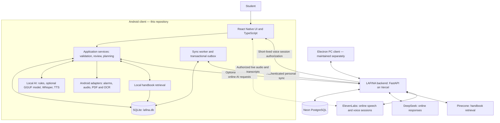
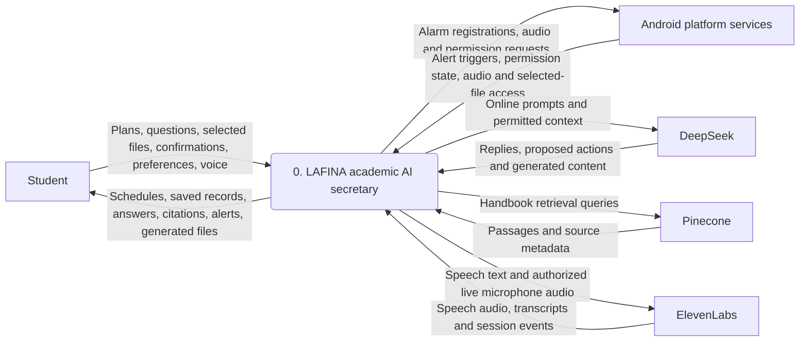
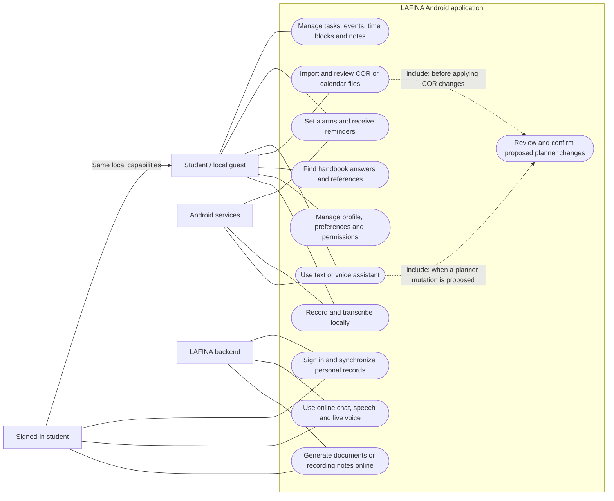
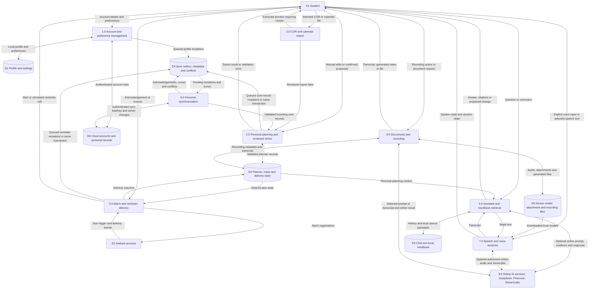
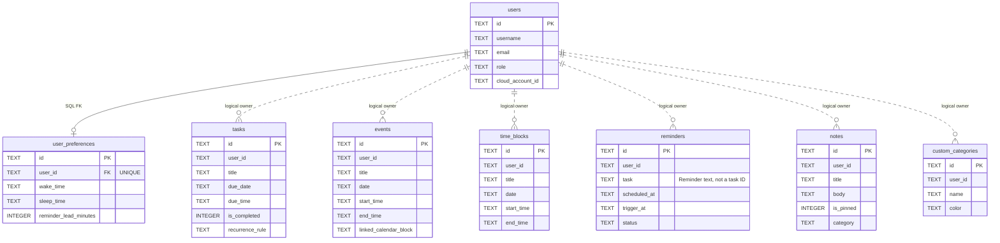
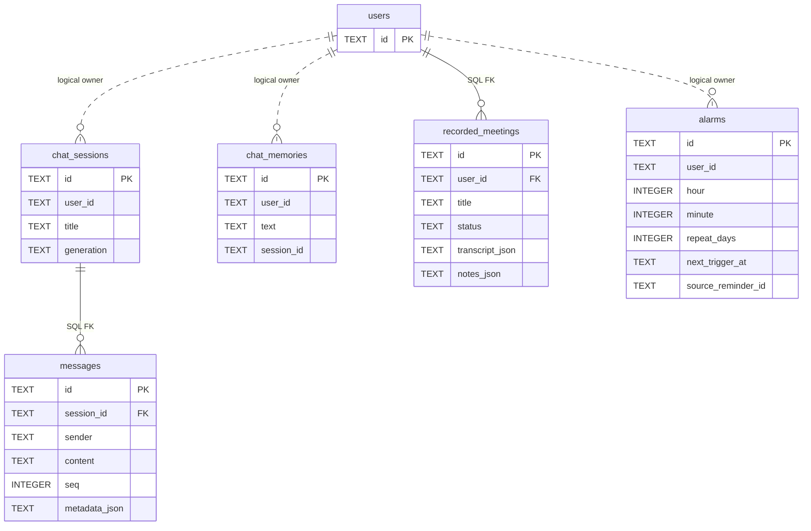
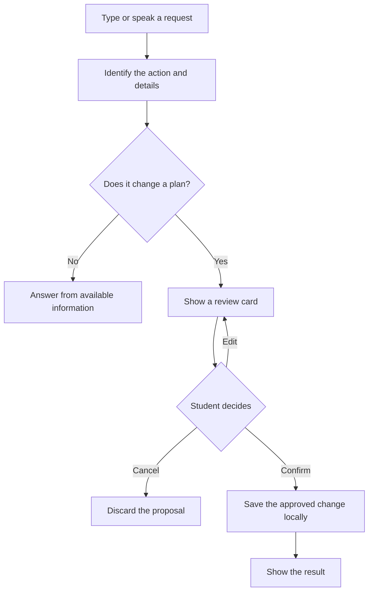
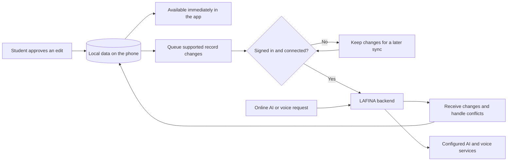

# LAFINA-CAPSTONE

**An Android-first, offline-first academic AI secretary for students.**

LAFINA brings a student's schedule, tasks, notes, reminders, and assistant into one application. Students can enter plans manually, type a request, or use their voice. Core planning works from a local database; an optional cloud account adds synchronization and online AI services.

The project supports university life generally, with USTP-specific features for the **University of Science and Technology of Southern Philippines**, including reviewed Certificate of Registration (COR) import and source-backed Student Handbook answers.

**Documentation baseline — 20 November 2026:** this repository contains the Android implementation. The separately maintained Electron PC client is included in the product architecture based on the owner's existing confirmation; its packaging, platform adapters, and feature parity were not verified in this checkout. Development-only additions are identified below. This README describes implementation and design intent, not a completed research evaluation or a guarantee of live-service availability.

## Contents

1. [Problem background](#problem-background)
2. [Research gap](#research-gap)
3. [Objectives and scope](#objectives-and-scope)
4. [System architecture](#system-architecture)
5. [Context diagram](#context-diagram)
6. [Use case diagram](#use-case-diagram)
7. [Data flow diagram](#data-flow-diagram)
8. [Entity–relationship diagram](#entityrelationship-diagram)
9. [Technology stack](#technology-stack)
10. [Current features and student workflows](#current-features-and-student-workflows)
11. [Offline use and cloud synchronization](#offline-use-and-cloud-synchronization)
12. [Privacy and permissions](#privacy-and-permissions)
13. [Run the project](#run-the-project)
14. [Validation and limitations](#validation-and-limitations)
15. [Project structure and further reading](#project-structure-and-further-reading)

## Problem background

A student's academic day involves recurring classes, changing deadlines, personal commitments, notes, and institutional requirements. Keeping these records useful involves more than entering a date: a student must find the right information, notice schedule conflicts, receive an alert at the right time, and update plans when circumstances change.

LAFINA addresses a practical design problem: how to make these activities available through one personal assistant while preserving basic planning when connectivity, speech services, or AI models are unavailable. For USTP-specific workflows, it also addresses the effort of transferring a COR into a calendar and checking handbook answers against identifiable source material.

These are the project's problem assumptions and implementation motivations. This repository does not establish their prevalence through a reported student survey, nor does it establish that LAFINA has improved academic outcomes.

## Research gap

The project's working research gap is the **integration and evaluation of offline personal planning, user-controlled AI actions, dependable Android alerts, and institution-specific source-backed assistance in one student workflow**.

| Area to investigate                                 | LAFINA's implemented approach                                                                                                  | Evidence still needed for a research conclusion                                                   |
| --------------------------------------------------- | ------------------------------------------------------------------------------------------------------------------------------ | ------------------------------------------------------------------------------------------------- |
| Continuity when internet access is unavailable      | Local SQLite planning, guest mode, supported offline commands, and optional cloud sync.                                        | Offline task-completion and recovery evaluation on representative devices.                        |
| Natural-language assistance with student control    | Manual/text/voice input, validated proposals, review before assistant planner writes, revision checks, and operation receipts. | Measured interpretation accuracy, correction effort, and user understanding of confirmations.     |
| Reminder delivery beyond an open app                | Native Android alarms, persisted delivery state, recovery receivers, and permission-health screens.                            | Physical-device delivery and lifecycle measurements across Android versions and battery policies. |
| Institution-specific information and schedule entry | Local handbook retrieval, online RAG with source references, and reviewed COR text/OCR import.                                 | Grounded-answer/citation evaluation and extraction accuracy over a representative document set.   |
| A coherent student experience                       | Shared planning data, calendar, notes, assistant, and preferences.                                                             | Usability and accessibility evaluation with the intended student population.                      |

This is a project-level research rationale, **not a systematic literature review or a claim that existing applications lack these capabilities**. Novelty, comparative advantage, and effectiveness require a cited review and empirical study; no unsupported percentages, survey findings, or superiority claims are asserted here.

## Objectives and scope

### General objective

Develop an academic AI secretary that lets students organize personal academic commitments, receive reminders, and access relevant assistance while retaining core planning without an internet connection.

### Specific objectives

1. Provide manual, text, and voice workflows for personal tasks, events, time blocks, reminders, and notes.
2. Persist working data locally and synchronize supported personal records through an optional authenticated cloud account.
3. Validate assistant-proposed planner changes and obtain student confirmation before applying them.
4. Deliver Android alarm and reminder workflows with durable scheduling state, recovery handling, and visible permission diagnostics.
5. Offer on-device speech recognition, supported local intent understanding, and offline-capable spoken output with usable text/manual fallbacks.
6. Support reviewed USTP COR import and handbook answers with checkable source references.
7. Integrate optional online conversation, speech, and the preserved document/recording workflows behind their applicable consent and service-access checks.
8. Evaluate correctness, usability, reliability, and resource behavior through automated checks and appropriate device/user testing.

These objectives describe the implementation direction; their presence here does not mean every evaluation has been completed.

### Scope and boundaries

| Dimension                    | Current scope                                                                                                                                                                                                                                                                                |
| ---------------------------- | -------------------------------------------------------------------------------------------------------------------------------------------------------------------------------------------------------------------------------------------------------------------------------------------- |
| Users                        | Individual students; local guest identity `local_guest_user` and optional accounts. Student/account administration and access are mediated by the backend, not a business workspace.                                                                                                         |
| Primary platform             | Android app in this checkout; minimum Android 11 / API 30. A separately maintained Electron client shares the product/backend context.                                                                                                                                                       |
| Core records                 | Profile, task, event, time block, reminder, note, and custom category are the seven mobile sync entity types.                                                                                                                                                                                |
| Local capabilities           | Planner, notes, alarm clocks, reminder scheduling, supported commands, local speech after setup, local handbook lookup when its resources are available, and COR extraction/review.                                                                                                          |
| Optional online capabilities | Authentication, personal sync, DeepSeek-backed chat, handbook RAG, ElevenLabs speech/live voice, document generation, and AI-generated recording notes. Access depends on connectivity, authentication, configuration, and server rules.                                                     |
| Existing academic extensions | The maintained application preserves document and lecture/meeting-recording workflows. The current development branch also contains the Skills hub described under [current features](#current-features-and-student-workflows); that branch is distinct from the source currently on `main`. |
| Exclusions                   | Business/team management, Gmail/inbox integration, university portal login/integration, autonomous operation across other apps, wake words, and always-on listening. Kokoro synthesis is not used.                                                                                           |

A simulated reminder call is an in-app alert, not a telephone call. Acknowledging it does **not** complete the related task. The system assists with personal organization; it does not replace official university advice.

## System architecture

LAFINA separates the student interface, local application services, Android adapters, and optional cloud services. **The Android SQLite database is the working source of truth for local planning.** Native alarm registration is reconciled after persistence; Android scheduling and SQLite do not share an atomic transaction.



| Layer                | Responsibility and implementation evidence                                                                                                                                                                                                                              |
| -------------------- | ----------------------------------------------------------------------------------------------------------------------------------------------------------------------------------------------------------------------------------------------------------------------- |
| Presentation         | Screens, navigation, themes, onboarding, product tour, and call UI in [App.tsx](App.tsx) and [src/ui](src/ui).                                                                                                                                                          |
| Application services | Local conversation, intent parsing, reviewed actions, scheduling coordination, document/recording adapters, and account-scoped operations in [src/ai](src/ai), [src/scheduler](src/scheduler), and [src/skills](src/skills).                                            |
| Local persistence    | One OP-SQLite database, versioned migrations, local stores, outbox, metadata, conflict records, and derived search indexes in [src/storage](src/storage).                                                                                                               |
| Android/native       | Kotlin bridges and receivers; C/C++ JNI for Whisper and the optional local model engine; PDF extraction and OCR in [android/app/src/main](android/app/src/main).                                                                                                        |
| Cloud boundary       | [Cloud client](src/cloud/cloudClient.ts), [sync worker](src/sync/syncWorker.ts), and [voice session API](src/cloud/voiceConversation/voiceConversationApi.ts). Production base URL: `https://lafina-backend.vercel.app`; development fallback: `http://127.0.0.1:8000`. |
| Separate backend     | [LAFINA-backend](https://github.com/LAFINA-AI/LAFINA-backend) supplies account services, personal sync, online AI/RAG, speech/session authorization, and academic file services. Its database is separate from the Android schema below.                                |

Ordinary online TTS goes through the backend. Live voice obtains a backend-authorized signed connection and streams microphone audio to ElevenLabs; the backend supplies the DeepSeek custom-LLM bridge. Provider configuration and credentials belong on the server. See [backend integration](backend_integration/README.md) for dated integration evidence; older entries retain historical deployment status.

## Context diagram

The boundary below treats the **LAFINA product as Process 0**, including clients, their local stores, and the shared backend. Android services are external platform services; AI providers are external services. SQLite and Neon are internal stores and therefore do not appear as external entities.



COR/calendar files are supplied by the student. This diagram does not imply an integration with the university portal. Model downloads and installation infrastructure are omitted to keep the context focused on normal application use.

## Use case diagram

This Mermaid diagram uses oval-style nodes for use cases and a box for the Android application boundary. A guest can use the core local workflows; the signed-in actor inherits these interactions and adds account services. Supporting actors participate only in the connected use cases.



This is a readable use-case view rather than a full UML specification. Review is required for proposed assistant planner mutations; read-only questions do not require a save confirmation. COR imports are reviewed before application. Optional online voice does not turn on a background microphone.

## Data flow diagram

The **Level 1 DFD** expands Process 0 into logical processes. Data-store labels group records by purpose; D1–D4 share the same Android database, D5 holds device files, and D6 is the separate cloud database. The diagram documents data movement rather than program import dependencies.



For online flows, the backend brokers ordinary provider requests; live audio uses its signed ElevenLabs session grant. Incoming sync application suppresses re-enqueueing the same remote change. Native alarm reconciliation follows committed record changes. Device files, alarm clocks, recordings, and every local setting are **not** implicitly synchronized by the seven-entity mobile contract.

## Entity–relationship diagram

This ERD describes the **Android SQLite schema, version 28**, defined by [dbInit.ts](src/storage/dbInit.ts) and its imported migration modules. It is not an ERD of the backend or Electron client. The following views select important columns for readability; they do not reproduce every declared column.

**Relationship notation:** solid connectors below represent declared SQL foreign keys; dashed connectors represent application-managed ownership or references. A dashed connector describes the intended association, not a database-enforced existence/cardinality constraint. `PK` marks primary keys; `FK` is used only for declared foreign keys.

### Personal planning and ownership



`reminders.task` stores text, so there is no declared `reminders.task → tasks.id` foreign key. Planner category values are labels rather than declared category-ID foreign keys. The `profile` sync entity combines local user/preference data; it is not an additional `profile` table.

### Conversations, recordings, and device alarms



The schema declares three SQL foreign keys: `user_preferences.user_id → users.id`, `messages.session_id → chat_sessions.id`, and `recorded_meetings.user_id → users.id`. The first two specify cascading deletion; the recording FK does not. Other associations are handled by application logic and/or triggers.

### Complete application-table inventory

With FTS5 available, the schema contains **36 application tables/virtual tables**, excluding SQLite internals and FTS shadow tables. This inventory includes support tables omitted from the readable ERD views.

| Group                              | Tables                                                                                                        |
| ---------------------------------- | ------------------------------------------------------------------------------------------------------------- |
| Identity and preferences (5)       | `users`, `user_preferences`, `active_session`, `remember_me`, `local_settings`                                |
| Personal planning (6)              | `tasks`, `events`, `time_blocks`, `reminders`, `notes`, `custom_categories`                                   |
| Conversations (4)                  | `chat_sessions`, `messages`, `chat_memories`, `chat_legacy_quarantine`                                        |
| Alarms and delivery (5)            | `alarms`, `job_queue_items`, `reminder_delivery_jobs`, `reminder_delivery_events`, `reminder_delivery_styles` |
| Synchronization (6)                | `sync_outbox`, `sync_metadata`, `sync_state`, `sync_control`, `sync_conflicts`, `entity_local_revisions`      |
| Derived local metadata (3)         | `notes_search_index`, `event_time_local`, `attachment_cleanup`                                                |
| Reviewed operations (1)            | `assistant_operation_receipts`                                                                                |
| Recordings and personalization (3) | `recorded_meetings`, `user_behavior_logs`, `ml_feature_snapshots`                                             |
| Handbook retrieval (3)             | `handbook_meta`, `handbook_chunks`, `handbook_chunks_fts`                                                     |

`handbook_chunks_fts` is a derived FTS5 index over `handbook_chunks`; builds without FTS5 can still initialize the ordinary tables, with the offline index disabled. Sync records identify their target through entity type/ID and account scope, rather than a foreign key to one planner table. Delivery jobs/events can outlive their source record for reconciliation/audit, so they should not be drawn as mandatory SQL foreign keys.

## Technology stack

Versions below come from [package.json](package.json), [TypeScript configuration](tsconfig.json), and Android build declarations. JavaScript package versions and the Android app version are separately maintained.

| Area                    | Current implementation                                                                                                                                                                                                                  |
| ----------------------- | --------------------------------------------------------------------------------------------------------------------------------------------------------------------------------------------------------------------------------------- |
| Mobile UI               | React Native **0.86.0**, React **19.2.3**, TypeScript **5.9.3** with strict checking; Hermes runtime.                                                                                                                                   |
| Design system           | Semantic colors, typography, spacing, themes, `StyleSheet.create`, `useTheme`, and `useThemedStyles`; SVG and Lucide icons.                                                                                                             |
| Android/native          | Kotlin **2.1.20**, Java/JDK **17**, C/C++ JNI, Gradle, CMake **3.22.1**, Android NDK **27.1.12297006**.                                                                                                                                 |
| Local database          | `@op-engineering/op-sqlite` **16.2.0**, SQLite migrations, FTS5 handbook search, transactional outbox and conflict stores.                                                                                                              |
| Speech recognition      | `whisper.cpp` and Silero VAD through `LafinaSpeechToTextModule`; required local model assets must be available.                                                                                                                         |
| Offline understanding   | Deterministic fast-path parser and optional `llama.cpp` GGUF inference through `LafinaIntentExtractorModule`. The catalog includes SmolLM2 135M, Qwen 2.5 0.5B, and Gemma 3 variants; availability depends on native build/model setup. |
| Local speech output     | `react-native-tts` **^4.1.1** using an installed offline-capable Android voice. No Kokoro synthesis.                                                                                                                                    |
| Android alerts          | `AlarmManager`, native receivers, notification/full-screen flows, and persisted delivery/recovery state.                                                                                                                                |
| COR and file input      | PDFBox Android **2.0.27.0**, ML Kit text recognition **19.0.1**, document picker; PDF text and supported image OCR paths.                                                                                                               |
| Calendar utilities      | `rrule` and `ical-js-parser` for recurrence/calendar data.                                                                                                                                                                              |
| Shared backend          | Python/FastAPI on Vercel with Neon PostgreSQL; maintained in [LAFINA-backend](https://github.com/LAFINA-AI/LAFINA-backend).                                                                                                             |
| Online AI and retrieval | DeepSeek responses, Pinecone handbook retrieval, ElevenLabs speech/live voice through the backend's authorization and service contracts.                                                                                                |
| Testing and quality     | Jest **29.7.0**, React Native Testing Library **13.3.3**, `node:sqlite` test adapters, ESLint **8.57.1**, Prettier **2.8.8**, TypeScript, Android JVM/instrumentation checks.                                                           |
| Desktop context         | Electron PC client maintained outside this repository; desktop-specific versions and adapters are not asserted here.                                                                                                                    |

The model catalog is a set of selectable implementations, not proof that every model is installed or that a particular build can run it. See [model manager](src/ai/nlu/modelManager.ts) for the actual catalog and native-engine checks.

## Current features and student workflows

The committed `main` source inspected for this documentation exposes **Home, Schedule, AI, Tools, and Profile**. The local `codex/skills-hub` development checkout renames **Tools → Skills** and adds a broader hub. **This README-only update does not merge that implementation into `main`.**

### Main navigation

The five main tabs keep everyday actions close together:

| Area         | What it is for                                                                                    |
| ------------ | ------------------------------------------------------------------------------------------------- |
| **Home**     | See the day at a glance, upcoming commitments, and shortcuts to common actions.                   |
| **Schedule** | Plan classes, events, and blocks of time; browse the calendar and manage alarms.                  |
| **AI**       | Chat with LAFINA, ask about personal plans, prepare changes, and access voice conversations.      |
| **Tools**    | Keep notes, manage to-dos, and access alarms.                                                     |
| **Profile**  | Manage an optional account, sync, appearance, speech preferences, and alarm reliability settings. |

### Getting started as a student

1. Open LAFINA and follow the introduction. Continue without an account for local guest use, or sign in for account services.
2. Choose your preferences and follow the optional offline model setup. USTP students can review a COR import to add their classes.
3. Take the guided walkthrough, then add a small task or note to try the planner.
4. Set up a test alarm and review Android's alert permissions before relying on time-critical reminders. Enable online AI, voice, or the floating shortcut when you want to use them.

### Planning, to-dos, and notes

- **Calendar planning:** organize events and time blocks in week and month views, with recurring schedules and checks for overlapping commitments.
- **To-dos:** keep track of tasks, deadlines, priorities, and completion separately from calendar events.
- **Notes:** write and edit formatted notes with Markdown preview, checklists, categories, search, pinning, and reordering.
- **Calendar files:** import or export `.ics` files and control the visibility of imported calendar layers.
- **Philippine holidays:** see holiday information alongside the calendar when planning the week.

### Bring in a class schedule

USTP students can import a COR rather than re-enter each class. LAFINA reads a portal PDF's text on the device and uses image text recognition for supported photos or screenshots. It checks the extracted subjects, units, days, and times, then presents the result for review before adding it to the schedule.

Use the original portal PDF when possible. Small or blurry images can lose details, and names or rooms may still need correction. The review highlights reading problems instead of quietly filling in an uncertain schedule. Importing a COR does not connect to or sign in to the university portal.

### Other supported academic workflows

The app also includes document-generation and lecture/meeting-recording workflows. Document requests support PDF, Word, Excel, and PowerPoint output through online services. Recording starts through an explicit user action; the recording workflow can produce transcripts and request organized notes online. Availability depends on the relevant screen, device support, account access, and backend configuration.

These workflows have different connectivity requirements from the core planner: cloud document generation and AI-generated meeting notes require online service access.

Recording and transcription use the native recorder and local Whisper resources. The meeting-summary request sends transcript text after explicit consent; it does not upload the recording audio. Live online voice is a separate workflow that does stream microphone audio to ElevenLabs.

### Development-branch Skills hub

The current development source contains entry points for alarms, to-dos, notes, Pomodoro focus sessions, flashcards, a quiz maker, a GWA calculator, a summarizer, recording/transcription, and document creation. These are documented as existing branch work, not as a newly authorized scope expansion or as features shipped by this README commit.

Local focus/flashcard/GWA workflows and online AI generation have different requirements. AI study generation requires the relevant online account/service access. The branch explicitly marks live meeting transcription, embedded Office preview, and DOCX source extraction as unavailable. Branch implementation and device acceptance must be reviewed separately under the repository's scope/phase rules.

## How the assistant makes changes

A request such as “Remind me to submit my assignment tomorrow at 5 PM” becomes a proposed change. LAFINA shows the interpreted details so the student can correct the title, date, or time before confirming.



For supported requests, LAFINA can prepare tasks, events, time blocks, reminders, notes, and alarms. It can also look up personal plans and available time. Online AI can help interpret a request or suggest a plan, but assistant changes still follow the review and confirmation flow.

Examples of everyday requests include:

- “What is on my schedule today?”
- “Add a task to finish my research outline tomorrow.”
- “Block an hour for reviewing chemistry on Friday.”
- “Wake me up at 6 AM.”

The manual screens remain available when speech recognition, an AI model, or the internet is unavailable. Offline understanding handles supported planning commands; it does not offer the same open-ended conversation as an online model.

## Alarms and reminder calls

An alarm clock and an academic reminder serve different purposes in LAFINA:

|                    | Alarm                                                  | Reminder                                                                |
| ------------------ | ------------------------------------------------------ | ----------------------------------------------------------------------- |
| **Typical use**    | Wake up at a specific time.                            | Remember a deadline, class, or planned activity.                        |
| **Alert**          | Native Android ringing screen with Dismiss and Snooze. | A reminder alert, including a simulated incoming call where configured. |
| **Speech**         | Optional local morning briefing after dismissal.       | Spoken reminder and supported follow-up actions.                        |
| **Across devices** | Stays on the phone where it was created.               | Included in personal cloud sync when using an account.                  |

Android handles alarm and reminder delivery so it does not depend only on an open app screen. Recovery logic rechecks pending alerts after events such as a reboot or a timezone change. Exact timing and lock-screen presentation depend on Android permissions, notification settings, and the phone's battery restrictions. **Profile → Alarm & Reminder Health** helps identify these settings and provides a test alarm.

Reminder calls are simulated inside LAFINA; they are not telephone calls. Answering or acknowledging an alert does **not** complete the underlying task. A task stays pending until the student explicitly completes it.

Adaptive reminder timing can suggest a lead time based on local response history. Students can turn this off, and proposed timing adjustments appear in the review flow.

## Voice, handbook answers, and personalization

### Talk to LAFINA

**Offline voice input** uses push-to-talk speech recognition on the device through Whisper. Supported requests are interpreted locally using command rules and available on-device models. Model setup or downloads may be needed before the selected offline features can be used.

**Offline spoken replies** use the phone's text-to-speech engine through `react-native-tts`. An installed offline voice is needed to speak without internet access. LAFINA does not use Kokoro.

**Online voice** uses ElevenLabs services when Online Mode is enabled and the account and server allow access. Call LAFINA supports a live voice session with transcripts, microphone controls, and an End action. It starts only after user interaction and microphone permission. DeepSeek supplies online assistant responses through the backend. If online spoken output fails, ordinary text-to-speech replies can fall back to the phone's voice; text and manual controls remain available.

### Ask about the USTP Student Handbook

LAFINA looks for relevant handbook passages and presents source references so students can check an answer. This approach is often called **retrieval-augmented generation (RAG)**: the assistant uses retrieved source material to support its response.

- Local handbook search can return relevant excerpts and references without internet access when a usable handbook pack is available.
- Online answers can use handbook evidence to produce a more conversational explanation.
- When the available material does not support an answer, LAFINA should say that it could not verify the policy.

USTP-specific features follow the app's student setup and eligibility checks. Answers refer to the available handbook edition; students should check the cited passage and confirm official decisions with the university.

### Make the experience personal

Light, dark, and system themes, speech settings, and reply preferences let students adjust how LAFINA looks and responds. Personal memory can retain useful preferences and can be managed or turned off. Relevant saved context may accompany online assistant requests when those features are enabled.

**Floating LAFINA** is an optional, off-by-default shortcut: an edge handle or bubble opens Quick Chat over another app. Students can adjust its appearance and position. It uses the same confirmation rules as the main assistant and does not read the contents of other apps.

## Offline use and cloud synchronization

“Offline-first” means the phone holds the working copy of a student's plans. Saving a task or note does not require a successful server request.

| Capability                                 | Without internet                                             | What online access adds                                      |
| ------------------------------------------ | ------------------------------------------------------------ | ------------------------------------------------------------ |
| Tasks, notes, events, and time blocks      | Create, view, and edit locally.                              | Synchronize supported personal records with an account.      |
| Alarms and reminders                       | Scheduled Android alerts, subject to device settings.        | Sync supported reminder records; alarms remain device-local. |
| Voice commands                             | On-device recognition and supported commands after setup.    | Broader interpretation and live voice services.              |
| Spoken replies                             | Phone speech engine with an offline voice installed.         | Available ElevenLabs voices.                                 |
| Handbook questions                         | Local excerpts when handbook data is available.              | AI explanations supported by retrieved sources.              |
| Open-ended AI chat and document generation | Local supported replies and saved content remain accessible. | Cloud conversation and document generation.                  |

Guest mode works without creating an account. An optional account enables synchronization of **profile, tasks, events, time blocks, reminders, notes, and custom categories**. These seven record types do not include every file or setting on the phone; alarms and floating-assistant preferences remain local.



Sync keeps track of pending changes and conflicts rather than treating the server as a requirement for every edit. Account boundaries separate personal records, and local writes and their queued sync changes are saved together to reduce inconsistencies.

The mobile app uses the [LAFINA backend](https://lafina-backend.vercel.app) for authentication, sync, and online AI. Development builds can also use a local backend. Online features depend on authentication, connection quality, service configuration, and applicable subscription or usage limits.

## Privacy and permissions

- **Local planning:** guest planner records stay in the phone's database. Offline speech recognition and COR reading run on the device.
- **Cloud use is a separate choice:** signing in enables account services; Online Mode controls online AI and speech. Requests may send the relevant message, context, or audio to the backend and its configured providers.
- **Intentional microphone use:** push-to-talk, answering a reminder call, starting a voice session, or starting a recording requires user interaction and OS permission. There is no wake word or always-on listening.
- **Optional overlay access:** Floating LAFINA requires Android's permission to display over other apps. It can be disabled in settings.
- **Alert permissions:** notification, exact-alarm, and full-screen settings affect how alerts arrive. The app exposes reliability checks rather than assuming every phone allows them.
- **Backend-managed credentials:** normal app builds call the backend for cloud services; provider API keys belong on the server.
- **Local data needs care:** clearing app data or uninstalling removes device-local content. Cloud sync covers the supported record types, not a complete backup of every file and setting.

LAFINA focuses on personal academic organization. It does not include business/team administration, Gmail inbox integration, or automatic access to university portal accounts.

## Run the project

This section is for contributors who want to run the Android app. The application uses React Native with TypeScript, Android native components, and a local SQLite database.

### Requirements

| Tool              | Project requirement                                                                                    |
| ----------------- | ------------------------------------------------------------------------------------------------------ |
| Node.js           | `>= 22.11.0` declared in `package.json`; Node `24.19.0+` is recommended for the full test environment. |
| npm               | `>= 10.0.0`                                                                                            |
| Java              | JDK 17                                                                                                 |
| Android SDK       | Platform 36 and Build Tools `36.0.0`                                                                   |
| Android NDK       | `27.1.12297006`                                                                                        |
| CMake             | `3.22.1`                                                                                               |
| Phone or emulator | Android 11 or newer (API 30+)                                                                          |

Install Android Studio and the listed SDK components, set `JAVA_HOME` and `ANDROID_HOME`, then run these commands from the repository root:

```powershell
npm ci
npm run doctor
```

Start the development server:

```powershell
npm start
```

In a second terminal, connect an Android device with USB debugging enabled or start an emulator, then run:

```powershell
npm run android
```

The debug app uses the package ID `com.lafina.capstone.debug`. Core guest planning does not need backend credentials. For local online-service testing, follow the [provider-testing guide](docs/qa-provider-testing.md); a backend on the computer can be reached over USB using `adb reverse tcp:8000 tcp:8000` and the debug server setting. Cloud provider secrets must not be added to the app.

### Check a change

```powershell
# TypeScript, lint, unit tests, and architecture checks
npm run preflight

# Android compilation and native unit tests
.\android\gradlew.bat -p android :app:compileDebugKotlin :app:testDebugUnitTest --console=plain
```

Individual checks are available as `npm run typecheck`, `npm run lint`, `npm test`, and `npm run check:architecture`. For actual alarm delivery, microphone behavior, voice quality, and battery restrictions, use the [manual phone checklist](docs/MANUAL-PHONE-TESTING.md). Automated tests alone cannot establish those behaviors on a physical device.

### Build an APK

For a standard preview build:

```powershell
.\android\gradlew.bat -p android :app:assembleRelease --console=plain
```

Split APKs are written to `android/app/build/outputs/apk/release/`: use `app-arm64-v8a-release.apk` for a compatible physical ARM64 phone or `app-x86_64-release.apk` for an x86_64 emulator. The release build is configured with preview signing; public distribution requires appropriate release signing.

Long Windows checkout paths can exceed native build-tool limits. The [native build guide](docs/plans/agy-improvements/reports/phase-11-native-qa.md) documents the short-path build procedure and APK checks. Avoid removing an existing drive mapping to reuse its letter.

To install the ARM64 preview on a connected phone:

```powershell
adb install -r android/app/build/outputs/apk/release/app-arm64-v8a-release.apk
```

## Validation and limitations

Implementation is not the same as verified runtime behavior. Automated tests can check data consistency, parser behavior, review rules, and mocked UI flows; they cannot establish alarm delivery, microphone behavior, audibility, battery-policy behavior, or provider quality on a physical phone.

| Area                        | How to verify                                                                                                                      | Limit of this documentation update                                                             |
| --------------------------- | ---------------------------------------------------------------------------------------------------------------------------------- | ---------------------------------------------------------------------------------------------- |
| Schema and contracts        | Read migrations, stores, sync types, and API adapters; run relevant storage/sync tests.                                            | ERD and descriptions are tied to the inspected schema/contract, not the separate cloud schema. |
| Android behavior            | Install a build, inspect permissions, test locked-screen alerts, snooze, acknowledgement, reboot/time changes, and voice controls. | No new physical-device acceptance is claimed.                                                  |
| Online services             | Use an authorized account and verify capability, authentication, quota, error, and fallback paths.                                 | No new authenticated provider or production availability certification is claimed.             |
| Research objectives         | Conduct a documented literature review, student evaluation, accuracy checks, and device benchmarks.                                | No completed comparative study, usability score, or academic-outcome improvement is asserted.  |
| Branch features and desktop | Review their respective source, build, tests, and device acceptance.                                                               | A README-only commit does not publish branch application changes or validate Electron parity.  |

For a contributor review, open the README on GitHub, inspect each diagram, compare the schema names with the linked migrations, and follow [manual phone testing](docs/MANUAL-PHONE-TESTING.md) for behaviors that require Android hardware.

## Project structure and further reading

| Location                              | Purpose                                                                     |
| ------------------------------------- | --------------------------------------------------------------------------- |
| `App.tsx`                             | App entry, navigation, and shared lifecycle behavior.                       |
| `src/ui/`                             | Screens, reusable components, themes, onboarding, and the product tour.     |
| `src/storage/`                        | Local records, database migrations, and persistence.                        |
| `src/scheduler/`                      | Reminder scheduling and delivery coordination.                              |
| `src/ai/`                             | Local speech, command understanding, assistant behavior, and spoken output. |
| `src/handbook/`                       | Local handbook data, search, and source references.                         |
| `src/cloud/` and `src/sync/`          | Account services, online AI, voice sessions, and synchronization.           |
| `src/skills/` and `src/meetings/`     | Document and recording-related workflows.                                   |
| `android/`                            | Android application, alarms, audio, and native bridges.                     |
| `__tests__/`, `scripts/`, and `docs/` | Automated checks, development utilities, and supporting documentation.      |

For more detail:

- [Architecture overview](docs/02-ARCHITECTURE.md) and [data and scheduling](docs/05-DATA-SCHEDULING.md).
- [Voice and offline AI](docs/06-VOICE-AND-OFFLINE-AI.md), [online AI and RAG](docs/07-RAG-AND-ONLINE.md), and [ElevenLabs backend integration](backend_integration/README.md).
- [Alarm design](docs/decisions/ADR-034-device-local-alarms.md), [reviewed assistant tools](docs/decisions/ADR-033-bounded-agent-tools.md), and [COR import checks](docs/decisions/ADR-039-cor-exact-pdf-text-and-layout-checks.md).
- [Floating LAFINA design](docs/decisions/ADR-036-floating-assistant.md), [security and privacy](docs/10-SECURITY-AND-PRIVACY.md), and [manual phone testing](docs/MANUAL-PHONE-TESTING.md).

Detailed design decisions live in `docs/decisions/`; some older planning documents describe earlier designs. Use the relevant feature decision and implementation together when making changes, and follow [AGENTS.md](AGENTS.md) for repository contribution rules.
