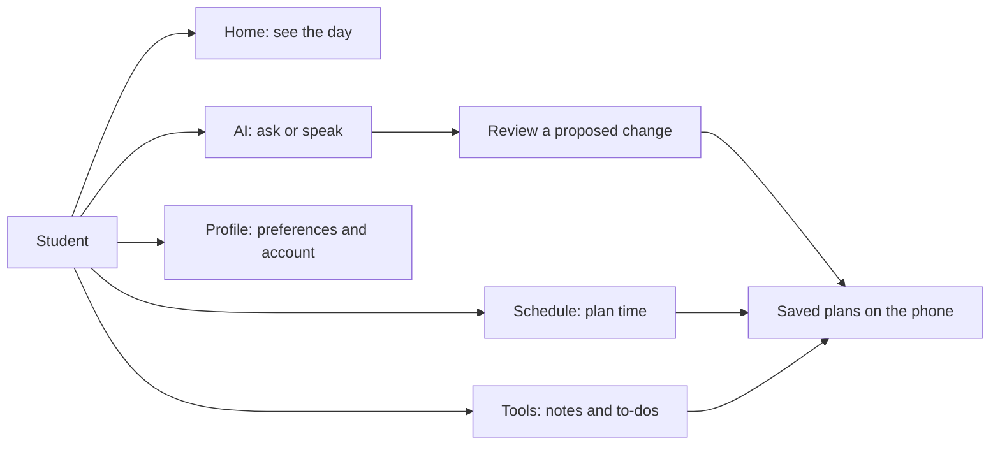
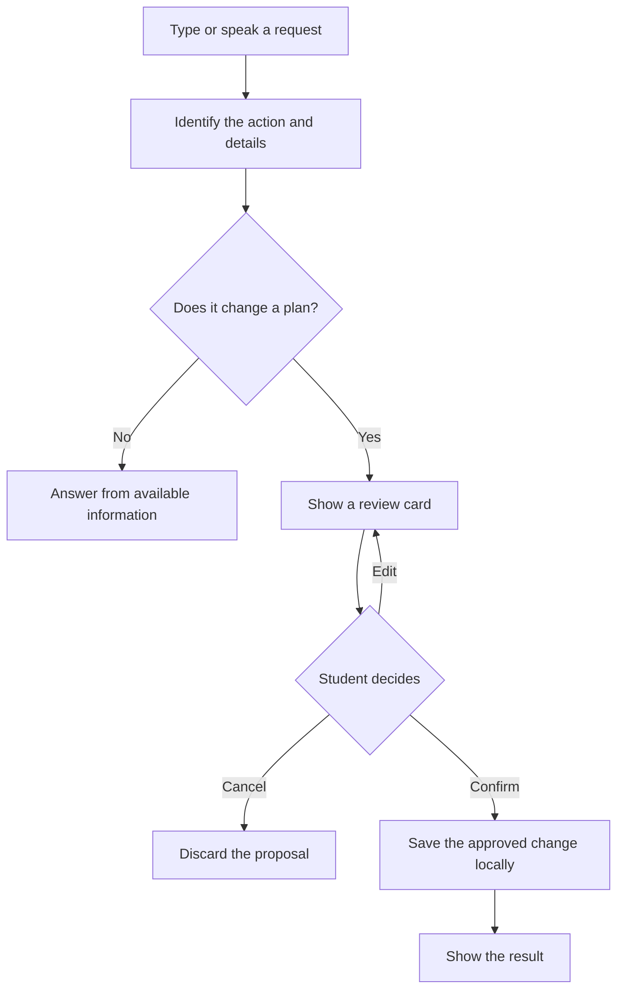
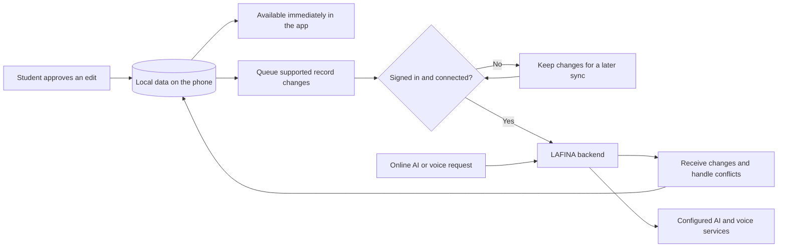

# LAFINA-CAPSTONE

**An Android-first academic AI secretary that helps students organize their day, remember commitments, and find answers—even when they are offline.**

LAFINA brings a student's schedule, to-dos, notes, reminders, and assistant into one app. Students can enter plans by hand, type a request, or use their voice. Core planning stays on the phone; an optional account adds cloud synchronization and online AI services.

The project is designed around university life, with additional support for University of Science and Technology of Southern Philippines (USTP) students through Certificate of Registration (COR) import and source-backed Student Handbook answers.

## Explore this README

- [What students can do](#what-students-can-do)
- [How the assistant makes changes](#how-the-assistant-makes-changes)
- [Alarms and reminder calls](#alarms-and-reminder-calls)
- [Voice, handbook answers, and personalization](#voice-handbook-answers-and-personalization)
- [Offline use and cloud synchronization](#offline-use-and-cloud-synchronization)
- [Privacy and permissions](#privacy-and-permissions)
- [Run the project](#run-the-project)
- [Project structure and further reading](#project-structure-and-further-reading)

## What students can do

LAFINA's five main tabs keep everyday actions close together:

| Area         | What it is for                                                                                    |
| ------------ | ------------------------------------------------------------------------------------------------- |
| **Home**     | See the day at a glance, upcoming commitments, and shortcuts to common actions.                   |
| **Schedule** | Plan classes, events, and blocks of time; browse the calendar and manage alarms.                  |
| **AI**       | Chat with LAFINA, ask about personal plans, prepare changes, and access voice conversations.      |
| **Tools**    | Keep notes, manage to-dos, and access alarms.                                                     |
| **Profile**  | Manage an optional account, sync, appearance, speech preferences, and alarm reliability settings. |



### Getting started as a student

1. Open LAFINA and follow the introduction. Continue without an account for local guest use, or sign in for account services.
2. Choose your preferences and follow the optional offline model setup. USTP students can review a COR import to add their classes.
3. Take the guided walkthrough, then add a small task or note to try the planner.
4. Set up a test alarm and review Android's alert permissions before relying on time-critical reminders. Enable online AI, voice, or the floating shortcut when you want to use them.

### Planning, to-dos, and notes

- **Calendar planning:** organize events and time blocks in week and month views, with recurring schedules and checks for overlapping commitments.
- **To-dos:** keep track of tasks, deadlines, priorities, and completion separately from calendar events.
- **Notes:** write and edit formatted notes with Markdown preview, checklists, categories, search, pinning, and reordering.
- **Calendar files:** import or export `.ics` files and control the visibility of imported calendar layers.
- **Philippine holidays:** see holiday information alongside the calendar when planning the week.

### Bring in a class schedule

USTP students can import a COR rather than re-enter each class. LAFINA reads a portal PDF's text on the device and uses image text recognition for supported photos or screenshots. It checks the extracted subjects, units, days, and times, then presents the result for review before adding it to the schedule.

Use the original portal PDF when possible. Small or blurry images can lose details, and names or rooms may still need correction. The review highlights reading problems instead of quietly filling in an uncertain schedule. Importing a COR does not connect to or sign in to the university portal.

### Other supported academic workflows

The app also includes document-generation and lecture/meeting-recording workflows. Document requests support PDF, Word, Excel, and PowerPoint output through online services. Recording starts through an explicit user action; the recording workflow can produce transcripts and request organized notes online. Availability depends on the relevant screen, device support, account access, and backend configuration.

These workflows have different connectivity requirements from the core planner: cloud document generation and AI-generated meeting notes require online service access.

## How the assistant makes changes

A request such as “Remind me to submit my assignment tomorrow at 5 PM” becomes a proposed change. LAFINA shows the interpreted details so the student can correct the title, date, or time before confirming.



For supported requests, LAFINA can prepare tasks, events, time blocks, reminders, notes, and alarms. It can also look up personal plans and available time. Online AI can help interpret a request or suggest a plan, but assistant changes still follow the review and confirmation flow.

Examples of everyday requests include:

- “What is on my schedule today?”
- “Add a task to finish my research outline tomorrow.”
- “Block an hour for reviewing chemistry on Friday.”
- “Wake me up at 6 AM.”

The manual screens remain available when speech recognition, an AI model, or the internet is unavailable. Offline understanding handles supported planning commands; it does not offer the same open-ended conversation as an online model.

## Alarms and reminder calls

An alarm clock and an academic reminder serve different purposes in LAFINA:

|                    | Alarm                                                  | Reminder                                                                |
| ------------------ | ------------------------------------------------------ | ----------------------------------------------------------------------- |
| **Typical use**    | Wake up at a specific time.                            | Remember a deadline, class, or planned activity.                        |
| **Alert**          | Native Android ringing screen with Dismiss and Snooze. | A reminder alert, including a simulated incoming call where configured. |
| **Speech**         | Optional local morning briefing after dismissal.       | Spoken reminder and supported follow-up actions.                        |
| **Across devices** | Stays on the phone where it was created.               | Included in personal cloud sync when using an account.                  |

Android handles alarm and reminder delivery so it does not depend only on an open app screen. Recovery logic rechecks pending alerts after events such as a reboot or a timezone change. Exact timing and lock-screen presentation depend on Android permissions, notification settings, and the phone's battery restrictions. **Profile → Alarm & Reminder Health** helps identify these settings and provides a test alarm.

Reminder calls are simulated inside LAFINA; they are not telephone calls. Answering or acknowledging an alert does **not** complete the underlying task. A task stays pending until the student explicitly completes it.

Adaptive reminder timing can suggest a lead time based on local response history. Students can turn this off, and proposed timing adjustments appear in the review flow.

## Voice, handbook answers, and personalization

### Talk to LAFINA

**Offline voice input** uses push-to-talk speech recognition on the device through Whisper. Supported requests are interpreted locally using command rules and available on-device models. Model setup or downloads may be needed before the selected offline features can be used.

**Offline spoken replies** use the phone's text-to-speech engine through `react-native-tts`. An installed offline voice is needed to speak without internet access. LAFINA does not use Kokoro.

**Online voice** uses ElevenLabs services when Online Mode is enabled and the account and server allow access. Call LAFINA supports a live voice session with transcripts, microphone controls, and an End action. It starts only after user interaction and microphone permission. DeepSeek supplies online assistant responses through the backend. If online spoken output fails, ordinary text-to-speech replies can fall back to the phone's voice; text and manual controls remain available.

### Ask about the USTP Student Handbook

LAFINA looks for relevant handbook passages and presents source references so students can check an answer. This approach is often called **retrieval-augmented generation (RAG)**: the assistant uses retrieved source material to support its response.

- Local handbook search can return relevant excerpts and references without internet access when a usable handbook pack is available.
- Online answers can use handbook evidence to produce a more conversational explanation.
- When the available material does not support an answer, LAFINA should say that it could not verify the policy.

USTP-specific features follow the app's student setup and eligibility checks. Answers refer to the available handbook edition; students should check the cited passage and confirm official decisions with the university.

### Make the experience personal

Light, dark, and system themes, speech settings, and reply preferences let students adjust how LAFINA looks and responds. Personal memory can retain useful preferences and can be managed or turned off. Relevant saved context may accompany online assistant requests when those features are enabled.

**Floating LAFINA** is an optional, off-by-default shortcut: an edge handle or bubble opens Quick Chat over another app. Students can adjust its appearance and position. It uses the same confirmation rules as the main assistant and does not read the contents of other apps.

## Offline use and cloud synchronization

“Offline-first” means the phone holds the working copy of a student's plans. Saving a task or note does not require a successful server request.

| Capability                                 | Without internet                                             | What online access adds                                      |
| ------------------------------------------ | ------------------------------------------------------------ | ------------------------------------------------------------ |
| Tasks, notes, events, and time blocks      | Create, view, and edit locally.                              | Synchronize supported personal records with an account.      |
| Alarms and reminders                       | Scheduled Android alerts, subject to device settings.        | Sync supported reminder records; alarms remain device-local. |
| Voice commands                             | On-device recognition and supported commands after setup.    | Broader interpretation and live voice services.              |
| Spoken replies                             | Phone speech engine with an offline voice installed.         | Available ElevenLabs voices.                                 |
| Handbook questions                         | Local excerpts when handbook data is available.              | AI explanations supported by retrieved sources.              |
| Open-ended AI chat and document generation | Local supported replies and saved content remain accessible. | Cloud conversation and document generation.                  |

Guest mode works without creating an account. An optional account enables synchronization of **profile, tasks, events, time blocks, reminders, notes, and custom categories**. These seven record types do not include every file or setting on the phone; alarms and floating-assistant preferences remain local.



Sync keeps track of pending changes and conflicts rather than treating the server as a requirement for every edit. Account boundaries separate personal records, and local writes and their queued sync changes are saved together to reduce inconsistencies.

The mobile app uses the [LAFINA backend](https://lafina-backend.vercel.app) for authentication, sync, and online AI. Development builds can also use a local backend. Online features depend on authentication, connection quality, service configuration, and applicable subscription or usage limits.

## Privacy and permissions

- **Local planning:** guest planner records stay in the phone's database. Offline speech recognition and COR reading run on the device.
- **Cloud use is a separate choice:** signing in enables account services; Online Mode controls online AI and speech. Requests may send the relevant message, context, or audio to the backend and its configured providers.
- **Intentional microphone use:** push-to-talk, answering a reminder call, starting a voice session, or starting a recording requires user interaction and OS permission. There is no wake word or always-on listening.
- **Optional overlay access:** Floating LAFINA requires Android's permission to display over other apps. It can be disabled in settings.
- **Alert permissions:** notification, exact-alarm, and full-screen settings affect how alerts arrive. The app exposes reliability checks rather than assuming every phone allows them.
- **Backend-managed credentials:** normal app builds call the backend for cloud services; provider API keys belong on the server.
- **Local data needs care:** clearing app data or uninstalling removes device-local content. Cloud sync covers the supported record types, not a complete backup of every file and setting.

LAFINA focuses on personal academic organization. It does not include business/team administration, Gmail inbox integration, or automatic access to university portal accounts.

## Run the project

This section is for contributors who want to run the Android app. The application uses React Native with TypeScript, Android native components, and a local SQLite database.

### Requirements

| Tool              | Project requirement                                                                                    |
| ----------------- | ------------------------------------------------------------------------------------------------------ |
| Node.js           | `>= 22.11.0` declared in `package.json`; Node `24.19.0+` is recommended for the full test environment. |
| npm               | `>= 10.0.0`                                                                                            |
| Java              | JDK 17                                                                                                 |
| Android SDK       | Platform 36 and Build Tools `36.0.0`                                                                   |
| Android NDK       | `27.1.12297006`                                                                                        |
| CMake             | `3.22.1`                                                                                               |
| Phone or emulator | Android 11 or newer (API 30+)                                                                          |

Install Android Studio and the listed SDK components, set `JAVA_HOME` and `ANDROID_HOME`, then run these commands from the repository root:

```powershell
npm ci
npm run doctor
```

Start the development server:

```powershell
npm start
```

In a second terminal, connect an Android device with USB debugging enabled or start an emulator, then run:

```powershell
npm run android
```

The debug app uses the package ID `com.lafina.capstone.debug`. Core guest planning does not need backend credentials. For local online-service testing, follow the [provider-testing guide](docs/qa-provider-testing.md); a backend on the computer can be reached over USB using `adb reverse tcp:8000 tcp:8000` and the debug server setting. Cloud provider secrets must not be added to the app.

### Check a change

```powershell
# TypeScript, lint, unit tests, and architecture checks
npm run preflight

# Android compilation and native unit tests
.\android\gradlew.bat -p android :app:compileDebugKotlin :app:testDebugUnitTest --console=plain
```

Individual checks are available as `npm run typecheck`, `npm run lint`, `npm test`, and `npm run check:architecture`. For actual alarm delivery, microphone behavior, voice quality, and battery restrictions, use the [manual phone checklist](docs/MANUAL-PHONE-TESTING.md). Automated tests alone cannot establish those behaviors on a physical device.

### Build an APK

For a standard preview build:

```powershell
.\android\gradlew.bat -p android :app:assembleRelease --console=plain
```

Split APKs are written to `android/app/build/outputs/apk/release/`: use `app-arm64-v8a-release.apk` for a compatible physical ARM64 phone or `app-x86_64-release.apk` for an x86_64 emulator. The release build is configured with preview signing; public distribution requires appropriate release signing.

Long Windows checkout paths can exceed native build-tool limits. The [native build guide](docs/plans/agy-improvements/reports/phase-11-native-qa.md) documents the short-path build procedure and APK checks. Avoid removing an existing drive mapping to reuse its letter.

To install the ARM64 preview on a connected phone:

```powershell
adb install -r android/app/build/outputs/apk/release/app-arm64-v8a-release.apk
```

## Project structure and further reading

| Location                              | Purpose                                                                     |
| ------------------------------------- | --------------------------------------------------------------------------- |
| `App.tsx`                             | App entry, navigation, and shared lifecycle behavior.                       |
| `src/ui/`                             | Screens, reusable components, themes, onboarding, and the product tour.     |
| `src/storage/`                        | Local records, database migrations, and persistence.                        |
| `src/scheduler/`                      | Reminder scheduling and delivery coordination.                              |
| `src/ai/`                             | Local speech, command understanding, assistant behavior, and spoken output. |
| `src/handbook/`                       | Local handbook data, search, and source references.                         |
| `src/cloud/` and `src/sync/`          | Account services, online AI, voice sessions, and synchronization.           |
| `src/skills/` and `src/meetings/`     | Document and recording-related workflows.                                   |
| `android/`                            | Android application, alarms, audio, and native bridges.                     |
| `__tests__/`, `scripts/`, and `docs/` | Automated checks, development utilities, and supporting documentation.      |

For more detail:

- [Architecture overview](docs/02-ARCHITECTURE.md) and [data and scheduling](docs/05-DATA-SCHEDULING.md).
- [Voice and offline AI](docs/06-VOICE-AND-OFFLINE-AI.md), [online AI and RAG](docs/07-RAG-AND-ONLINE.md), and [ElevenLabs backend integration](backend_integration/README.md).
- [Alarm design](docs/decisions/ADR-034-device-local-alarms.md), [reviewed assistant tools](docs/decisions/ADR-033-bounded-agent-tools.md), and [COR import checks](docs/decisions/ADR-039-cor-exact-pdf-text-and-layout-checks.md).
- [Floating LAFINA design](docs/decisions/ADR-036-floating-assistant.md), [security and privacy](docs/10-SECURITY-AND-PRIVACY.md), and [manual phone testing](docs/MANUAL-PHONE-TESTING.md).

Detailed design decisions live in `docs/decisions/`; some older planning documents describe earlier designs. Use the relevant feature decision and implementation together when making changes, and follow [AGENTS.md](AGENTS.md) for repository contribution rules.
