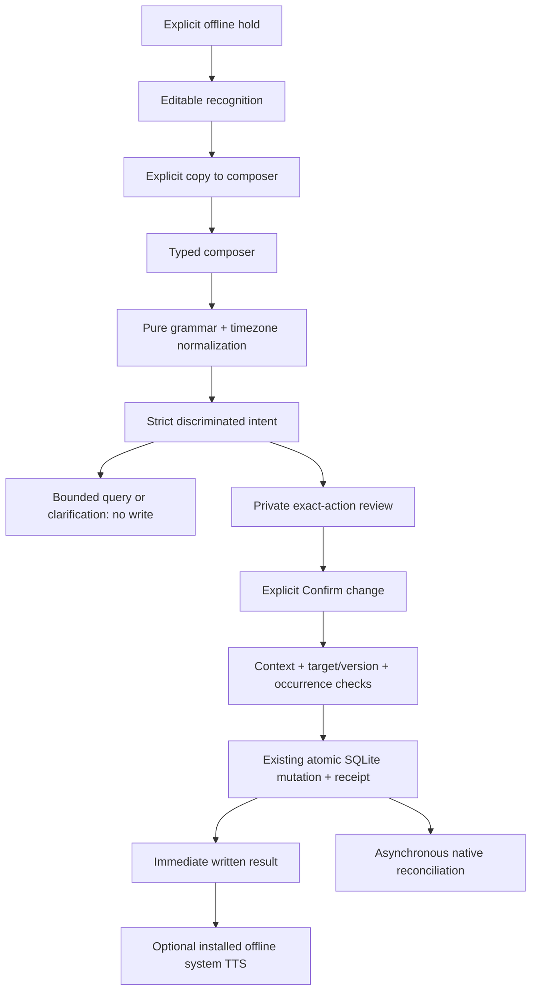
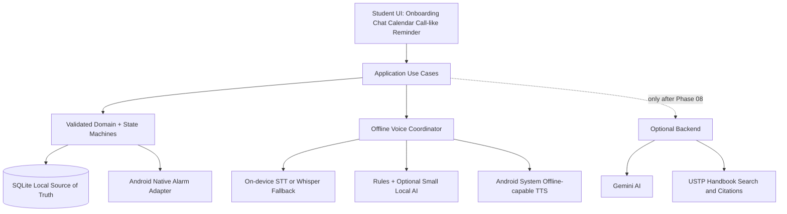

# 02 — Proposed Application Architecture

## Implemented through Phase07 — confirmed commands; device acceptance pending

[ADR-020](decisions/ADR-020-confirmed-offline-commands.md) adds pure `core/ai`
grammar/temporal/strict intent validation and a `CommandSession` application
boundary. Parsing produces a proposal or clarification, never a DB write.
Queries use bounded existing pages/windows. A parameterized exact-title identity
query returns at most21 rows; duplicate/truncated results require manual
disambiguation, and SQLite NOCASE is ASCII-only.

Every mutation creates a private five-minute review with normalized date/time,
timezone, captured target/version and optional ringing occurrence/generation.
Only the opaque current review ID can be confirmed. Time/context/default lead,
target uniqueness/version and legal reminder state are rechecked before the
existing transactional repository/receipt commits. Saved records and asynchronous
Android reconciliation are separate outcomes. ACK remains separate from task
completion; no bare/global acknowledgement selects an alert.

`ChatScreen` owns a manual composer, latest-first bounded40-message conversation,
Send/Confirm/Discard/Clear/retry states and optional asynchronous system TTS.
Conversation is memory-only; leaving Chat clears it, and backgrounding cancels a
review. `SpeechInputPanel` explicitly copies reviewed words to the composer;
the user must Send and Confirm separately. Native answered-reminder drafts remain
Phase06 local-only. No new schema, history/privacy setting, native engine, Android
permission, NLU model or cloud dependency is added. Older speech/phone limitations
remain open; exact current checks belong in [the Phase07 report](reports/phase-07-report.md).



This is an authored data-flow diagram, not a claimed Graphify execution. The
independent first parser corpus and later regression are separate from executor,
native alarm, STT and physical-device evidence.

## Phase06 record — recognition foundation and acceptance boundary

[ADR-019](decisions/ADR-019-offline-stt.md) adds a narrow `CapstoneStt` bridge,
Chat's transient manual/recognized editors and explicit hold lifecycle. Kotlin
`SpeechInput` owns one main-thread session, the shared OS microphone lease,
API31+ on-device recognizer and in-memory PCM fallback. Android11/API30 requires
the explicitly packaged verified Whisper model for STT or remains text-only.
API33 installed-language checks do not download models. The generic potentially
network recognizer is forbidden.

Whisper runs on a worker with checked local weights, per-request decoder ownership
and cooperative cancellation. A cancelled inference retains its lease until safe
cleanup; no second model or recording is queued automatically.15-second capture,
8-second preparation and60-second session transcription bounds are policies,
not measured speed guarantees. The energy gate is not VAD. The optional model,
private verified disk copy and runtime memory costs are distinct.

The native Answer action commits ACK before offering `AnsweredDictationPanel`.
Answer itself never starts a mic; the task remains open. Manual/recognized text
is explicitly reviewed/copied/confirmed locally and never reaches an intent
executor or planner database in this phase. There is no audio/transcript table,
background microphone service or application download client. TTS ends before
capture; background/unmount/replacement cancels input. Real engine/UI and phone
outcomes belong in [the Phase06 report](reports/phase-06-report.md), not this diagram.

## Speech output retained from Phase05

[ADR-018](decisions/ADR-018-system-tts.md) adds a typed `CapstoneTts` boundary,
strict bridge decoding, compatible optional speech preferences and visible
text-first output. `SpeechSettings` enumerates eligible installed voices and
provides preview/Stop/setup guidance. `ReplyMessage` keeps text visible while
optional canned replies initialize and speak. Neither scheduling transactions
nor durable confirmation await audio.

Kotlin `SystemSpeechModule` exposes the RN bridge; `SystemSpeech` owns lazy
initialization, live voice verification, audio focus, bounded replacement,
callbacks, timeouts and shutdown. `SpeechPolicy` holds pure selection/ticket
rules. The separate visible native reminder reads the existing `app_settings`
payload and owns its own speech instance without loading React. Lifecycle loss,
Stop and focus loss cancel speech; they do not ACK or complete a task. There is
no background speech service or audio cache in that TTS adapter; Phase06 capture
is a separate explicit foreground owner. Android11 TTS service
visibility adds a manifest query, not a permission.

Only voices reporting installed data and no network requirement are eligible;
the public API can still fall back while binding an engine. Requested package
labels and engine metadata are not independently verified service identity or
vendor traffic proof. Airplane-mode audibility, quality, phone interruption and
low-end memory/energy remain device gates. Native `onStart` is a callback
milestone, not first audible output. See [Phase 05 report](reports/phase-05-report.md)
for actual executed evidence and [the phone checklist](../qa/PHASE-05-MANUAL.md).
Intent execution and online services remain deferred; recognition is the
conditional Phase06 adapter above and still requires device acceptance.

## Manual planner retained from Phase 04

The [manual planner](phase-04-manual-planner.md),
[ADR-016](decisions/ADR-016-planner-queries.md) and
[ADR-017](decisions/ADR-017-manual-planner-ui.md) add production Today/week/day
agenda, paged tasks, manual forms and item/reminder actions. UI uses bounded
window/page queries; the finite QA snapshot is not a product read API. Android
pickers return local components for domain timezone/DST validation. Local saves
finish before native reconciliation, whose completion and app foreground refresh
update detail delivery state without polling. Schema 2 remains unchanged.

The [Phase03 architecture](phase-03-native-reminders.md) and
[ADR-015](decisions/ADR-015-native-reminder-delivery.md) describe the current native
delivery boundary. Main-process OP-SQLite owns migrations and manual planner edits;
a private `:reminders` Android process reads validated durable jobs and performs
AlarmManager/notification actions against the same DELETE-journal database.
The provider exposes fixed commands, never arbitrary SQL. Post-commit
reconciliation failure leaves saved manual edits intact and shows a warning.
Phase 05 speech does not alter this delivery/storage boundary.

## Recommendation

Continue **React Native + TypeScript** for UI/domain, supplemented by Kotlin Android native bridges and minimal existing C/C++ where needed. This is provisional pending Phase 00 audit/Phase 01 viability. Rewriting fully in Kotlin is a change request, not the default. No dependency on online/cloud features in offline layers.

## Modules (conceptual, create only as implemented)

```text
LAFINA-CAPSTONE/
  AGENTS.md
  docs/{architecture,reports,decisions,benchmarks,...}
  src/
    app/          # boot, nav, lifecycle
    features/
      onboarding/
      calendar/
      scheduling/
      reminders/
      chat/
      settings/
      handbook/   # only Phase 10+
    core/
      theme/      # semantic tokens, light/dark
      ui/         # lean reusable buttons, inputs, status, modal
      domain/     # types, use cases, validation, pure state machines
      storage/    # SQLite entities, migration/repositories
      native/     # TS typed interfaces to Android
      voice/      # implemented visible reply coordinator
      # Chat's implemented session hook coordinates the typed native STT adapter.
      ai/         # implemented pure rules/validation + confirmed command session
    services/
      online/     # disabled entirely until Phase 09
  android/        # AlarmManager, TTS, on-device STT, JNI as needed
  backend/        # introduced in Phase 09, FastAPI
  __tests__/
  benchmarks/
```

## Dependency direction

`UI -> application use cases -> domain interfaces`; adapters implement those interfaces: `SQLite`, `AndroidAlarm`, `TTS`, `STT`, `IntentProcessor`, `BackendProvider` (later). Domain should have no React Native/native/network imports. Scheduler decides intent/schedule; platform alarm adapter delivers; UI only shows current state. One source of truth = SQLite.

## Logical diagram



## Port/adapter contracts

- `ReminderRepository`: create/update/read/list/delete transactionally, log events, expose active reminders.
- `NativeAlarmPort`: schedule(id,time), cancel(id), capability status, reconcile, alarm triggered event.
- `TextToSpeechPort`: list offline voices, initialize, speak/stop/dispose, availability, timing signals.
- `SpeechToTextPort`: capabilities, capture start/stop/cancel, transcript + timing/confidence if available; single capture ownership.
- `IntentParserPort`: parse(text, context, currentTime, locale) -> discriminated `IntentResult` incl confidence/ambiguity; **no write side effects**.
- `CommandExecutor`: validate authoritative selected action, confirmation gating, transaction, resulting display message.
- `KnowledgeProvider` (later): query -> answer/sources/unavailable reasons; never used for offline scheduling.

## Offline vs online boundary

Modules under `core/domain`, `core/storage`, `core/ai`, `core/voice` and `core/native` cannot import backend/network clients. Enforce with lint/dependency validation. Run airplane-mode integration testing. Optional online mode is an explicit UI state; no silent auto upload of speech or personal tasks.

## Performance model

Native alarm receiver should do minimal safe work, no model load at due moment. On user interaction, call TTS immediately with prepared string. STT only during active hold-to-talk (or explicitly consented visible interaction), not in background. AI model lazy loaded and released based on measured memory behavior; no permanent polling daemon if Android native alarm is active.

## Legacy migration policy

Ports are selected module-by-module after inspecting the pinned old implementation, ownership, dependencies and tests. No full repo copy, no unreviewed binary redistribution, no old cloud/business schema. Fresh local install is primary scope; upgrade/migration from legacy must be separately approved.

## Phase 00 audit resolution

The [implementation blueprint](phase-00-blueprint.md) refines this proposed design
using the pinned audit. Domain ports are owned by the pure domain; concrete
adapters import those contracts. The logical diagram above is data flow, not a
domain-to-SQLite-driver import dependency. SQLite and AlarmManager cannot commit
atomically; persist desired jobs with reminder changes and reconcile native effects.
Native access to current durable generation/cancellation state must be proved in
Phase 03. No application modules or dependencies exist yet. Graphify and runtime
architecture tests are NOT RUN; manual Mermaid diagrams describe the proposal only.

## Implemented foundation — Phase 01

The [current implementation map](phase-01-foundation.md) distinguishes the shipped
local onboarding/settings/theme shell from all proposed later modules. The one
database currently contains only an atomic versioned preference snapshot; no
planner/reminder schema or native voice/alarm behavior is implemented early.
The [Phase 01 ADR](decisions/ADR-013-phase-01-preferences.md) documents persistence,
permission boundaries, dependencies and later schema extension. Phase 00 records
above remain historical evidence, not a description of the current tree.

## Implemented data layer — Phase 02

[Data architecture and schema](phase-02-data.md) describes the implemented typed
repository, transactional migration, shared SQLite owner, reminder state machine,
weekly/timezone policies and debug-only review harness. [ADR-014](decisions/ADR-014-planner-transactions.md)
distinguishes desired job persistence from the absent Android alarm adapter. Native
delivery/reconciliation remains Phase03; calendar product UI remains Phase04.
