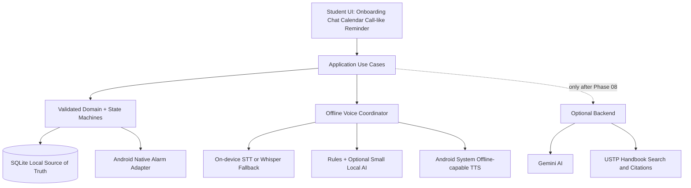

# 02 — Proposed Application Architecture

## Implemented through Phase03

The [Phase03 architecture](phase-03-native-reminders.md) and
[ADR-015](decisions/ADR-015-native-reminder-delivery.md) describe the current native
delivery boundary. Main-process OP-SQLite owns migrations and manual planner edits;
a private `:reminders` Android process reads validated durable jobs and performs
AlarmManager/notification actions against the same DELETE-journal database.
The provider exposes fixed commands, never arbitrary SQL. Post-commit
reconciliation failure leaves saved manual edits intact and shows a warning.
Speech, product calendar UI and intent execution remain deferred.

## Recommendation

Continue **React Native + TypeScript** for UI/domain, supplemented by Kotlin Android native bridges and minimal existing C/C++ where needed. This is provisional pending Phase 00 audit/Phase 01 viability. Rewriting fully in Kotlin is a change request, not the default. No dependency on online/cloud features in offline layers.

## Modules (conceptual, create only as implemented)

```text
LAFINA-CAPSTONE/
  AGENTS.md
  docs/{architecture,reports,decisions,benchmarks,...}
  src/
    app/          # boot, nav, lifecycle
    features/
      onboarding/
      calendar/
      scheduling/
      reminders/
      chat/
      settings/
      handbook/   # only Phase 10+
    core/
      theme/      # semantic tokens, light/dark
      ui/         # lean reusable buttons, inputs, status, modal
      domain/     # types, use cases, validation, pure state machines
      storage/    # SQLite entities, migration/repositories
      native/     # TS typed interfaces to Android
      speech/     # TTS/STT engine abstraction and audio focus
      intent/     # rules, NLU, structured commands and guardrails
    services/
      online/     # disabled entirely until Phase 09
  android/        # AlarmManager, TTS, on-device STT, JNI as needed
  backend/        # introduced in Phase 09, FastAPI
  __tests__/
  benchmarks/
```

## Dependency direction

`UI -> application use cases -> domain interfaces`; adapters implement those interfaces: `SQLite`, `AndroidAlarm`, `TTS`, `STT`, `IntentProcessor`, `BackendProvider` (later). Domain should have no React Native/native/network imports. Scheduler decides intent/schedule; platform alarm adapter delivers; UI only shows current state. One source of truth = SQLite.

## Logical diagram



## Port/adapter contracts

- `ReminderRepository`: create/update/read/list/delete transactionally, log events, expose active reminders.
- `NativeAlarmPort`: schedule(id,time), cancel(id), capability status, reconcile, alarm triggered event.
- `TextToSpeechPort`: list offline voices, initialize, speak/stop/dispose, availability, timing signals.
- `SpeechToTextPort`: capabilities, capture start/stop/cancel, transcript + timing/confidence if available; single capture ownership.
- `IntentParserPort`: parse(text, context, currentTime, locale) -> discriminated `IntentResult` incl confidence/ambiguity; **no write side effects**.
- `CommandExecutor`: validate authoritative selected action, confirmation gating, transaction, resulting display message.
- `KnowledgeProvider` (later): query -> answer/sources/unavailable reasons; never used for offline scheduling.

## Offline vs online boundary

Modules under `core/domain`, `core/storage`, `core/speech`, `core/intent`, `native` cannot import backend/network clients. Enforce with lint/dependency validation. Run airplane-mode integration testing. Optional online mode is an explicit UI state; no silent auto upload of speech or personal tasks.

## Performance model

Native alarm receiver should do minimal safe work, no model load at due moment. On user interaction, call TTS immediately with prepared string. STT only during active hold-to-talk (or explicitly consented visible interaction), not in background. AI model lazy loaded and released based on measured memory behavior; no permanent polling daemon if Android native alarm is active.

## Legacy migration policy

Ports are selected module-by-module after inspecting the pinned old implementation, ownership, dependencies and tests. No full repo copy, no unreviewed binary redistribution, no old cloud/business schema. Fresh local install is primary scope; upgrade/migration from legacy must be separately approved.

## Phase 00 audit resolution

The [implementation blueprint](phase-00-blueprint.md) refines this proposed design
using the pinned audit. Domain ports are owned by the pure domain; concrete
adapters import those contracts. The logical diagram above is data flow, not a
domain-to-SQLite-driver import dependency. SQLite and AlarmManager cannot commit
atomically; persist desired jobs with reminder changes and reconcile native effects.
Native access to current durable generation/cancellation state must be proved in
Phase 03. No application modules or dependencies exist yet. Graphify and runtime
architecture tests are NOT RUN; manual Mermaid diagrams describe the proposal only.

## Implemented foundation — Phase 01

The [current implementation map](phase-01-foundation.md) distinguishes the shipped
local onboarding/settings/theme shell from all proposed later modules. The one
database currently contains only an atomic versioned preference snapshot; no
planner/reminder schema or native voice/alarm behavior is implemented early.
The [Phase 01 ADR](decisions/ADR-013-phase-01-preferences.md) documents persistence,
permission boundaries, dependencies and later schema extension. Phase 00 records
above remain historical evidence, not a description of the current tree.

## Implemented data layer — Phase 02

[Data architecture and schema](phase-02-data.md) describes the implemented typed
repository, transactional migration, shared SQLite owner, reminder state machine,
weekly/timezone policies and debug-only review harness. [ADR-014](decisions/ADR-014-planner-transactions.md)
distinguishes desired job persistence from the absent Android alarm adapter. Native
delivery/reconciliation remains Phase03; calendar product UI remains Phase04.
