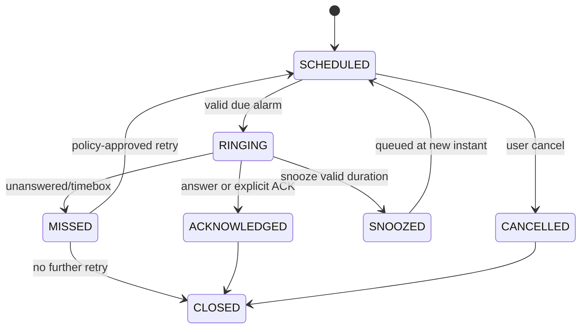

# 05 — Local Data, Calendar and Scheduling Design

## Non-negotiable

Scheduling and all reminders must be functional in airplane mode, without accounts, without STT/TTS, and without a resident LLM or backend. SQLite stores authoritative user schedules and alarm/job state; OS alarms are **delivery mechanisms**, never the source of truth. Prefer injection of a test clock and alarm adapter for deterministic testing.

## Minimal domain entities (adapt as needed)

| Entity | Essential fields |
|---|---|
| `LocalProfile` | stable `localProfileId`, optional display name, timezone, onboardingCompletedAt, preferences |
| `Task` | id, title, notes, dueAtUtc nullable, createdAtUtc, updatedAtUtc, status `TODO/IN_PROGRESS/COMPLETED/CANCELLED`, version |
| `Event` | id, title, notes, startAtUtc, endAtUtc, timezoneId, optional recurrenceRule, status |
| `Reminder` | id, sourceType+sourceId, scheduledAtUtc, leadMinutes, status, snoozedUntilUtc nullable, attempts, version, lastOutcomeAtUtc |
| `ReminderJob` | id, reminderId, occurrenceKey, runAtUtc, status, attemptCount, platformAlarmKey, version |
| `ReminderInteraction` | id, reminderId, occurrenceKey, openedAtUtc, outcome, optional duration; no raw voice recording by default |
| `ChatMessage` | id, timestamp, local role, text, optional structuredActionId; app-owned local only |
| `AppPreferences` | key-values for theme, default lead/snooze, response mode, audio options and hints |

Create no business tables, subscriptions, cloud identity fields, Qdrant vectors, transcripts store or user_behavior logging by default. Store only data actively required for the capstone.

## State machine

Ensure diagram maps to actual code behavior. Distinguish task `COMPLETED` from alert `ACKNOWLEDGED`; don't let auto-dismiss mark an assignment done. Call `answer` may transition to `ACTIVE/ANSWERED` before final outcome if useful; log event order. State should be persisted, not just in React component state.

## Reliability requirements

1. Paired `Reminder` + `ReminderJob` writes are performed atomically (`BEGIN ... COMMIT`) through a repository method such as `commitReminderOutcome`.
2. A native alarm event carries id/occurrenceKey and idempotency token. Duplicate broadcasts, already-deleted reminders and stale call callbacks do not duplicate actions.
3. On boot/app launch/permission changes, reconcile pending DB jobs with platform scheduled alarms. `BOOT_COMPLETED` behavior must be tested; don't promise force-stop recovery before app reopens where OS prohibits it.
4. Schedule next occurrence for repeated classes in an idempotent manner. Recurrence anchored to chosen IANA timezone and appropriate wall-clock local time; handle changing timezone/travel and daylight-saving on phones even if USTP is in Asia/Manila.
5. Changing due time cancels/replaces the prior alarm. Concurrent edits and ringing events are serialized or version-checked.
6. Snooze must validate duration range (e.g. 1–120 min configurable). Overlapping alarms use independent IDs and queued notifications; avoid multiple simultaneous microphone sessions.
7. Destructive delete is confirmed and cascades only to owned reminder jobs. DB migration is non-destructive, deterministic, backed by test fixture.
8. Permission denied -> clear warning, request user action and fallback notification if possible; never silently mark an undelivered reminder as delivered.

## Android scheduling boundary

Use eligible exact alarms only for user-facing, time-specific reminders, with normal fallback when restricted. Use platform API capability checks (not merely API-level checks), implement appropriate permission education, and verify Google Play policy before considering `USE_EXACT_ALARM`. Do not rely on arbitrary background activities or continuously running foreground services. Set `AlarmManager`/`PendingIntent` identity carefully; avoid accidentally overwriting simultaneous alarms. Deferrable cleanup/model refresh uses `WorkManager` if later justified.

## Calendar scope

Core screens: Today agenda, Calendar (minimum usable month/week navigation), Add/Edit Task, Add/Edit Event, Reminder details. Distinguish date-only all-day tasks from timed events. Display local timezone; internally store stable UTC instants, selected timezone and/or date-only semantics. Initial import/export and external Google Calendar integration explicitly out of scope. Weekly recurring classes supported if included in approved phase; use dedicated recurrence test cases.

## Manual QA examples

- Fresh install airplane mode -> add task tomorrow 9am -> force close/reopen -> still visible.
- Trigger time while screen locked; confirm correct alarm fallback and audio/vibration on allowed platform.
- Create two reminders at same time; both exist, neither overwrites the other.
- Delete a reminder 10 sec before due; no stale acknowledgment updates.
- Snooze for 10 min while app is interrupted; current+future states remain consistent.
- Change timezone; compare next scheduled occurrence with explicitly defined policy.
- Reboot: verify reconciling after boot; record brand-specific battery restrictions.
- Separate 'Acknowledged' from 'Task completed'.
