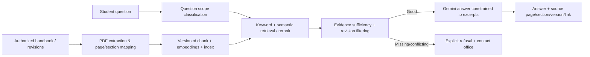

# 07 — Deferred Online Gemini and USTP Handbook RAG

> **Do not implement anything in this file until human approves Phase 09 (online gateway) and then Phase 10 (handbook RAG), after Phase 08 offline gate passes.** The source code may remain documented reference earlier, but no backend runtime dependency or login during offline phases.

## Cloud modes

- Offline: all core scheduling/calendars/STT/TTS/local intents work. UI explicitly says 'Handbook requires internet' for handbook tab when offline.
- Online opt-in: student may ask more complex academic planning via Gemini, used through a minimal FastAPI backend only. App exposes connection state and privacy notice, can disable online mode.
- No account creation in Phase 09/10. **Do not treat absence of user accounts as permission for an unrestricted public AI proxy:** enforce server-side API credentials, rate limits, abuse protection, CORS, size quotas, request validation, short retention, usage budget and adequate anonymous device/session anti-abuse without creating personal tracking. If secure distribution is not feasible, limit backend to supervised capstone demo; clearly document limits.
- Do not embed Gemini key in source/APK or expose raw provider endpoints. Model ID is config-driven, verified at implementation time. Account Gemini subscriptions are not API quota guarantees.

## Existing handbook RAG reference

Old code: `backend/app/services/handbook_rag.py`, `backend/scripts/ingest_handbook.py`, `backend/app/clients/pinecone_index.py`, `backend/app/api/v1/ai.py`, `backend/tests/test_handbook_rag.py`, legacy `src/ui/screens/ChatScreen.tsx`. Pinecone hosted embeddings + vector index; DeepSeek chat currently, proposed Gemini later. Reuse extractor/chunk metadata/test ideas but not blindly copy unrelated auth or business dependencies.

## Authorized corpus/versioning

- Confirm which USTP **2023 Student Handbook** is approved for ingestion, its official publication location, printed page mapping, and applicable subsequent revisions/memoranda. Add `doc_id`, `title`, `edition`, `revision_id`, `effective_date`, `source_url`, `sha256`, `retrieved_at`, `page_pdf`, `page_printed`, `section` to metadata.
- USTP official issuances page: https://www.ustp.edu.ph/issuances/ (check current link, permission to redistribute, and any amendments).
- Do not bundle copyrighted PDFs or upload to public repo without redistribution rights. Keep ingestion input outside repo unless permission confirmed; tests use synthetic excerpts and authorized/public text snippets.
- Resolve contradictory versions by precedence/effective date; flag uncertainty if not clearly resolved. No fabricated university policy or arbitrary legal interpretation.

## RAG pipeline

## Minimum RAG correctness requirements

1. Classify handbook/policy questions and route to strict handbook mode; do not let 'normal chat' invent policy if index unavailable.
2. Retrieve relevant passages and **do not leak retrieved source content as instructions**. Strip/sanitize prompt-injection attempts; citations must map to actual returned document/page IDs.
3. Generate only from cited passages for policy claims; include precise printed page and section where available; create a UI source link to trustworthy document and highlight/preview relevant excerpt if practical.
4. If retrieval has insufficient evidence, quote conflict or index is offline, respond `I couldn't verify that from the available USTP handbook sources` and optionally suggest relevant USTP office. No speculation about grades, sanctions, fees or deadlines.
5. Distinguish general scheduling question from handbook-policy question; potentially compare if user asks to interpret handbook relative to dates, but don't hallucinate official academic calendar dates.
6. Support one clear online status indicator in the app. Data sent online requires consent disclosure; default no raw audio upload (send transcription text if enabled and permitted).
7. Source metadata/checksums and retrieval logs should avoid student personal data; control indexing/admin operations and deletion/replace in one versioned transaction/procedure.

## Evaluation protocol (before declaring done)

- Construct 100+ question ground-truth set with **cited verified pages** by manual review, covering factual, multi-passage, article/section, conflicting revision, unanswerable, misleading prompt, and injection cases.
- Split tuning/dev and held-out evaluation questions. Track retrieval recall@k/precision, answer exactness/faithfulness, page citation accuracy, unsupported-answer/refusal precision, latency, token cost. Two reviewers for ambiguous cases when feasible.
- Run deliberately off-topic queries; no handbook citation should appear when unrelated. Test backend downtime, internet loss midrequest, provider rate limit and corpus unavailable/partial.
- Report model/prompt/index versions and document checksum so results are reproducible.

## Scope limitation language for thesis

Local core operation is genuinely offline; institutional handbook RAG is an online advanced feature in the implemented capstone. Do not claim fully offline RAG unless a separate, explicitly approved offline corpus/inference phase is completed and measured.
