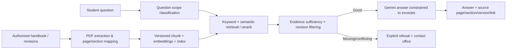

# 07 — Deferred Online Gemini and USTP Handbook RAG

> **Do not implement anything in this file until human approves Phase 09 (online gateway) and then Phase 10 (handbook RAG), after Phase 08 offline gate passes.** The source code may remain documented reference earlier, but no backend runtime dependency or login during offline phases.

## Cloud modes

- Offline: all core scheduling/calendars/STT/TTS/local intents work. UI explicitly says 'Handbook requires internet' for handbook tab when offline.
- Online opt-in: student may ask more complex academic planning via Gemini, used through a minimal FastAPI backend only. App exposes connection state and privacy notice, can disable online mode.
- No account creation in Phase 09/10. **Do not treat absence of user accounts as permission for an unrestricted public AI proxy:** enforce server-side API credentials, rate limits, abuse protection, CORS, size quotas, request validation, short retention, usage budget and adequate anonymous device/session anti-abuse without creating personal tracking. If secure distribution is not feasible, limit backend to supervised capstone demo; clearly document limits.
- Do not embed Gemini key in source/APK or expose raw provider endpoints. Model ID is config-driven, verified at implementation time. Account Gemini subscriptions are not API quota guarantees.

## Existing handbook RAG reference

Old code: `backend/app/services/handbook_rag.py`, `backend/scripts/ingest_handbook.py`, `backend/app/clients/pinecone_index.py`, `backend/app/api/v1/ai.py`, `backend/tests/test_handbook_rag.py`, legacy `src/ui/screens/ChatScreen.tsx`. Pinecone hosted embeddings + vector index; DeepSeek chat currently, proposed Gemini later. Reuse extractor/chunk metadata/test ideas but not blindly copy unrelated auth or business dependencies.

## Authorized corpus/versioning

- Confirm which USTP **2023 Student Handbook** is approved for ingestion, its official publication location, printed page mapping, and applicable subsequent revisions/memoranda. Add `doc_id`, `title`, `edition`, `revision_id`, `effective_date`, `source_url`, `sha256`, `retrieved_at`, `page_pdf`, `page_printed`, `section` to metadata.
- USTP official issuances page: https://www.ustp.edu.ph/issuances/ (check current link, permission to redistribute, and any amendments).
- Do not bundle copyrighted PDFs or upload to public repo without redistribution rights. Keep ingestion input outside repo unless permission confirmed; tests use synthetic excerpts and authorized/public text snippets.
- Resolve contradictory versions by precedence/effective date; flag uncertainty if not clearly resolved. No fabricated university policy or arbitrary legal interpretation.

## RAG pipeline

## Minimum RAG correctness requirements

1. Classify handbook/policy questions and route to strict handbook mode; do not let 'normal chat' invent policy if index unavailable.
2. Retrieve relevant passages and **do not leak retrieved source content as instructions**. Strip/sanitize prompt-injection attempts; citations must map to actual returned document/page IDs.
3. Generate only from cited passages for policy claims; include precise printed page and section where available; create a UI source link to trustworthy document and highlight/preview relevant excerpt if practical.
4. If retrieval has insufficient evidence, quote conflict or index is offline, respond `I couldn't verify that from the available USTP handbook sources` and optionally suggest relevant USTP office. No speculation about grades, sanctions, fees or deadlines.
5. Distinguish general scheduling question from handbook-policy question; potentially compare if user asks to interpret handbook relative to dates, but don't hallucinate official academic calendar dates.
6. Support one clear online status indicator in the app. Data sent online requires consent disclosure; default no raw audio upload (send transcription text if enabled and permitted).
7. Source metadata/checksums and retrieval logs should avoid student personal data; control indexing/admin operations and deletion/replace in one versioned transaction/procedure.

## Evaluation protocol (before declaring done)

- Construct 100+ question ground-truth set with **cited verified pages** by manual review, covering factual, multi-passage, article/section, conflicting revision, unanswerable, misleading prompt, and injection cases.
- Split tuning/dev and held-out evaluation questions. Track retrieval recall@k/precision, answer exactness/faithfulness, page citation accuracy, unsupported-answer/refusal precision, latency, token cost. Two reviewers for ambiguous cases when feasible.
- Run deliberately off-topic queries; no handbook citation should appear when unrelated. Test backend downtime, internet loss midrequest, provider rate limit and corpus unavailable/partial.
- Report model/prompt/index versions and document checksum so results are reproducible.

## Scope limitation language for thesis

Local core operation is genuinely offline; institutional handbook RAG is an online advanced feature in the implemented capstone. Do not claim fully offline RAG unless a separate, explicitly approved offline corpus/inference phase is completed and measured.

## Live voice conversation API (ADR-030, 2026-11-08)

Signed-in, active accounts only (`student`, `student_pro`, `admin`). Requires explicit Online Mode and the one-time consent notice on the device. All routes are under `/v1/ai/voice`; existing `/v1/ai/chat`, `/v1/ai/chat/stream` and `/v1/ai/tts*` are unchanged.

| Route | Auth | Purpose |
|---|---|---|
| `GET /capabilities` | access token | `{provider, enabled, maxDurationSeconds, maxTurns, detail}`. `enabled:false` plus `detail` when the agent is not configured. |
| `POST /sessions` `{requestId, voiceId?, useHandbook}` | access token | Daily session cap and voice validation (unknown voice → 422). Returns `{sessionId, signedUrl, grant, voiceId, expiresAt, maxDurationSeconds, maxTurns}` with `Cache-Control: no-store`. A new session ends the account's previous active one. |
| `POST /sessions/{id}/connected` `{conversationId}` | access token, owner | Binds the ElevenLabs conversation id once (409 on mismatch). |
| `POST /sessions/{id}/end` `{conversationId?}` | access token, owner | Idempotent end. |
| `GET /sessions/{id}` | access token, owner | `{status, turns, lastErrorCode, lastErrorMessage}`; the app asks once when a turn goes unanswered for 25 s. |
| `POST /llm/chat/completions` | shared secret (Bearer) + grant (`X-Lafina-Voice-Grant` or `elevenlabs_extra_body.lafina_voice_grant`) + `X-Lafina-Conversation-Id` | OpenAI-compatible streaming completion called by ElevenAgents. Bounded context, per-minute, per-day and per-session turn limits, a duplicate turn paid once, DeepSeek `max_tokens` 300, reasoning never sent. Errors before the first token are JSON `{error:{message,type}}`; errors mid-stream end the stream and record a student-safe `lastError`. |

Errors the app turns into actions: 401 → sign in again; 403 → account cannot use online features; 422 → choose another voice in Profile; 429 → limit reached; 503 → not set up or provider unavailable. The handbook is used when `useHandbook` is on; when retrieval fails, the spoken answer says the handbook could not be checked.

## Choosing the server in debug and test builds (2026-11-08)

- Release builds always use `https://lafina-backend.vercel.app` (Vercel, Singapore region `sin1`).
- Debug and `dataQa` builds have **Profile → Developer → Server (debug)**. It switches between Vercel and a backend on the developer's computer (`http://127.0.0.1:8000`, reached from the phone with `adb reverse tcp:8000 tcp:8000`).
- The native flag `ENABLE_BACKEND_SWITCH` (BuildConfig, exposed as `CapstoneBuild.backendSwitchEnabled`) is false in release. There the row is hidden, and a saved choice is ignored.
- The choice is one device-wide `local_settings` row (owner `__device__`, key `debug.api_backend`). It is never synced, and is applied at startup before the first request (`src/cloud/backendSelection.ts`).
- Sign-ins belong to one server. A signed-in account is first signed out at the old server, and planner data stays on the phone. A guest is simply switched.
- `-PlafinaApiBaseUrl` still sets a test build's starting server. A choice made in Profile overrides it.

## Offline handbook pack and the two handbook sources (2026-11-16)

- **Source PDF.** `USTP Student Handbook 2023 Edition.pdf` at the repo root is the input for `scripts/build_handbook_pack.py`. It has been tracked since `cd9fdc8`, so the app status audit's L6 note ("untracked") is out of date. Whether LAFINA may redistribute the PDF is the owner's decision. If it ever has to come out of the repo, keep the generated pack in `src/handbook/` and document where to get the PDF instead.
- **Two sources (audit L9).** Chat answers handbook questions from the **local 2023 pack**: offline with BM25 search, and online by sending local excerpts as `<handbook_excerpts>`. **Call Lafina** sends `useHandbook` to the backend, which searches its **server-side index**. If the two indexes are built from different editions or chunkings, they can cite different pages for the same question. Rebuild both from the same PDF, or say in the UI which source a call used.
- **Fail-closed search (audit H1/M5).** The local search answers only when a domain concept (INC, LOA, shifting, dress code…) or enough free words match, and when words absent from the pack's vocabulary do not outweigh the matches. Otherwise it returns `insufficientEvidence` and the app shows the no-evidence reply. Regression list: `__tests__/ai/appStatusAudit20261116.test.ts`.
- **No FTS5 (audit H5).** On a build where SQLite has no FTS5 module, schema v28 still applies: the FTS table and triggers are skipped inside a savepoint, and the handbook reports *not available* instead of failing database init.

## USTP Cagayan de Oro knowledge pack (ADR-044, 2026-11-24)

- **Second collection.** The reviewed pack in `knowledge/ustp-cdo/2026-11-24/` is built by `python -I scripts/build_campus_knowledge_pack.py` into `src/handbook/ustpCdoKnowledgePack.json`. It covers 14 documents and 88 passages, and is indexed beside the Student Handbook in `handbook_chunks` (`collection = 'ustp_cdo'`, schema v32). Run the builder with `--check` before a release; it fails when the committed pack is out of date or a knowledge file no longer matches its manifest SHA-256.
- **Which source answers.**
  - Standing policies (grades, offenses, dress code, LOA) come from the 2023 handbook.
  - Dates, offices, portals, programs, the library and organizations come from the campus pack.
  - Mixed questions can cite both.
- **Scoping.**
  - Semester, academic year and UG/GR are read from the question.
  - A question about another academic year is refused, with links to the official calendar.
  - Graduate rows appear only when the question asks about graduate studies.
- **Conflicts.** Passages affected by C1–C7 and C9 carry a caveat. It is shown offline as a note and sent online as `Caveat:`. The midyear start always shows both June 5 and June 9.
- **Citations.** The note under a reply adds official https links with PDF pages and the snapshot date, and each link is tappable. Links come only from the pack's source registry.
- **Freshness.** After the volatility window (45, 120 or 365 days), replies say the snapshot may have changed.
- **Not covered.** Call Lafina still uses the backend index (see the "Two sources" note above), so it does not know the campus pack. Document generation is limited to the handbook. `events.json` is not used.
- **Regression tests.** `__tests__/ai/ustpCdoKnowledge.test.ts` and `__tests__/ui/sourceNoteText.test.tsx`.
- **Ask USTP and the sources library (ADR-045).** The chat mode is named Ask USTP. Each answer saves the passage ids its note cites, on the phone only (never synced). **See passages** opens those passages. The **USTP sources** library, opened from the sidebar or the empty state, shows every passage both sources hold, with pages, scope, conflict notes, official links and a plain search. Tests: `__tests__/ui/ustpSourcesLibrary.test.tsx`.
