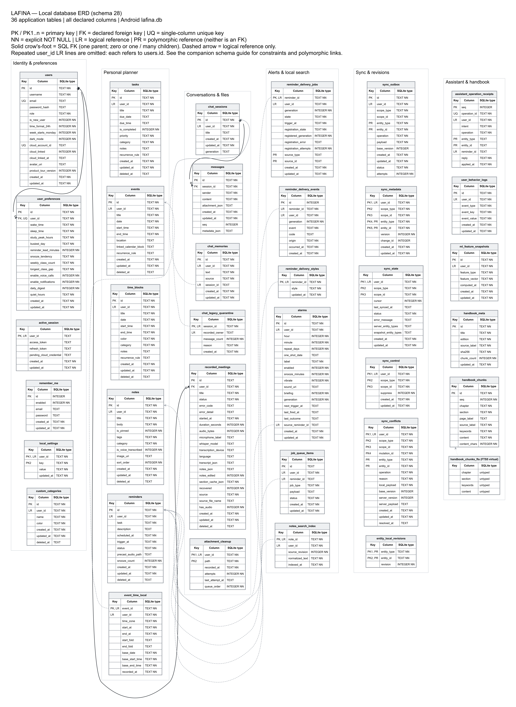

# LAFINA entity–relationship diagram

This documents the **implemented Android local database, `lafina.db`, schema version 28**: 36 application tables (35 ordinary tables and one FTS5 virtual table), 344 declared columns, and three declared foreign keys. It is derived from this checkout, not a proposed design.

[](lafina-erd.svg)

Open the SVG to zoom into individual columns. The table style follows the supplied reference: names, keys, typed attributes, and relationship connectors on a white background.

## Scope and notation

- **PK / PK1…n**: primary key; numbers show the order within a composite key. **FK**: a SQL-declared foreign key. **UQ**: a single-column unique constraint/index. Full composite keys and indexes are retained in the schema snapshot.
- **NN** means an explicit `NOT NULL` declaration reported by `PRAGMA table_info`. Absence of NN is not a guarantee that a key accepts NULL: an `INTEGER PRIMARY KEY` is the rowid alias. SQLite also permits NULL in some non-integer primary keys without explicit `NOT NULL` (for example `active_session.user_id`, `job_queue_items.id`, and `recorded_meetings.id`).
- **Solid crow’s-foot connectors** show the three declared SQL FKs. A user can have zero or one preference row and zero or many recorded meetings; a chat session can have zero or many messages. Each FK-bearing row references one existing parent when foreign-key enforcement is enabled, as `initDatabase` configures.
- **LR / dashed arrows** identify logical references handled by application code or triggers. **PR** marks a polymorphic type/ID pair whose target depends on the type. Neither is a SQL FK or guarantees a live parent or cascading deletion. For readability, repeated `user_id → users.id` lines are represented by LR on the column. Historical references can outlive their targets.
- Every declared column is shown. Defaults, CHECK expressions, indexes, and exact DDL appear in the generated catalog below and the [machine-readable snapshot](lafina-schema.json). The generic SQLite rowid and hidden FTS5 control columns are not declared application columns. FTS5 shadow tables and `sqlite_sequence` are implementation internals and are excluded.
- The FTS5 virtual table has untyped declared fields. Its dotted link indicates an external-content index over `handbook_chunks` using rowid, not an FK. FTS5 is optional at runtime: builds lacking it retain the two ordinary handbook tables.
- Cloud authentication, subscriptions, server storage, external providers, and separately maintained Electron storage are outside this physical ERD. No unverified PostgreSQL tables or relationships are inferred from API payloads.

## Important data semantics

- The seven core sync entity types are `profile`, `task`, `event`, `time_block`, `reminder`, `note`, and `custom_category`. `profile` is a wire entity assembled from local user/preferences data; there is no local `profile` table. The sync stores and local support tables are not additional synchronized entity types.
- `reminders.task` is human-readable reminder text, **not** `tasks.id`. A standalone reminder need not have a planner source. Explicit source identity is stored in `reminder_delivery_jobs.(source_type, source_id)` for a task, event, or time block; strict legacy inference may find a source without storing a link.
- `tasks.category`, `notes.category`, and `time_blocks.category` are text labels, not `custom_categories.id` foreign keys. Built-in categories can exist without custom-category rows. Notes category renaming updates matching owner/name labels in application code.
- `events.linked_calendar_block` is not an FK to `time_blocks`; current calendar code also uses group markers such as `group:birthdays`.
- `entity_local_revisions.(entity_type, entity_id)` refers polymorphically to tasks, events, time blocks, notes, or reminders. Revision rows can remain after deletion. The sync stores use `entity_type` and `entity_id` for the seven wire types, qualified by owner and account scope. `scope_id` is not a separate local scope table.
- `assistant_operation_receipts.(entity_type, entity_id)` is historical operation-result metadata, not a normal FK. Its nullable `reminder_id` is likewise a historical reference.
- `remember_me` is constrained to singleton key `id = 1`; `handbook_meta` to `id = 'active'`. There is no `handbook_meta_id` column on handbook chunks: the active corpus is managed by the store. Do not infer a relational FK between those tables.
- Reminder delivery jobs may survive hard deletion as retired rows; delivery events are retained as bounded audit history. Notes search and event-time metadata use invalidation triggers; reminder delivery styles are removed by reminder deletion/tombstone triggers.
- `local_settings.value` stores settings/feature payloads under `(user_id, key)`. JSON content such as attachments, transcripts, tags, and sync payloads does not create additional SQL tables. Audio and generated document files are referenced by paths/JSON rather than modeled as invented file tables.

## Declared SQL foreign keys

| Child column | Parent column | Child rows per parent | ON DELETE |
| --- | --- | --- | --- |
| `messages.session_id` | `chat_sessions.id` | 0..many | CASCADE |
| `recorded_meetings.user_id` | `users.id` | 0..many | NO ACTION |
| `user_preferences.user_id` | `users.id` | 0..1 | CASCADE |

## Logical reference inventory

These references are useful for navigating the schema; they do not add database constraints. Polymorphic references are described above.

| Child column | Referenced column | Meaning |
| --- | --- | --- |
| `notes_search_index.note_id` | `notes.id` | Revision-stamped search cache; invalidation triggers. |
| `event_time_local.event_id` | `events.id` | Optional local time metadata; invalidation/owner triggers. |
| `reminder_delivery_jobs.reminder_id` | `reminders.id` | Trigger-maintained delivery state; retired rows can survive hard deletion. |
| `reminder_delivery_events.reminder_id` | `reminders.id` | Bounded delivery audit history; may outlive the reminder. |
| `reminder_delivery_styles.reminder_id` | `reminders.id` | Optional local style; absence means call; cleanup triggers. |
| `job_queue_items.reminder_id` | `reminders.id` | Nullable queue reference; no SQL FK. |
| `alarms.source_reminder_id` | `reminders.id` | Nullable migration provenance; not a unique association. |
| `chat_memories.session_id` | `chat_sessions.id` | Nullable source-session provenance; no SQL FK. |
| `chat_legacy_quarantine.session_id` | `chat_sessions.id` | Quarantine record for legacy session; no SQL FK. |
| `chat_legacy_quarantine.recorded_owner` | `users.id` | Historical owner can be absent or ambiguous. |
| `assistant_operation_receipts.reminder_id` | `reminders.id` | Nullable historical result reference. |
| `active_session.user_id` | `users.id` | Application ownership/scope; no SQL FK. Cleanup obligations may survive owner deletion. |
| `alarms.user_id` | `users.id` | Application ownership/scope; no SQL FK. Cleanup obligations may survive owner deletion. |
| `assistant_operation_receipts.user_id` | `users.id` | Application ownership/scope; no SQL FK. Cleanup obligations may survive owner deletion. |
| `attachment_cleanup.user_id` | `users.id` | Application ownership/scope; no SQL FK. Cleanup obligations may survive owner deletion. |
| `chat_memories.user_id` | `users.id` | Application ownership/scope; no SQL FK. Cleanup obligations may survive owner deletion. |
| `chat_sessions.user_id` | `users.id` | Application ownership/scope; no SQL FK. Cleanup obligations may survive owner deletion. |
| `custom_categories.user_id` | `users.id` | Application ownership/scope; no SQL FK. Cleanup obligations may survive owner deletion. |
| `event_time_local.user_id` | `users.id` | Application ownership/scope; no SQL FK. Cleanup obligations may survive owner deletion. |
| `events.user_id` | `users.id` | Application ownership/scope; no SQL FK. Cleanup obligations may survive owner deletion. |
| `job_queue_items.user_id` | `users.id` | Application ownership/scope; no SQL FK. Cleanup obligations may survive owner deletion. |
| `local_settings.user_id` | `users.id` | Application ownership/scope; no SQL FK. Cleanup obligations may survive owner deletion. |
| `ml_feature_snapshots.user_id` | `users.id` | Application ownership/scope; no SQL FK. Cleanup obligations may survive owner deletion. |
| `notes.user_id` | `users.id` | Application ownership/scope; no SQL FK. Cleanup obligations may survive owner deletion. |
| `notes_search_index.user_id` | `users.id` | Application ownership/scope; no SQL FK. Cleanup obligations may survive owner deletion. |
| `reminder_delivery_events.user_id` | `users.id` | Application ownership/scope; no SQL FK. Cleanup obligations may survive owner deletion. |
| `reminder_delivery_jobs.user_id` | `users.id` | Application ownership/scope; no SQL FK. Cleanup obligations may survive owner deletion. |
| `reminders.user_id` | `users.id` | Application ownership/scope; no SQL FK. Cleanup obligations may survive owner deletion. |
| `sync_conflicts.user_id` | `users.id` | Application ownership/scope; no SQL FK. Cleanup obligations may survive owner deletion. |
| `sync_control.user_id` | `users.id` | Application ownership/scope; no SQL FK. Cleanup obligations may survive owner deletion. |
| `sync_metadata.user_id` | `users.id` | Application ownership/scope; no SQL FK. Cleanup obligations may survive owner deletion. |
| `sync_outbox.user_id` | `users.id` | Application ownership/scope; no SQL FK. Cleanup obligations may survive owner deletion. |
| `sync_state.user_id` | `users.id` | Application ownership/scope; no SQL FK. Cleanup obligations may survive owner deletion. |
| `tasks.user_id` | `users.id` | Application ownership/scope; no SQL FK. Cleanup obligations may survive owner deletion. |
| `time_blocks.user_id` | `users.id` | Application ownership/scope; no SQL FK. Cleanup obligations may survive owner deletion. |
| `user_behavior_logs.user_id` | `users.id` | Application ownership/scope; no SQL FK. Cleanup obligations may survive owner deletion. |

## Reproduce and verify

The generator transpiles only schema modules, runs the actual baseline and migrations in an empty in-memory Node SQLite database, and inspects `table_list`, `table_info`, `foreign_key_list`, and indexes. It also runs SQLite integrity/foreign-key checks. It never opens a student database or loads native React Native modules.

```powershell
# Regenerate JSON snapshot, schema guide, and editable Graphviz source:
node scripts/generate-erd.cjs
# Compare the live migrated schema and generated text artifacts with the checked-in versions:
node scripts/generate-erd.cjs --check
# Also render SVG and PNG (requires @viz-js/viz and sharp; NODE_PATH may point to bundled packages):
node scripts/generate-erd.cjs --render
```

Source: [baseline and migration sequence](../../src/storage/dbInit.ts), the schema modules it imports, [source reminder resolution](../../src/storage/sourceReminders.ts), [sync types](../../src/storage/syncTypes.ts), [profile payload](../../src/storage/profileSyncPayload.ts), [category handling](../../src/storage/notesStore.ts), and [calendar grouping](../../src/storage/scheduleEntriesStore.ts).

## Exact table catalog

The following SQL is read back from SQLite after all migrations. It preserves CHECK constraints, defaults, column order, FK actions, and nullable declarations. Index definitions follow each table; the JSON snapshot also records index origin and uniqueness.

### active_session

```sql
CREATE TABLE active_session (
      user_id TEXT PRIMARY KEY,
      access_token TEXT,
      refresh_token TEXT,
      pending_cloud_credential TEXT,
      created_at TEXT NOT NULL DEFAULT CURRENT_TIMESTAMP,
      updated_at TEXT NOT NULL DEFAULT CURRENT_TIMESTAMP
    );
```

| Index | Unique | Columns (in key order) |
| --- | --- | --- |
| `sqlite_autoindex_active_session_1` | Yes | `user_id` |

### alarms

```sql
CREATE TABLE alarms (
    id TEXT PRIMARY KEY NOT NULL,
    user_id TEXT NOT NULL,
    hour INTEGER NOT NULL CHECK (hour BETWEEN 0 AND 23),
    minute INTEGER NOT NULL CHECK (minute BETWEEN 0 AND 59),
    repeat_days INTEGER NOT NULL DEFAULT 0 CHECK (repeat_days BETWEEN 0 AND 127),
    one_shot_date TEXT,
    label TEXT NOT NULL DEFAULT '',
    enabled INTEGER NOT NULL DEFAULT 1 CHECK (enabled IN (0,1)),
    snooze_minutes INTEGER NOT NULL DEFAULT 9 CHECK (snooze_minutes BETWEEN 1 AND 30),
    vibrate INTEGER NOT NULL DEFAULT 1 CHECK (vibrate IN (0,1)),
    sound_uri TEXT,
    briefing INTEGER NOT NULL DEFAULT 0 CHECK (briefing IN (0,1)),
    generation INTEGER NOT NULL DEFAULT 1,
    next_trigger_at TEXT,
    last_fired_at TEXT,
    last_outcome TEXT,
    source_reminder_id TEXT,
    created_at TEXT NOT NULL,
    updated_at TEXT NOT NULL
  );
```

| Index | Unique | Columns (in key order) |
| --- | --- | --- |
| `idx_alarms_user` | No | `user_id`, `hour`, `minute` |
| `sqlite_autoindex_alarms_1` | Yes | `id` |

```sql
CREATE INDEX idx_alarms_user ON alarms(user_id, hour, minute);
```

### assistant_operation_receipts

```sql
CREATE TABLE assistant_operation_receipts (
    seq INTEGER PRIMARY KEY AUTOINCREMENT,
    operation_id TEXT NOT NULL UNIQUE,
    user_id TEXT NOT NULL,
    intent TEXT NOT NULL,
    operation TEXT NOT NULL,
    entity_type TEXT,
    entity_id TEXT,
    reminder_id TEXT,
    reply TEXT NOT NULL,
    applied_at TEXT NOT NULL
  );
```

| Index | Unique | Columns (in key order) |
| --- | --- | --- |
| `idx_assistant_receipts_owner` | No | `user_id`, `seq` |
| `sqlite_autoindex_assistant_operation_receipts_1` | Yes | `operation_id` |

```sql
CREATE INDEX idx_assistant_receipts_owner ON assistant_operation_receipts(user_id, seq);
```

### attachment_cleanup

```sql
CREATE TABLE attachment_cleanup (
    user_id TEXT NOT NULL,
    path TEXT NOT NULL CHECK (length(path) BETWEEN 2 AND 1024),
    recorded_at TEXT NOT NULL,
    attempts INTEGER NOT NULL DEFAULT 0,
    last_attempt_at TEXT, queue_order INTEGER NOT NULL DEFAULT 0,
    PRIMARY KEY (user_id, path)
  );
```

| Index | Unique | Columns (in key order) |
| --- | --- | --- |
| `sqlite_autoindex_attachment_cleanup_1` | Yes | `user_id`, `path` |

### chat_legacy_quarantine

```sql
CREATE TABLE chat_legacy_quarantine (
      session_id TEXT PRIMARY KEY NOT NULL,
      recorded_owner TEXT,
      message_count INTEGER NOT NULL,
      reason TEXT NOT NULL,
      created_at TEXT NOT NULL
    );
```

| Index | Unique | Columns (in key order) |
| --- | --- | --- |
| `sqlite_autoindex_chat_legacy_quarantine_1` | Yes | `session_id` |

### chat_memories

```sql
CREATE TABLE chat_memories (
      id TEXT PRIMARY KEY NOT NULL,
      user_id TEXT NOT NULL,
      text TEXT NOT NULL,
      source TEXT NOT NULL,
      session_id TEXT,
      created_at TEXT NOT NULL,
      updated_at TEXT NOT NULL
    );
```

| Index | Unique | Columns (in key order) |
| --- | --- | --- |
| `idx_chat_memories_owner` | No | `user_id`, `created_at` |
| `sqlite_autoindex_chat_memories_1` | Yes | `id` |

```sql
CREATE INDEX idx_chat_memories_owner ON chat_memories(user_id, created_at);
```

### chat_sessions

```sql
CREATE TABLE chat_sessions (
      id TEXT PRIMARY KEY NOT NULL,
      user_id TEXT NOT NULL DEFAULT 'local_guest_user',
      title TEXT,
      created_at TEXT NOT NULL,
      updated_at TEXT NOT NULL
    , generation TEXT);
```

| Index | Unique | Columns (in key order) |
| --- | --- | --- |
| `idx_chat_sessions_owner` | No | `user_id`, `updated_at` |
| `sqlite_autoindex_chat_sessions_1` | Yes | `id` |

```sql
CREATE INDEX idx_chat_sessions_owner ON chat_sessions(user_id, updated_at);
```

### custom_categories

```sql
CREATE TABLE custom_categories (
      id TEXT PRIMARY KEY NOT NULL,
      user_id TEXT NOT NULL DEFAULT 'local_guest_user',
      name TEXT NOT NULL,
      color TEXT NOT NULL,
      created_at TEXT NOT NULL,
      updated_at TEXT NOT NULL DEFAULT CURRENT_TIMESTAMP,
      deleted_at TEXT
    );
```

| Index | Unique | Columns (in key order) |
| --- | --- | --- |
| `sqlite_autoindex_custom_categories_1` | Yes | `id` |

### entity_local_revisions

```sql
CREATE TABLE entity_local_revisions (
    entity_type TEXT NOT NULL
      CHECK (entity_type IN ('task','event','time_block','note','reminder')),
    entity_id TEXT NOT NULL,
    revision INTEGER NOT NULL CHECK (revision >= 0),
    PRIMARY KEY (entity_type, entity_id)
  );
```

| Index | Unique | Columns (in key order) |
| --- | --- | --- |
| `sqlite_autoindex_entity_local_revisions_1` | Yes | `entity_type`, `entity_id` |

### event_time_local

```sql
CREATE TABLE event_time_local (
    event_id TEXT PRIMARY KEY NOT NULL,
    user_id TEXT NOT NULL,
    time_zone TEXT NOT NULL CHECK (length(time_zone) BETWEEN 1 AND 100),
    start_at TEXT NOT NULL,
    end_at TEXT NOT NULL,
    start_fold TEXT CHECK (start_fold IS NULL OR start_fold IN ('earlier', 'later')),
    end_fold TEXT CHECK (end_fold IS NULL OR end_fold IN ('earlier', 'later')),
    base_date TEXT NOT NULL,
    base_start_time TEXT NOT NULL,
    base_end_time TEXT NOT NULL,
    recorded_at TEXT NOT NULL
  );
```

| Index | Unique | Columns (in key order) |
| --- | --- | --- |
| `idx_event_time_local_owner` | No | `user_id`, `event_id` |
| `sqlite_autoindex_event_time_local_1` | Yes | `event_id` |

```sql
CREATE INDEX idx_event_time_local_owner ON event_time_local(user_id, event_id);
```

### events

```sql
CREATE TABLE events (
      id TEXT PRIMARY KEY NOT NULL,
      user_id TEXT NOT NULL DEFAULT 'local_guest_user',
      title TEXT NOT NULL,
      date TEXT NOT NULL,
      start_time TEXT NOT NULL,
      end_time TEXT NOT NULL,
      location TEXT,
      linked_calendar_block TEXT,
      recurrence_rule TEXT,
      created_at TEXT NOT NULL,
      updated_at TEXT NOT NULL,
      deleted_at TEXT
    );
```

| Index | Unique | Columns (in key order) |
| --- | --- | --- |
| `idx_events_user_date` | No | `user_id`, `date`, `start_time` |
| `sqlite_autoindex_events_1` | Yes | `id` |

```sql
CREATE INDEX idx_events_user_date ON events(user_id, date, start_time);
```

### handbook_chunks

```sql
CREATE TABLE handbook_chunks (
      id TEXT PRIMARY KEY NOT NULL,
      seq INTEGER NOT NULL,
      chapter TEXT NOT NULL,
      section TEXT NOT NULL,
      page_label TEXT,
      source_label TEXT NOT NULL,
      keywords TEXT NOT NULL DEFAULT '',
      content TEXT NOT NULL,
      content_chars INTEGER NOT NULL
    );
```

| Index | Unique | Columns (in key order) |
| --- | --- | --- |
| `idx_handbook_chunks_seq` | No | `seq` |
| `sqlite_autoindex_handbook_chunks_1` | Yes | `id` |

```sql
CREATE INDEX idx_handbook_chunks_seq ON handbook_chunks(seq);
```

### handbook_chunks_fts

```sql
CREATE VIRTUAL TABLE handbook_chunks_fts USING fts5(
      chapter,
      section,
      keywords,
      content,
      content='handbook_chunks',
      content_rowid='rowid',
      tokenize='porter unicode61 remove_diacritics 2'
    );
```

### handbook_meta

```sql
CREATE TABLE handbook_meta (
      id TEXT PRIMARY KEY NOT NULL CHECK (id = 'active'),
      title TEXT NOT NULL,
      edition TEXT NOT NULL,
      source_label TEXT NOT NULL,
      sha256 TEXT NOT NULL,
      chunk_count INTEGER NOT NULL DEFAULT 0,
      updated_at TEXT NOT NULL
    );
```

| Index | Unique | Columns (in key order) |
| --- | --- | --- |
| `sqlite_autoindex_handbook_meta_1` | Yes | `id` |

### job_queue_items

```sql
CREATE TABLE job_queue_items (
      id TEXT PRIMARY KEY,
      user_id TEXT NOT NULL,
      reminder_id TEXT,
      job_type TEXT NOT NULL,
      payload TEXT,
      status TEXT NOT NULL DEFAULT 'queued',
      created_at TEXT NOT NULL,
      updated_at TEXT NOT NULL
    );
```

| Index | Unique | Columns (in key order) |
| --- | --- | --- |
| `sqlite_autoindex_job_queue_items_1` | Yes | `id` |

### local_settings

```sql
CREATE TABLE local_settings (
      user_id TEXT NOT NULL,
      key TEXT NOT NULL,
      value TEXT NOT NULL,
      updated_at TEXT NOT NULL,
      PRIMARY KEY (user_id, key)
    );
```

| Index | Unique | Columns (in key order) |
| --- | --- | --- |
| `sqlite_autoindex_local_settings_1` | Yes | `user_id`, `key` |

### messages

```sql
CREATE TABLE messages (
      id TEXT PRIMARY KEY NOT NULL,
      session_id TEXT NOT NULL,
      sender TEXT NOT NULL,
      content TEXT NOT NULL,
      attachment_json TEXT,
      created_at TEXT NOT NULL,
      updated_at TEXT NOT NULL, seq INTEGER, metadata_json TEXT,
      FOREIGN KEY (session_id) REFERENCES chat_sessions(id) ON DELETE CASCADE
    );
```

| Index | Unique | Columns (in key order) |
| --- | --- | --- |
| `idx_messages_seq` | No | `seq` |
| `idx_messages_session` | No | `session_id`, `created_at` |
| `idx_messages_session_order` | No | `session_id`, `created_at`, `seq` |
| `sqlite_autoindex_messages_1` | Yes | `id` |

```sql
CREATE INDEX idx_messages_seq ON messages(seq);
CREATE INDEX idx_messages_session ON messages(session_id, created_at);
CREATE INDEX idx_messages_session_order ON messages(session_id, created_at, seq);
```

### ml_feature_snapshots

```sql
CREATE TABLE ml_feature_snapshots (
      id TEXT PRIMARY KEY NOT NULL,
      user_id TEXT NOT NULL,
      feature_type TEXT NOT NULL,
      feature_vector TEXT NOT NULL,
      computed_at TEXT NOT NULL,
      created_at TEXT NOT NULL,
      updated_at TEXT NOT NULL
    );
```

| Index | Unique | Columns (in key order) |
| --- | --- | --- |
| `sqlite_autoindex_ml_feature_snapshots_1` | Yes | `id` |

### notes

```sql
CREATE TABLE notes (
      id TEXT PRIMARY KEY NOT NULL,
      user_id TEXT NOT NULL DEFAULT 'local_guest_user',
      title TEXT NOT NULL,
      body TEXT NOT NULL,
      is_pinned INTEGER NOT NULL DEFAULT 0,
      tags TEXT NOT NULL DEFAULT '[]',
      category TEXT NOT NULL DEFAULT 'General',
      is_voice_transcribed INTEGER NOT NULL DEFAULT 0,
      image_uri TEXT,
      sort_order INTEGER NOT NULL DEFAULT 0,
      created_at TEXT NOT NULL,
      updated_at TEXT NOT NULL,
      deleted_at TEXT
    );
```

| Index | Unique | Columns (in key order) |
| --- | --- | --- |
| `idx_notes_user_page` | No | `user_id`, `is_pinned`, `sort_order`, `updated_at`, `id` |
| `idx_notes_user_sort` | No | `user_id`, `is_pinned`, `sort_order`, `updated_at` |
| `sqlite_autoindex_notes_1` | Yes | `id` |

```sql
CREATE INDEX idx_notes_user_page
       ON notes(user_id, is_pinned DESC, sort_order ASC, updated_at DESC, id ASC);
CREATE INDEX idx_notes_user_sort ON notes(user_id, is_pinned, sort_order, updated_at);
```

### notes_search_index

```sql
CREATE TABLE notes_search_index (
    note_id TEXT PRIMARY KEY NOT NULL,
    user_id TEXT NOT NULL,
    source_revision INTEGER NOT NULL CHECK (source_revision >= 0),
    normalized_text TEXT NOT NULL,
    indexed_at TEXT NOT NULL
  );
```

| Index | Unique | Columns (in key order) |
| --- | --- | --- |
| `idx_notes_search_owner` | No | `user_id`, `note_id` |
| `sqlite_autoindex_notes_search_index_1` | Yes | `note_id` |

```sql
CREATE INDEX idx_notes_search_owner ON notes_search_index(user_id, note_id);
```

### recorded_meetings

```sql
CREATE TABLE recorded_meetings (
      id TEXT PRIMARY KEY,
      user_id TEXT NOT NULL,
      title TEXT NOT NULL,
      status TEXT NOT NULL DEFAULT 'recording',
      error_code TEXT,
      error_detail TEXT,
      started_at TEXT NOT NULL,
      duration_seconds INTEGER NOT NULL DEFAULT 0,
      audio_bytes INTEGER NOT NULL DEFAULT 0,
      microphone_label TEXT,
      whisper_model TEXT,
      transcription_device TEXT,
      language TEXT,
      transcript_json TEXT,
      notes_json TEXT,
      notes_edited INTEGER NOT NULL DEFAULT 0,
      section_cache_json TEXT NOT NULL DEFAULT '{}',
      recovered INTEGER NOT NULL DEFAULT 0,
      source TEXT NOT NULL DEFAULT 'recording',
      source_file_name TEXT,
      has_audio INTEGER NOT NULL DEFAULT 1,
      created_at TEXT NOT NULL,
      updated_at TEXT NOT NULL,
      deleted_at TEXT,
      FOREIGN KEY (user_id) REFERENCES users (id)
    );
```

| Index | Unique | Columns (in key order) |
| --- | --- | --- |
| `idx_recorded_meetings_user` | No | `user_id`, `started_at` |
| `sqlite_autoindex_recorded_meetings_1` | Yes | `id` |

```sql
CREATE INDEX idx_recorded_meetings_user ON recorded_meetings (user_id, started_at);
```

### remember_me

```sql
CREATE TABLE remember_me (
      id INTEGER PRIMARY KEY CHECK (id = 1),
      enabled INTEGER NOT NULL DEFAULT 0,
      email TEXT,
      password TEXT,
      created_at TEXT NOT NULL DEFAULT CURRENT_TIMESTAMP,
      updated_at TEXT NOT NULL
    );
```

### reminder_delivery_events

```sql
CREATE TABLE reminder_delivery_events (
    id INTEGER PRIMARY KEY AUTOINCREMENT,
    reminder_id TEXT NOT NULL,
    user_id TEXT NOT NULL,
    generation INTEGER NOT NULL,
    event TEXT NOT NULL,
    code TEXT,
    origin TEXT NOT NULL CHECK (origin IN ('js','native')),
    occurred_at TEXT NOT NULL,
    created_at TEXT NOT NULL
  );
```

| Index | Unique | Columns (in key order) |
| --- | --- | --- |
| `idx_delivery_events_reminder` | No | `reminder_id`, `id` |

```sql
CREATE INDEX idx_delivery_events_reminder ON reminder_delivery_events(reminder_id, id);
```

### reminder_delivery_jobs

```sql
CREATE TABLE reminder_delivery_jobs (
    reminder_id TEXT PRIMARY KEY NOT NULL,
    user_id TEXT NOT NULL,
    generation INTEGER NOT NULL CHECK (generation >= 1),
    state TEXT NOT NULL CHECK (state IN ('armed','ringing','retired')),
    trigger_at TEXT NOT NULL,
    registration_state TEXT NOT NULL DEFAULT 'unregistered'
      CHECK (registration_state IN ('unregistered','registered','failed','suppressed','idle')),
    registered_generation INTEGER NOT NULL DEFAULT 0,
    registration_error TEXT,
    registration_attempts INTEGER NOT NULL DEFAULT 0,
    source_type TEXT CHECK (source_type IS NULL OR source_type IN ('task','event','time_block')),
    source_id TEXT,
    created_at TEXT NOT NULL,
    updated_at TEXT NOT NULL
  );
```

| Index | Unique | Columns (in key order) |
| --- | --- | --- |
| `idx_delivery_jobs_owner` | No | `user_id`, `state`, `trigger_at` |
| `idx_delivery_jobs_source` | No | `user_id`, `source_type`, `source_id` |
| `sqlite_autoindex_reminder_delivery_jobs_1` | Yes | `reminder_id` |

```sql
CREATE INDEX idx_delivery_jobs_owner ON reminder_delivery_jobs(user_id, state, trigger_at);
CREATE INDEX idx_delivery_jobs_source ON reminder_delivery_jobs(user_id, source_type, source_id);
```

### reminder_delivery_styles

```sql
CREATE TABLE reminder_delivery_styles (
    reminder_id TEXT PRIMARY KEY NOT NULL,
    style TEXT NOT NULL CHECK (style IN ('call','notify')),
    updated_at TEXT NOT NULL
  );
```

| Index | Unique | Columns (in key order) |
| --- | --- | --- |
| `sqlite_autoindex_reminder_delivery_styles_1` | Yes | `reminder_id` |

### reminders

```sql
CREATE TABLE reminders (
      id TEXT PRIMARY KEY NOT NULL,
      user_id TEXT NOT NULL DEFAULT 'local_guest_user',
      task TEXT NOT NULL,
      description TEXT,
      scheduled_at TEXT NOT NULL,
      trigger_at TEXT NOT NULL,
      status TEXT NOT NULL DEFAULT 'pending',
      precast_audio_path TEXT,
      snooze_count INTEGER NOT NULL DEFAULT 0,
      created_at TEXT NOT NULL,
      updated_at TEXT NOT NULL,
      deleted_at TEXT
    );
```

| Index | Unique | Columns (in key order) |
| --- | --- | --- |
| `idx_reminders_user_trigger` | No | `user_id`, `status`, `trigger_at` |
| `sqlite_autoindex_reminders_1` | Yes | `id` |

```sql
CREATE INDEX idx_reminders_user_trigger ON reminders(user_id, status, trigger_at);
```

### sync_conflicts

```sql
CREATE TABLE sync_conflicts (
      user_id TEXT NOT NULL,
      scope_type TEXT NOT NULL DEFAULT 'account',
      scope_id TEXT NOT NULL,
      mutation_id TEXT NOT NULL,
      entity_type TEXT NOT NULL,
      entity_id TEXT NOT NULL,
      operation TEXT NOT NULL,
      reason TEXT NOT NULL,
      local_payload TEXT NOT NULL,
      base_version INTEGER,
      server_version INTEGER,
      server_payload TEXT,
      created_at TEXT NOT NULL,
      updated_at TEXT NOT NULL,
      resolved_at TEXT,
      PRIMARY KEY (user_id, scope_type, scope_id, mutation_id)
    );
```

| Index | Unique | Columns (in key order) |
| --- | --- | --- |
| `idx_sync_conflicts_unresolved` | No | `user_id`, `scope_type`, `scope_id`, `resolved_at`, `updated_at` |
| `sqlite_autoindex_sync_conflicts_1` | Yes | `user_id`, `scope_type`, `scope_id`, `mutation_id` |

```sql
CREATE INDEX idx_sync_conflicts_unresolved ON sync_conflicts(user_id, scope_type, scope_id, resolved_at, updated_at);
```

### sync_control

```sql
CREATE TABLE sync_control (
      user_id TEXT NOT NULL,
      scope_type TEXT NOT NULL DEFAULT 'account',
      scope_id TEXT NOT NULL,
      suppress INTEGER NOT NULL DEFAULT 0,
      created_at TEXT NOT NULL,
      updated_at TEXT NOT NULL,
      PRIMARY KEY (user_id, scope_type, scope_id)
    );
```

| Index | Unique | Columns (in key order) |
| --- | --- | --- |
| `sqlite_autoindex_sync_control_1` | Yes | `user_id`, `scope_type`, `scope_id` |

### sync_metadata

```sql
CREATE TABLE sync_metadata (
      user_id TEXT NOT NULL,
      scope_type TEXT NOT NULL DEFAULT 'account',
      scope_id TEXT NOT NULL,
      entity_type TEXT NOT NULL,
      entity_id TEXT NOT NULL,
      version INTEGER NOT NULL DEFAULT 1,
      change_id INTEGER,
      created_at TEXT NOT NULL,
      updated_at TEXT NOT NULL,
      PRIMARY KEY (user_id, scope_type, scope_id, entity_type, entity_id)
    );
```

| Index | Unique | Columns (in key order) |
| --- | --- | --- |
| `sqlite_autoindex_sync_metadata_1` | Yes | `user_id`, `scope_type`, `scope_id`, `entity_type`, `entity_id` |

### sync_outbox

```sql
CREATE TABLE sync_outbox (
      id TEXT PRIMARY KEY NOT NULL,
      user_id TEXT NOT NULL,
      scope_type TEXT NOT NULL DEFAULT 'account',
      scope_id TEXT NOT NULL,
      entity_type TEXT NOT NULL,
      entity_id TEXT NOT NULL,
      operation TEXT NOT NULL,
      payload TEXT NOT NULL,
      base_version INTEGER,
      created_at TEXT NOT NULL,
      updated_at TEXT NOT NULL,
      status TEXT NOT NULL DEFAULT 'pending',
      attempts INTEGER NOT NULL DEFAULT 0
    );
```

| Index | Unique | Columns (in key order) |
| --- | --- | --- |
| `idx_sync_outbox_user_scope_entity` | No | `user_id`, `scope_type`, `scope_id`, `entity_type`, `entity_id`, `status` |
| `idx_sync_outbox_user_scope_status_created` | No | `user_id`, `scope_type`, `scope_id`, `status`, `created_at` |
| `sqlite_autoindex_sync_outbox_1` | Yes | `id` |

```sql
CREATE INDEX idx_sync_outbox_user_scope_entity ON sync_outbox(user_id, scope_type, scope_id, entity_type, entity_id, status);
CREATE INDEX idx_sync_outbox_user_scope_status_created ON sync_outbox(user_id, scope_type, scope_id, status, created_at);
```

### sync_state

```sql
CREATE TABLE sync_state (
      user_id TEXT NOT NULL,
      scope_type TEXT NOT NULL DEFAULT 'account',
      scope_id TEXT NOT NULL,
      cursor INTEGER NOT NULL DEFAULT 0,
      last_synced_at TEXT,
      status TEXT NOT NULL DEFAULT 'Local only',
      error_message TEXT,
      server_entity_types TEXT,
      snapshot_entity_types TEXT,
      created_at TEXT NOT NULL,
      updated_at TEXT NOT NULL,
      PRIMARY KEY (user_id, scope_type, scope_id)
    );
```

| Index | Unique | Columns (in key order) |
| --- | --- | --- |
| `sqlite_autoindex_sync_state_1` | Yes | `user_id`, `scope_type`, `scope_id` |

### tasks

```sql
CREATE TABLE tasks (
      id TEXT PRIMARY KEY NOT NULL,
      user_id TEXT NOT NULL DEFAULT 'local_guest_user',
      title TEXT NOT NULL,
      due_date TEXT,
      due_time TEXT,
      is_completed INTEGER NOT NULL DEFAULT 0,
      priority TEXT NOT NULL DEFAULT 'Medium',
      category TEXT NOT NULL DEFAULT 'General',
      notes TEXT,
      recurrence_rule TEXT,
      created_at TEXT NOT NULL,
      updated_at TEXT NOT NULL,
      deleted_at TEXT
    );
```

| Index | Unique | Columns (in key order) |
| --- | --- | --- |
| `idx_tasks_user_due` | No | `user_id`, `is_completed`, `due_date`, `due_time` |
| `sqlite_autoindex_tasks_1` | Yes | `id` |

```sql
CREATE INDEX idx_tasks_user_due ON tasks(user_id, is_completed, due_date, due_time);
```

### time_blocks

```sql
CREATE TABLE time_blocks (
      id TEXT PRIMARY KEY NOT NULL,
      user_id TEXT NOT NULL DEFAULT 'local_guest_user',
      title TEXT NOT NULL,
      date TEXT NOT NULL,
      start_time TEXT NOT NULL,
      end_time TEXT NOT NULL,
      color TEXT NOT NULL DEFAULT '#E6003A',
      category TEXT NOT NULL DEFAULT 'personal',
      notes TEXT,
      recurrence_rule TEXT,
      created_at TEXT NOT NULL,
      updated_at TEXT NOT NULL,
      deleted_at TEXT
    );
```

| Index | Unique | Columns (in key order) |
| --- | --- | --- |
| `idx_time_blocks_user_date` | No | `user_id`, `date`, `start_time` |
| `sqlite_autoindex_time_blocks_1` | Yes | `id` |

```sql
CREATE INDEX idx_time_blocks_user_date ON time_blocks(user_id, date, start_time);
```

### user_behavior_logs

```sql
CREATE TABLE user_behavior_logs (
      id TEXT PRIMARY KEY NOT NULL,
      user_id TEXT NOT NULL,
      event_type TEXT NOT NULL,
      event_key TEXT NOT NULL,
      event_value TEXT NOT NULL,
      created_at TEXT NOT NULL,
      updated_at TEXT NOT NULL
    );
```

| Index | Unique | Columns (in key order) |
| --- | --- | --- |
| `idx_user_behavior_logs_user_type` | No | `user_id`, `event_type` |
| `sqlite_autoindex_user_behavior_logs_1` | Yes | `id` |

```sql
CREATE INDEX idx_user_behavior_logs_user_type ON user_behavior_logs(user_id, event_type);
```

### user_preferences

```sql
CREATE TABLE user_preferences (
      id TEXT PRIMARY KEY NOT NULL,
      user_id TEXT NOT NULL UNIQUE,
      wake_time TEXT NOT NULL DEFAULT '07:00',
      sleep_time TEXT NOT NULL DEFAULT '23:00',
      study_peak_hours TEXT NOT NULL DEFAULT '["morning"]',
      busiest_day TEXT NOT NULL DEFAULT 'Monday',
      reminder_lead_minutes INTEGER NOT NULL DEFAULT 15,
      snooze_tendency TEXT NOT NULL DEFAULT 'snooze_once',
      weekly_class_count TEXT NOT NULL DEFAULT '4-6',
      longest_class_gap TEXT NOT NULL DEFAULT '1 hour',
      enable_voice_calls INTEGER NOT NULL DEFAULT 1,
      enable_notifications INTEGER NOT NULL DEFAULT 1,
      daily_digest INTEGER NOT NULL DEFAULT 0,
      quiet_hours TEXT NOT NULL DEFAULT '22:00-07:00',
      created_at TEXT NOT NULL,
      updated_at TEXT NOT NULL,
      FOREIGN KEY (user_id) REFERENCES users (id) ON DELETE CASCADE
    );
```

| Index | Unique | Columns (in key order) |
| --- | --- | --- |
| `sqlite_autoindex_user_preferences_1` | Yes | `id` |
| `sqlite_autoindex_user_preferences_2` | Yes | `user_id` |

### users

```sql
CREATE TABLE users (
      id TEXT PRIMARY KEY NOT NULL,
      username TEXT NOT NULL,
      email TEXT UNIQUE,
      password_hash TEXT,
      role TEXT NOT NULL DEFAULT 'student',
      is_new_user INTEGER NOT NULL DEFAULT 1,
      time_format_24h INTEGER NOT NULL DEFAULT 0,
      week_starts_monday INTEGER NOT NULL DEFAULT 0,
      dark_mode INTEGER NOT NULL DEFAULT 0,
      cloud_account_id TEXT UNIQUE,
      cloud_linked INTEGER NOT NULL DEFAULT 0,
      cloud_linked_at TEXT,
      avatar_uri TEXT,
      product_tour_version INTEGER NOT NULL DEFAULT 0,
      created_at TEXT NOT NULL,
      updated_at TEXT NOT NULL
    );
```

| Index | Unique | Columns (in key order) |
| --- | --- | --- |
| `idx_users_cloud_account_id` | Yes | `cloud_account_id` |
| `sqlite_autoindex_users_1` | Yes | `id` |
| `sqlite_autoindex_users_2` | Yes | `email` |
| `sqlite_autoindex_users_3` | Yes | `cloud_account_id` |

```sql
CREATE UNIQUE INDEX idx_users_cloud_account_id ON users(cloud_account_id);
```

