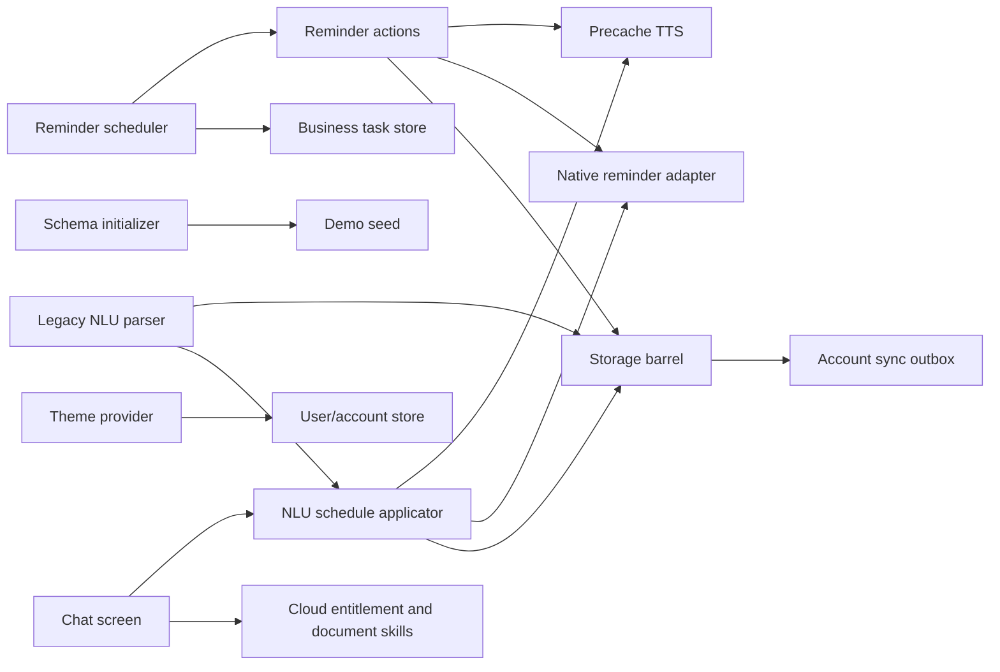

# Phase 00 — pinned legacy reuse and domain audit

Date: 2026-10-21 (Asia/Manila). Scope: documentation and source inspection only; no application implementation, dependency installation, model copying, legacy build, or legacy test execution.

## Evidence boundary

All legacy source references below were fetched through the connected GitHub `fetch_file` tool with `repository_full_name=LAFINA-AI/LAFINA` and **explicit ref `f7e70aec54e6d16e627f444f2a67114cbfb07b5e`**. The recursive Git tree at that ref was read for path/provenance discovery. Links contain the same immutable ref. Source locations are one-based line numbers. This is a targeted audit, not a claim to have reviewed every legacy file.

The local legacy checkout is not the reproducible audit source: its pin is unavailable and it contains existing changes. It was neither modified nor built for this audit. No legacy application code, models, dependencies, credentials, database, or build output was copied into the capstone repository.

`PORT` below means a **candidate for a later approved phase**, after provenance clearance, adaptation, and tests. It does not authorize or record a Phase 00 source port. `REWRITE` preserves a needed behavior while replacing unsafe coupling. `REFERENCE ONLY` establishes UI or behavioral reference. `DROP` excludes an out-of-scope behavior.

## File-specific decisions

| Pinned file and inspected lines | Decision | Useful behavior and required changes |
|---|---|---|
| [`src/scheduler/reminderScheduler.ts:1–108, 114–255`](https://github.com/LAFINA-AI/LAFINA/blob/f7e70aec54e6d16e627f444f2a67114cbfb07b5e/src/scheduler/reminderScheduler.ts#L1-L255) | REWRITE; DROP business reconciler | Preserve recovery scenarios and the rule against parallel JS/native ringing. Remove business store imports and 15-second polling fallback. Native module existence is not proof that alarms are permitted. Persist authoritative job state and recover by occurrence/version, not a guessed 60-second orphan window alone. |
| [`src/scheduler/reminderAlarm.ts:1–208`](https://github.com/LAFINA-AI/LAFINA/blob/f7e70aec54e6d16e627f444f2a67114cbfb07b5e/src/scheduler/reminderAlarm.ts#L1-L208) | PORT interface concepts; REWRITE adapter | Useful capability/settings methods, pending-call consumption, cleanup and external audio event. Replace `reminderId`-only trigger/cancel identity with stable job/occurrence/generation identity; inject clock. Return typed delivery failures and support a visible degraded state. Native implementation requires separate Android audit/device evidence. |
| [`src/scheduler/reminderActions.ts:29–108, 113–152`](https://github.com/LAFINA-AI/LAFINA/blob/f7e70aec54e6d16e627f444f2a67114cbfb07b5e/src/scheduler/reminderActions.ts#L29-L152) | REWRITE | Keep integer snooze bound 1–120 minutes and acknowledgment separate from task completion. Replace native-first snooze plus compensating cancellation with durable DB intent and retryable platform reconciliation. Remove Kokoro cache cleanup and account ownership. Use version/idempotency checks. |
| [`src/scheduler/callDispatcher.ts:1–145, 628–725`](https://github.com/LAFINA-AI/LAFINA/blob/f7e70aec54e6d16e627f444f2a67114cbfb07b5e/src/scheduler/callDispatcher.ts#L1-L145) | REWRITE; PORT selected state/session safeguards | Session IDs, duplicate Answer protection, audio-focus cleanup and manual controls are valuable. The 844-line module mixes persistence, STT, TTS warmup, automatic mic capture and call UI events in module globals. Separate durable reminder outcomes from ephemeral audio session state. Replace automatic capture after Answer with the approved visible hold-to-talk behavior. Do not port `speaking_listening`/barge-in by default. |
| [`src/storage/database.ts:1–40, 234–334`](https://github.com/LAFINA-AI/LAFINA/blob/f7e70aec54e6d16e627f444f2a67114cbfb07b5e/src/storage/database.ts#L1-L40) | REWRITE | Native OP-SQLite opening is a useful stack lead. A failed native load silently selects an in-memory mock SQL parser: production persistence cannot inherit this fallback. Remove `any` row/query types, module-load side effects and overlapping manual async transactions. Use one serialized DB owner, explicit transaction API and typed errors. Test against real SQLite. |
| [`src/storage/dbInit.ts:1–16, 379–649, 1260–1609`](https://github.com/LAFINA-AI/LAFINA/blob/f7e70aec54e6d16e627f444f2a67114cbfb07b5e/src/storage/dbInit.ts#L379-L649) | REWRITE; DROP legacy schema/seeds | Schema version is 17. User/session/auth, behavior snapshots, cloud outbox and business/Gmail tables are embedded; initialization ends with demo seeding. Create a new capstone version-1 schema and migrations. No migration from legacy user databases is promised. Retain lessons about foreign keys, index ordering, transactional migrations and surfaced migration failure. |
| [`src/storage/remindersStore.ts:1–79, 114–302`](https://github.com/LAFINA-AI/LAFINA/blob/f7e70aec54e6d16e627f444f2a67114cbfb07b5e/src/storage/remindersStore.ts#L1-L79) | REWRITE | Retain validation scenarios. Domain mutations are coupled to an account sync outbox (precache-path update is local-only), reads convert DB exceptions into empty/missing results, and no occurrence/version is checked. Do not interpret storage failure as an empty agenda. Introduce atomic reminder/job operations and constrained row decoding. |
| [`src/storage/tasksStore.ts:1–60`](https://github.com/LAFINA-AI/LAFINA/blob/f7e70aec54e6d16e627f444f2a67114cbfb07b5e/src/storage/tasksStore.ts#L1-L60) | REWRITE | The date-only and optional time distinction is useful. Replace `isCompleted` with the required task states; remove account/outbox coupling. Explicitly separate date-only due dates from timed UTC instants and preserve timezone/recurrence intent. The inspected Task/Event shapes do not carry an IANA timezone. |
| [`src/storage/rruleHelper.ts:1–110, 143–315`](https://github.com/LAFINA-AI/LAFINA/blob/f7e70aec54e6d16e627f444f2a67114cbfb07b5e/src/storage/rruleHelper.ts#L143-L315) | PORT limited pure parsing/test ideas; REWRITE temporal policy | Zero-dependency parsing and bounded expansion are useful. Do not repeat its broad RFC 5545 compliance claim: it supports a subset, uses host-local `Date`, clamps monthly dates, and caps iteration at 1,000. Define supported weekly-class subset, selected timezone, gap/fold policy and bounded expansion errors. Weekly historical series also need explicit fast-forward coverage. |
| [`src/ai/nlu/parser.ts:46–446, 453–615`](https://github.com/LAFINA-AI/LAFINA/blob/f7e70aec54e6d16e627f444f2a67114cbfb07b5e/src/ai/nlu/parser.ts#L453-L615) | PORT pure normalization/date examples; REWRITE command boundary | Useful compact-time, relative-time and weekday parsing. The parser imports stores and performs writes; `complete` selects the first substring match and an empty search can match the first task. Generic `set/create/class` or any detected time can produce a successful schedule. Return an untrusted proposal/clarification only; require unique target and validated dates before effects. Drop note creation from MVP. |
| [`src/ai/nlu/jsonParser.ts:1–127`](https://github.com/LAFINA-AI/LAFINA/blob/f7e70aec54e6d16e627f444f2a67114cbfb07b5e/src/ai/nlu/jsonParser.ts#L51-L125) | PORT allowlist/unknown-input pattern; REWRITE validation | Intent/time checks are a starting point, not a safe command validator. A date-only regex accepts impossible dates such as `2026-02-31`; fractional positive duration rounds (even below 0.5 to zero); unknown keys are ignored; surrounding text is sliced between braces. Enforce real calendar date round-trip, exact bounded schema, supported recurrence and target/version checks. A model's `status=success` is not authorization. |
| [`src/ai/nlu/scheduler.ts:58–226`](https://github.com/LAFINA-AI/LAFINA/blob/f7e70aec54e6d16e627f444f2a67114cbfb07b5e/src/ai/nlu/scheduler.ts#L91-L226) | REWRITE | It inserts task/time-block, separately inserts reminder, schedules native fire-and-forget and precaches Kokoro. Errors in reminder creation are caught while schedule success is returned. It defaults missing dates/times and flattens named weekdays to `FREQ=WEEKLY` without `BYDAY`. Route manual/text/voice through one validated, transactional use case; report durable save and delivery readiness separately. |
| [`src/ai/nlu/prompt.ts:12–43`](https://github.com/LAFINA-AI/LAFINA/blob/f7e70aec54e6d16e627f444f2a67114cbfb07b5e/src/ai/nlu/prompt.ts#L12-L43) | REFERENCE ONLY | Small structured response schema is useful if a later measured model is approved. The prompt computes today's date using UTC `toISOString()` although student commands use local calendar dates. No SmolLM2/model prompt is required for deterministic MVP commands. |
| [`src/ui/screens/OnboardingScreen.tsx:1–108, 110–185`](https://github.com/LAFINA-AI/LAFINA/blob/f7e70aec54e6d16e627f444f2a67114cbfb07b5e/src/ui/screens/OnboardingScreen.tsx#L74-L108) | REFERENCE ONLY; REWRITE persistence | Preserve compact progress/card/back-next style. Replace user ID, behavior-event logging and ML snapshot creation with optional anonymous name, timezone, theme/audio/reminder preferences and one atomic completion save. Store no inferred academic load or snooze behavior merely because legacy collected it. Show recoverable save errors. |
| [`src/ui/components/onboarding/OnboardingProgress.tsx:1–65`](https://github.com/LAFINA-AI/LAFINA/blob/f7e70aec54e6d16e627f444f2a67114cbfb07b5e/src/ui/components/onboarding/OnboardingProgress.tsx#L1-L65), [`OnboardingNavigation.tsx:1–85`](https://github.com/LAFINA-AI/LAFINA/blob/f7e70aec54e6d16e627f444f2a67114cbfb07b5e/src/ui/components/onboarding/OnboardingNavigation.tsx#L1-L85) | PORT small presentational patterns | Small prop-driven components can be adapted after theme/provenance review. Verify screen reader labels, large text, touch targets and keyboard behavior; preserve visual familiarity. |
| [`src/ui/screens/calendar/CalendarScreen.tsx:1–36`](https://github.com/LAFINA-AI/LAFINA/blob/f7e70aec54e6d16e627f444f2a67114cbfb07b5e/src/ui/screens/calendar/CalendarScreen.tsx#L1-L36) | REFERENCE ONLY | Keep month/week navigation and add/edit calendar workflow. Screen imports notes/editor, import/export and calendar layers beyond MVP. Build thin feature screens over new use cases rather than copying this 625-line workspace. |
| [`calendar/components/MonthView.tsx:1–205`](https://github.com/LAFINA-AI/LAFINA/blob/f7e70aec54e6d16e627f444f2a67114cbfb07b5e/src/ui/screens/calendar/components/MonthView.tsx#L1-L205), [`WeekView.tsx:1–184`](https://github.com/LAFINA-AI/LAFINA/blob/f7e70aec54e6d16e627f444f2a67114cbfb07b5e/src/ui/screens/calendar/components/WeekView.tsx#L1-L184) | PORT selected rendering patterns | Selected-day highlight, compact item previews, week strip and all-day/timed separation provide the visual reference. Replace legacy storage types/hooks and holiday/layer coupling. Do not inherit implicit host timezone calculations. |
| [`calendar/utils/timeGridLayout.ts:1–174`](https://github.com/LAFINA-AI/LAFINA/blob/f7e70aec54e6d16e627f444f2a67114cbfb07b5e/src/ui/screens/calendar/utils/timeGridLayout.ts#L35-L67) | PORT overlap packing after tests | `layoutIntervals` is a small pure candidate; adjacent endpoints intentionally do not overlap. Adapt temporal inputs to validated domain types. `timeToMinutes` accepts a prefix without validating hour/minute bounds, so it cannot serve as a domain validator. Cross-midnight and all-day rules need independent tests. |
| [`src/ui/screens/ChatScreen.tsx:1–45, 286–411`](https://github.com/LAFINA-AI/LAFINA/blob/f7e70aec54e6d16e627f444f2a67114cbfb07b5e/src/ui/screens/ChatScreen.tsx#L286-L411) | REFERENCE ONLY; DROP cloud/entitlement/document paths | Preserve familiar bubbles, composer and immediate text feedback. The screen mixes local schedule effects, automatic online selection, account entitlement/token checks, document skills and handbook UI. It is not an offline-core port. At this revision the inspected composer does not implement hold-to-talk; that behavior must be added in its approved phase, not claimed as already reusable. |
| [`chat/ChatInput.tsx:1–95`](https://github.com/LAFINA-AI/LAFINA/blob/f7e70aec54e6d16e627f444f2a67114cbfb07b5e/src/ui/components/chat/ChatInput.tsx#L1-L95), [`ChatMessageItem.tsx:1–60`](https://github.com/LAFINA-AI/LAFINA/blob/f7e70aec54e6d16e627f444f2a67114cbfb07b5e/src/ui/components/chat/ChatMessageItem.tsx#L1-L60) | PORT plain text presentation only | Remove file generator buttons, Student Pro lock, attachment/document imports and fixed composer bottom offset. Keep accessible send control and text rendering; add recording/error/cancel states later without large redesign. |
| [`src/ui/theme/colors.ts:1–29`](https://github.com/LAFINA-AI/LAFINA/blob/f7e70aec54e6d16e627f444f2a67114cbfb07b5e/src/ui/theme/colors.ts#L1-L29), [`spacing.ts:1–15`](https://github.com/LAFINA-AI/LAFINA/blob/f7e70aec54e6d16e627f444f2a67114cbfb07b5e/src/ui/theme/spacing.ts#L1-L15), [`typography.ts:1–21`](https://github.com/LAFINA-AI/LAFINA/blob/f7e70aec54e6d16e627f444f2a67114cbfb07b5e/src/ui/theme/typography.ts#L1-L21) | PORT reviewed token principles | Preserve familiar palette, Android system fonts and spacing scale. Name by semantic role: legacy `blue` is crimson `#E6003A`. Include dimensions/radii, contrast, motion and large text centrally; no subscriptions/auth tokens. |
| [`src/ui/contexts/ThemeContext.tsx:1–7, 76–238`](https://github.com/LAFINA-AI/LAFINA/blob/f7e70aec54e6d16e627f444f2a67114cbfb07b5e/src/ui/contexts/ThemeContext.tsx#L76-L238), [`createThemedStyles.ts:1–35`](https://github.com/LAFINA-AI/LAFINA/blob/f7e70aec54e6d16e627f444f2a67114cbfb07b5e/src/ui/theme/createThemedStyles.ts#L1-L35) | PORT semantic light/dark and memoization; REWRITE preferences | Preserve light/dark semantic surfaces and module-level style factory pattern. Theme provider currently imports user store and native reveal animation; decouple into anonymous preference service, support system/light/dark and reduced motion. Optional reveal effect is outside initial minimum. |

## Reliability and coupling findings

1. **SQLite is authoritative; Android is an external delivery adapter.** The legacy scheduler comment calls native alarms the source of truth for delivery. The capstone must keep desired reminder/job state durably in one database. SQLite and AlarmManager cannot share one atomic transaction. Commit domain state plus pending platform effect together, then apply/retry the effect and persist its result. A process crash between those steps must be recoverable.
2. **Store writes are not an atomic scheduling operation.** A task, reminder and platform job must not independently claim success. Enforce paired reminder/job mutations in one transaction; show “saved; reminder delivery restricted” when the schedule exists but platform capability is denied. Do not remove the manual schedule because STT/TTS/alarm registration failed.
3. **Reminder acknowledgment is not task completion.** Legacy `acknowledgeReminderAction` changes only reminder state, which is worth preserving; its user message says “Task acknowledged,” which should be clarified to “Reminder acknowledged.” Completing a task is a separate validated action. A generic greeting must not share a side-effectful ACK command type.
4. **An in-memory DB is a test double, never a production recovery path.** Native storage failure must expose a recoverable error and prevent false durable-success messages. Read failure must not produce an empty calendar that hides saved work. Migration/integrity failure needs an explicit failed state.
5. **Temporal semantics need one policy.** Legacy uses local `Date` in parsers/UI but UTC date in the model prompt; scheduled rows lack selected timezone. Define date-only values, timed UTC instants, weekly wall-clock recurrence, DST gap/fold behavior and travel policy. Reject impossible dates and unsupported recurrence rather than normalizing silently.
6. **No effect from an ambiguous model/parser result.** Parse → validate → clarify/confirm if needed → durable use case → optional spoken reply. Destructive actions require explicit confirmation and target version. Do not select first substring matches, silently invent a default due hour, or permit model reply text to assert success before commit.
7. **Ephemeral audio state needs durable domain identity.** Session locks and audio-focus yield are useful, but a process-global active session cannot establish reminder completion after process death. Every callback carries job/occurrence/generation plus a deduplication token. TTS/STT failures return controls to the user; only visible hold-to-talk owns the mic.
8. **Privacy logging requires review.** Legacy scheduler logs reminder titles and NLU can persist voice-derived notes. Capstone logs should use redacted IDs/codes, and benchmark text/audio must be synthetic/public/consented. No behavior telemetry is necessary for local onboarding.

Source-derived dependency sketch (manual inspection; **Graphify was not run for this audit**):

This diagram establishes coupling worth removing. It is not an exhaustive import graph or proof that cycles are absent.

## Proposed minimum schema — documentation only

One new local SQLite database, beginning at capstone schema version 1, with foreign-key enforcement, deterministic migrations, real-SQLite transaction tests and indexes driven by agenda/due-job queries. No account/auth/business/sync tables. No raw recording or generalized transcript table. No legacy database import is implied.

| Table | Intended fields/constraints |
|---|---|
| `local_profile` | Single anonymous local profile ID, optional display name, IANA timezone, onboarding completion timestamp. ID is local data identity, never an account/login. |
| `app_preferences` | Typed keys/validated values for theme (`system/light/dark`), reminder lead/snooze, text/voice preference and installed offline voice choice. Persist only used settings. |
| `tasks` | ID, title, optional notes, state `TODO/IN_PROGRESS/COMPLETED/CANCELLED`, optional **date-only** due date OR timed `due_at_utc` with timezone, timestamps, version. Mutually exclusive due representations; a date-only task receives no invented hour. |
| `events` | ID, title, notes, timed start/end UTC with timezone; explicit all-day representation when supported, timestamps, state, version. End after start. Optional supported recurrence pattern anchored to local date/time+timezone; reject unsupported rules. |
| `reminders` | ID, typed source link, occurrence key, scheduled instant, lead, current state, optional snooze instant, attempts, last outcome time, generation/version. Use enforceable task/event foreign keys (exactly one for linked reminders), rather than an unenforced polymorphic source ID. A direct reminder can create its owning task through the same use case. |
| `reminder_jobs` | ID, reminder FK, occurrence key, generation, intended run instant, desired platform action, delivery state, attempts, unique platform alarm key, error code, version. Unique `(reminder_id, occurrence_key, generation)`; old generations remain cancellable. Queued DB intent doubles as the bounded delivery-effect queue; no business/cloud queue. |
| `reminder_interactions` | ID/deduplication token, reminder/job/occurrence/generation, opened timestamp, outcome and optional duration. Uniqueness prevents repeated outcome application. No audio by default. |
| `chat_messages` | ID, local timestamp, role, text, optional local structured action ID. Retention/delete behavior must be visible and local. No provider token, entitlement or account session. |

Final SQL is intentionally deferred to its approved phase. Tests must cover foreign keys, status checks, uniqueness, index use, disk/write failure and migration rollback. Recurrence must create an unambiguous new occurrence rather than reopening an acknowledged old occurrence. Deleting an item records cancellation intent for its live jobs before removing data needed for native cleanup.

Reminder states follow `docs/05-DATA-SCHEDULING.md`: `SCHEDULED → RINGING → ACKNOWLEDGED/SNOOZED/MISSED`, plus `CANCELLED/CLOSED` and approved retry paths. Define legal transitions and compare expected version in the transaction. Job states are separate from user outcomes: proposed `ARM_PENDING → ARMED → FIRED → FINISHED`, with `CANCEL_PENDING → CANCELLED`, `BLOCKED` and retryable `FAILED` paths. Snooze creates a new generation and retires the old job atomically. A permission error is not an acknowledgment. Ephemeral call/audio states remain outside the durable reminder state machine.

## Proposed use-case and adapter contracts — documentation only

| Contract | Required behavior |
|---|---|
| `CompleteAnonymousOnboarding(preferences)` | Validate minimum preferences; transactionally store local profile/preferences and completion. No credential collection or network dependency. Report failed durable save. |
| `ParseSchedulingCommand(text, clock, timezone)` | Pure deterministic first pass returning a typed **proposal**, clarification request, or unsupported result. No stores/native imports. Speech and typed input use this same boundary. |
| `ValidateSchedulingProposal(proposal, context)` | Real calendar dates, supported timezone/recurrence, duration bounds, unambiguous target and version, required confirmations. A model result is untrusted input. |
| `CreateOrUpdateTask/Event(command, expectedVersion)` | Single transaction writes item and all affected reminder/job desired actions. Stable structured action ID supports retry without duplicate creation. Return durable item plus delivery readiness; trigger reconciliation after commit. |
| `CommitReminderOutcome(jobIdentity, outcome, expectedVersion, dedupToken)` | Atomically checks live occurrence/generation, records interaction, changes reminder and old/new job rows. Duplicate/stale events are safe no-ops. ACK never writes task COMPLETED. |
| `ReconcileAlarmJobs(reason, clock, platformCapabilities)` | Serialize bounded due/pending jobs; apply idempotent native schedule/cancel by stable key; persist success/restricted/error. Used on launch and supported boot/time/timezone/permission recovery paths. No permanent polling/AI daemon. |
| `ListAgenda(range, selectedTimezone)` | Read-only tasks/events query with correct date-only and recurring projections, explicit failure state, and no voice/cloud dependency. |
| `AlarmAdapter` | Typed capability check, schedule/cancel, pending payload consumption, settings entry points, events with full job identity. Permission-denied result remains visible. Platform behavior is validated on phone. |
| `SpeechRecognizer` / `SpeechSynthesizer` | Injectable capability/session/cancel/error interfaces. Android system TTS defaults to verified offline voice. Android on-device STT capability is evaluated, Whisper fallback only after provenance/performance checks. Text/manual flow remains usable. |
| `Clock` / `Database` / `Preferences` | Injectable current instant/timezone, serialized transaction boundary and typed preference persistence. Production storage never silently becomes volatile. |

The domain/use-case layer depends on these interfaces; UI and Android bridges depend on domain contracts. Concrete DB, native audio and any optional future inference implementations are wired at composition boundaries. No core import may reach cloud/account/skills code. Initial handbook feature remains absent/disabled until its phase approval.

## Tests worth adapting later

**Execution status: NOT RUN.** These are inspected pinned test scenarios, not new capstone tests or proof of Android behavior. In particular, several legacy Jest names say “on device” while using mocked native/speech services; retain scenarios but rename them to accurately identify adapter unit tests.

| Pinned tests | Preserve or change |
|---|---|
| [`__tests__/scheduler/reminderActions.test.ts:60–141`](https://github.com/LAFINA-AI/LAFINA/blob/f7e70aec54e6d16e627f444f2a67114cbfb07b5e/__tests__/scheduler/reminderActions.test.ts#L60-L141) | Preserve unknown ID, invalid/over-limit snooze and cleanup-failure scenarios. Replace native-first expected ordering with transaction/intent/reconciliation assertions, and add crash windows plus duplicate generation tests. |
| [`__tests__/scheduler/reminderRecovery.test.ts:88–273`](https://github.com/LAFINA-AI/LAFINA/blob/f7e70aec54e6d16e627f444f2a67114cbfb07b5e/__tests__/scheduler/reminderRecovery.test.ts#L88-L273) | Preserve interrupted-call recovery, failed row isolation and native/JS duplicate prevention. Add persistent job recovery and process restart tests; do not rely only on mocked globals or a grace-time heuristic. |
| [`__tests__/scheduler/callDispatcherEdgeCases.test.ts:254–926`](https://github.com/LAFINA-AI/LAFINA/blob/f7e70aec54e6d16e627f444f2a67114cbfb07b5e/__tests__/scheduler/callDispatcherEdgeCases.test.ts#L254-L333) | Preserve button fallback after speech failure, cancellation, audio-focus yield, stale capture callbacks, duplicate Answer and simultaneous reminder handling. Remove automatic microphone/barge-in expectations from initial MVP. Requires separate locked-screen/audio phone tests. |
| [`__tests__/ai/nlu.test.ts:93–406`](https://github.com/LAFINA-AI/LAFINA/blob/f7e70aec54e6d16e627f444f2a67114cbfb07b5e/__tests__/ai/nlu.test.ts#L93-L406) | Preserve explicit month/day, weekday rollover, compact times, relative offset across midnight/DST and meaningful title numbers. Replace missing-date/default generic title success with clarification where ambiguous; preserve requested weekdays in recurrence. Add negated commands, duplicate titles and destructive confirmation. |
| [`__tests__/ai/nluJsonParser.test.ts:23–121`](https://github.com/LAFINA-AI/LAFINA/blob/f7e70aec54e6d16e627f444f2a67114cbfb07b5e/__tests__/ai/nluJsonParser.test.ts#L23-L121) | Preserve invalid intent/type/time/JSON rejection. Add impossible dates, fractional/zero/huge durations, extra keys, recurrence validation and success text without commit. Decide strict shape rather than preserving acceptance of assistant chatter blindly. |
| [`__tests__/storage/rruleHelper.test.ts:31–225`](https://github.com/LAFINA-AI/LAFINA/blob/f7e70aec54e6d16e627f444f2a67114cbfb07b5e/__tests__/storage/rruleHelper.test.ts#L31-L225) | Preserve weekly BYDAY, interval/count/until and historical daily series. Reject malformed recurrence explicitly for commands instead of silently broadening count/interval. Add timezone travel, DST folds/gaps, far-past weekly start, leap day and end-of-month policy. |
| [`__tests__/storage/remindersStore.test.ts:59–273`](https://github.com/LAFINA-AI/LAFINA/blob/f7e70aec54e6d16e627f444f2a67114cbfb07b5e/__tests__/storage/remindersStore.test.ts#L59-L273) | Preserve CRUD boundaries, past-time rejection and write-error propagation. Replace empty-list-on-read-failure expectation with surfaced errors, remove account fixture, and verify real SQLite persistence/rollback/constraint enforcement. |

Minimum new meaningful tests in approved implementation phases: concurrent due events, task+reminder+job all-or-nothing save, DB commit followed by native rejection, process death before/after OS scheduling, cancellation before due, repeated/stale broadcast, snooze collision, acknowledgment versus completion, recurrence occurrence uniqueness, permission loss/regrant and text/manual operation with every speech/model adapter unavailable.

## Visual reference and limits

Source establishes a familiar light cream surface/white cards, dark charcoal surfaces, crimson primary actions, restrained system typography, rounded message composer/cards, compact calendar previews, a week strip and a progressive onboarding card. Retain these principles with one semantic token system and accessible states; avoid a major redesign. Remove account/pro branding, document tools and behavior questionnaire fields.

No legacy app was launched or rendered during this audit. This is **source-derived visual reference**, not pixel comparison or accessibility certification. Human screenshot/device review remains required before a later UI port. Brand/logo/illustration redistribution rights are not established by source visibility.

## Provenance and manuscript/runtime reconciliation

- The pinned root tree contains no root `LICENSE`, `COPYING`, or `NOTICE` file. This does not establish that no third-party licenses exist elsewhere, nor that public source is licensed for unrestricted reuse. Rely on the source-owner authorization recorded below, add attribution details when supplied, and independently verify each third-party component/model's redistribution terms/checksum. **No code/asset copy was made in Phase 00.**
- Actual runtime is confirmed from [`backend/app/main.py:1–35`](https://github.com/LAFINA-AI/LAFINA/blob/f7e70aec54e6d16e627f444f2a67114cbfb07b5e/backend/app/main.py#L1-L35): FastAPI, DeepSeek client, Pinecone handbook retriever, and a Gemini TTS client. [`backend/requirements.txt:1–32`](https://github.com/LAFINA-AI/LAFINA/blob/f7e70aec54e6d16e627f444f2a67114cbfb07b5e/backend/requirements.txt#L1-L32) and `backend/pyproject.toml` were inspected; they declare FastAPI/SQLAlchemy/asyncpg and many auth/document/backend dependencies unnecessary for the offline capstone.
- [`docs/plans/sprint_7_8_cloud_sync_and_ai.md:1–30`](https://github.com/LAFINA-AI/LAFINA/blob/f7e70aec54e6d16e627f444f2a67114cbfb07b5e/docs/plans/sprint_7_8_cloud_sync_and_ai.md#L1-L30) and the pinned README also describe FastAPI/DeepSeek/PostgreSQL. The README includes business demo credentials; they were not copied into this document or repository.
- The handoff reports that an old capstone paper says Django/Qdrant/DeepSeek. **Paper-side claim: UNVERIFIED.** No manuscript/paper/thesis/PDF/DOCX appears in the pinned Git tree examined. Obtain the actual manuscript before claiming it was audited or corrected. Runtime evidence supports FastAPI/Pinecone/DeepSeek; it does not establish what an inaccessible paper says.
- This inspection is only enough to identify drift. No backend or handbook code is brought into the offline MVP. Optional Gemini remains Phase 09+ and verified handbook RAG remains Phase 10+, contingent on offline-core review through Phase 08.

## Next-phase review inputs

User confirmed source/brand authorization during Phase 00: “I have authorization;
details to follow.” Record owner/attribution details when supplied; this resolves
the source-owner permission question, while third-party/model terms still need
verification. Human review should allow/deny the narrow adaptation candidates,
select low-end Android test hardware, and accept date-only/timezone/recurrence and
delivery-error semantics. Supply the manuscript only if paper reconciliation is
required. Those decisions do not authorize Phase 01. A later approved phase must
verify the chosen SQLite driver against the RN/native toolchain before claiming
durability.
