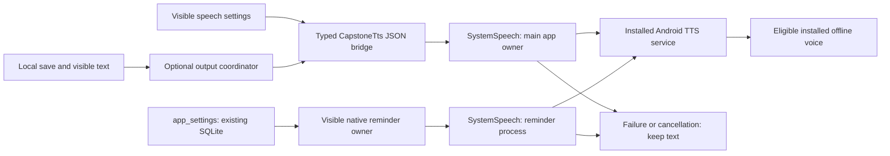

# ADR-018 — bounded Android system TTS with visible text fallback

**Status:** accepted implementation direction; physical voice validation pending  
**Date:** 2026-10-25, Asia/Manila  
**Phase:** 05  
**Extends:** [ADR-005](ADR-005-system-tts.md)

## Context

The existing output preference defaults to text. Manual planning and Android
reminder delivery already work without a speech engine. Phase 05 adds optional
spoken output while preserving those independent paths. The pinned legacy uses
Kokoro→WAV→MediaPlayer and has no traceable numeric matched-device TTS baseline;
its model/cache/store coupling is unsuitable for the initial capstone. See
[the selective legacy review](../audits/phase-05-legacy-tts.md).

## Decision

Use Android system `TextToSpeech` through the typed `CapstoneTts` native boundary.
The React Native bridge serializes structured results as JSON; malformed/unknown
results must become recoverable failures, not successful speech. Kotlin owns
engine initialization, installed-voice inspection, per-request voice checks,
audio focus, a bounded replacement queue and terminal callbacks. JavaScript owns
the visible fallback and current output mode. No synthesis filesystem cache,
download client, ONNX runtime, Kokoro payload or cloud SDK is added.

`SystemSpeechModule.kt` is the React Native bridge, `SystemSpeech.kt` owns
platform resources and `SpeechPolicy.kt` holds pure validation/selection and
request-ticket rules. The native reminder uses the same policy without loading
React. Each visible owner disposes its own client; this is not a resident global
speech service.

The optional `Preferences.tts` field extends the existing schema-1 settings
payload with `enginePackage`, `voiceName`, `languageTag`, `rate` and `pitch`.
Absence means `{enginePackage: null, voiceName: null, languageTag: 'en-US',
rate: 1, pitch: 1}`. Old saved settings remain readable; no new database or schema
migration is introduced. The native reminder process reads the same authoritative
`app_settings` payload rather than a divergent speech preference store.

Text remains the default reply mode. Voice/both can request speech for visible
canned replies and the visible simulated reminder, while readable content and
manual buttons remain available even in voice mode. Explicit visible preview is
permitted in text mode. A scheduling save commits and confirms before any optional
speech request; no DB transaction waits for playback. Canned output does not
implement natural-language commands, STT or generative responses.

## Offline selection and trust boundary

Enumerate installed engines and their current voices. Reject voices that report
network-required or `notInstalled` data before selecting them; never invoke
language/voice selection as a download mechanism. Validate requested language,
selected voice, rate and pitch, check selection return values and recheck the live
voice before every utterance. A missing, changed, unsupported or rejected voice
must yield text with setup guidance. Do not fall back to a network voice or another
language silently. Android describes the `notInstalled` substitution/download
behavior in its [engine API](https://developer.android.com/reference/android/speech/tts/TextToSpeech.Engine).

These checks trust engine-reported metadata. They are not independent network
traffic inspection or proof of a vendor engine's behavior. The platform can fall
back while binding the requested constructor engine; a requested/default package
label must not be called independently verified bound-service identity. Review the
Android default engine and record the public API metadata during physical tests.
No app INTERNET permission does not remove a separate engine's permissions.
Actual airplane-mode listening remains mandatory.

## Ownership and lifecycle

Initialize on demand with a **10-second** initialization timeout and a
**60-second** accepted-utterance timeout, with one owner per native runtime.
Changing configuration or losing the visible owner must invalidate stale
callbacks. Stop/replace cancels previous speech rather than accumulating an
unbounded reply backlog. Every accepted request must reach one terminal outcome,
including stop, replacement, error, timeout and shutdown. Late engine callbacks
cannot resolve a newer request. Reinitialization after failure must be explicit
and bounded; scheduling remains available throughout.

Allow at most **600 UTF-16 code units** per utterance, **80** characters in a
request identifier and **200** retained content-free events/replay identifiers.
Expose at most **50** installed engine descriptors and **500** voice descriptors;
these output caps do not certify how a vendor allocates its initial voice set.
An engine with a larger inventory can have eligible voices omitted by this cap;
do not claim exhaustive support for every installed voice.
Speed/pitch must be finite in **0.5–2.0**. Voice selection matches the exact
language tag case-insensitively, then requested name if supplied, otherwise
quality descending, reported latency ascending and stable name order. Reported
quality/latency are engine categories, not measured scores or milliseconds.

Request `AUDIOFOCUS_GAIN_TRANSIENT` with speech/navigation-guidance audio
attributes just before playback; a refused request
keeps the text. Stop on focus loss, user Stop, owner leaving the foreground and
resource disposal; abandon focus and shut down the instance when ownership ends.
Loss, transient loss and can-duck all stop speech; gaining focus does not
automatically resume it. React Native host pause/destroy/invalidation disposes
the main-app instance. The separate visible reminder owns its own instance and
auto-reads at most once per displayed reminder identity in Voice/Both mode.
Do not force speakerphone routing or add telephony/microphone permission. Current
Android target behavior can deny focus to background apps, which supports this
visible-owner design. See the [audio focus guide](https://developer.android.com/media/optimize/audio-focus).

The reminder stays a simulated call-style screen, with no real phone call or
background microphone. Speech failure, focus loss and Stop do not acknowledge or
complete a task; only the existing explicit reminder/task actions mutate those
states. Notification text/manual controls remain the fallback when the reminder
screen is not visible or speech cannot start.

## Measurement semantics and alternatives

Use `SystemClock.elapsedRealtime()` for request, engine `onStart`, terminal,
stop/cancel and errors, with bounded content-free diagnostics. Events carry
`requestId`, `type` (`requested`, `start`, `done`, `error`, `cancelled`), absolute
monotonic `elapsedMs` and optional `reason`/`requestToStartMs`. Initialization is
reported separately as the `initializationMs` duration. The native request-to-
start interval begins after initialization; it is not full UI-tap-to-speech time.
`speak` enqueue
success, synthesized-buffer availability and `onStart` are not first audible
speaker output. The latter needs physical listening/loopback evidence collected
separately; callbacks alone cannot satisfy that phase gate.
[UtteranceProgressListener API](https://developer.android.com/reference/android/speech/tts/UtteranceProgressListener).

Kokoro stays excluded by the product decision and unresolved artifact provenance,
not a fabricated speed comparison. WAV caching of fixed prompts stays deferred:
there is no measured workload/storage benefit to justify a second playback/cache
path. Android TTS service resources must be measured separately from app PSS;
moving synthesis out of the app does not make its memory/energy cost zero.

The [phone checklist](../../qa/PHASE-05-MANUAL.md) defines cold/warm timing,
airplane-mode voice quality, focus interruption and failure cohorts. It extends
the [matched baseline protocol](../benchmarks/phase-00-baseline.md). No physical
voice, language, energy or Kokoro improvement is certified by this ADR.

## Verification and rollback

Required automation covers strict bridge decoding, missing/network/not-installed
voices, selection failure, configuration, queue replacement, cancellation, stale
callbacks, lifecycle disposal, focus denial and text/voice/both behavior. Actual
build/test counts and executed emulator outcomes belong to
[the Phase 05 report](../reports/phase-05-report.md). Device callbacks are evidence
of the tested engine path only, not a human listening score.

If speech is unavailable, retain text mode and the existing local planner/alarm
architecture. Leave saved schedules and preferences intact. Engine substitution,
Kokoro import, background playback service, speech recognition and online services
require their own approved scope and evidence.
