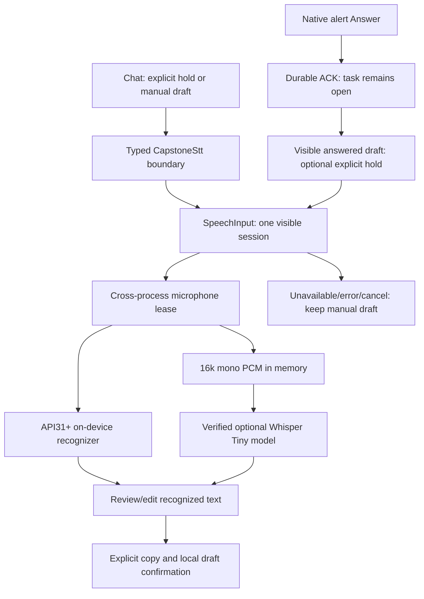

# ADR-019 — explicit hold-to-talk with two local recognition paths

**Status:** implemented direction; build, offline recognition and device acceptance
belong to the [Phase06 report](../reports/phase-06-report.md).  
**Date:**2026-10-26, Asia/Manila  
**Phase:**06 only; extends [ADR-006](ADR-006-adaptive-stt.md).

## Context and decision

Students must retain manual planning when speech is unavailable, denied or wrong.
Android11/API30 cannot use the API31 on-device recognizer factory. Newer Android
also does not guarantee an installed recognizer or local language. Use an explicit
foreground hold, two local engine candidates and readable failure states. Never
substitute the generic Android recognizer, a network recognizer or cloud STT.

`SpeechInputPanel` and its session hook own the visible hold, permission request,
local draft review and cancellation. The strict typed `CapstoneStt` bridge passes
bounded structured events. Kotlin `SpeechInput` owns the actual recording/engine
lifecycle. Recognition does not parse an intent or mutate planner records.

## Engine selection and offline boundary

- Automatic chooses the advertised API31+ Android on-device candidate first,
  otherwise a packaged Whisper candidate. The user can explicitly select either
  engine in Chat. Android11 requires the reviewed Whisper asset for STT; without
  it the app remains usable through manual text/planner controls.
- Android uses `isOnDeviceRecognitionAvailable` and
  `createOnDeviceSpeechRecognizer`. API33+ checks installed local language data
  when the provider supports that query. A provider that cannot check support
  can still be attempted through the same on-device factory. No model download
  API or generic `createSpeechRecognizer` path is used.
- Failure of an Android language/engine ends that hold. Certain failures mark
  that language for Whisper selection on the **next explicit hold**. The app
  never reopens the microphone automatically to retry an utterance.
- Availability means an engine candidate, separately from microphone permission.
  Whisper's cheap check covers library/build flag/asset length; the worker checks
  the exact model SHA256 before decoding. Neither candidate flag proves working
  recognition, accent quality or physical offline behavior.

Android's factory and installed-language checks are platform contracts. A
separately installed provider has its own process/permissions; a capstone manifest
without INTERNET does not independently audit that provider. Airplane-mode tests
must record the actual engine and language. See the Android
[SpeechRecognizer API](https://developer.android.com/reference/android/speech/SpeechRecognizer).

## Recording, ownership and cancellation

Microphone permission is requested only on use. Granting an OS dialog does not
start capture: the finger must release and the user must hold again. A hold that
ends during preparation is cancelled, and late callbacks cannot revive it.
There is no tap-to-toggle recording, wake word or background microphone service.
System TTS is stopped before Chat capture; answering ends reminder reading
before optional native dictation. Manual controls remain available throughout.

`SpeechInputSessions` supplies identity/phase fencing and128 replay identifiers.
One OS file lock is shared by main and reminder processes. The empty lease file
contains no audio. A decoder may retain that lease until cooperative cleanup,
so a quick new hold can report busy after Cancel instead of queuing another model.
The Whisper path requests exclusive transient audio focus and checks audio mode
and silenced capture; supported audio-mode callbacks and lifecycle changes cancel
the session. Android recognizer callbacks are cancelled/destroyed on termination.

Bounds are15 seconds/240,000 samples for16kHz mono capture,8 seconds preparation,
60 seconds session transcription,2,000 UTF-16 transcript characters and80
characters per session identifier. Native Whisper has a30-second cooperative
abort deadline,128 output tokens and two CPU threads. These are limits, not
measured latency guarantees or proof that every provider/model-load operation
can be preempted instantly. Recognition can end before finger release; it does
not restart while that finger remains held.

PCM is held in bounded memory and best-effort cleared after decoding/error;
there is no production audio file or transcript cache. The energy threshold
rejects empty/very quiet buffers; it is **not VAD** and cannot guarantee rejection
of noise or hallucinated words. Recognized text is kept separate from manual
draft text and only copied by an explicit action. Leaving Chat/closing the
answered panel clears its unsaved draft; backgrounding cancels recording.

## Optional Whisper source, model and cost

Use the reviewed CPU-only source selection and Tiny multilingual Q5_1 model in
[the provenance ledger](../third-party/phase-06-provenance.md). Model payload is
32,152,673 bytes; SHA256:
`818710568da3ca15689e31a743197b520007872ff9576237bda97bd1b469c3d7`.
Original/converted model and runtime notices are MIT; exact source/model pins,
notice hashes and upstream limitations are recorded separately. English maps to
`en`; the Filipino choice maps to Whisper's `tl`. This is configuration, not a
claim that Tiny is accurate for either an accent or Tagalog speech.

`-PwhisperModelDir=<reviewed-assets>` explicitly includes the checked model and
notice; the app never downloads it. `WHISPER_MODEL_INCLUDED` distinguishes that
build. A no-model build must report unavailable where Android cannot recognize
locally. Test corpus inclusion uses a separate `sttCorpusDir` flag and affects
androidTest assets only. Version/filename alone cannot identify these variants;
retain the actual APK hash and flags.

Each request loads/frees its decoder. No measured benefit currently justifies a
resident model daemon or persistent audio cache. The verified private model copy
adds disk use as well as the APK asset;31MB of weights is not31MB peak RAM or an
APK-size promise. Allocator/page caches and a vendor service can survive a client
request. Measure actual APK size, sampled memory, phone peak/energy and latency
before making a low-end support or speedup claim.

## Validation and rejected alternatives

Injected UI/bridge tests, pure policy tests and WER calculations are separate
from real decoder inference, capture and human listening. A direct synthetic PCM
benchmark can prove the tested decoder path without opening a microphone; it
cannot certify Android recognizer accuracy, Filipino accents, noise, real hold
latency or battery. Text exact-match rate is not semantic command execution.

Rejected: generic recognizer with only `EXTRA_PREFER_OFFLINE` (insufficient
offline guarantee), silent re-recording on fallback, automatic model downloads,
always-on recording, keeping Tiny resident without measurements, and executing
raw transcripts. Phase07 intent validation remains unimplemented and unapproved.
Phone acceptance and any matched legacy comparison remain explicit gates.
