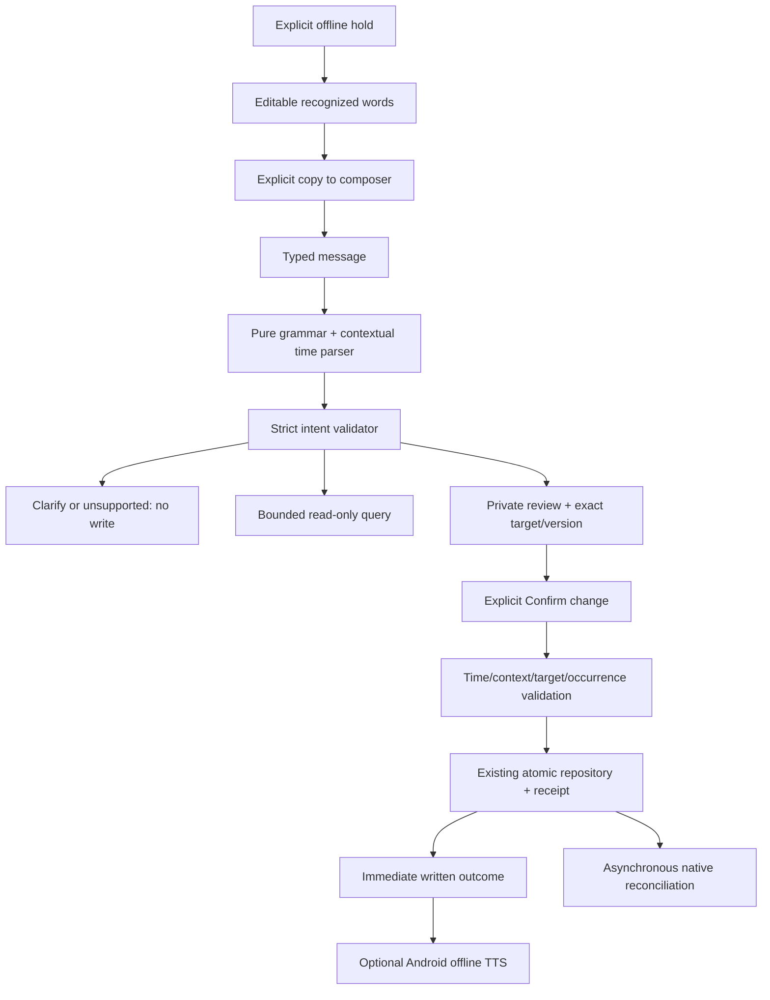

# ADR-020 — Deterministic offline commands and private confirmation reviews

**Status:** implemented direction; physical acceptance pending  
**Phase/date:** 07 / 2026-10-26 Asia/Manila  
**Approval:** owner explicitly wrote `APPROVE PHASE 07`.

## Decision and boundaries

Use an anchored English grammar and strict discriminated JSON-shaped intents.
The parser and temporal normalization are pure. The selected local timezone,
clock and existing DST gap/fold validation define dates; today, tomorrow, exact
ISO dates and bounded explicit minute offsets are supported. Bare weekdays,
vague times, negation, compound actions and unsupported requests ask for a new
explicit command. Confidence 1 means grammar coverage, not statistical accuracy
or permission to write. No language model, network or arbitrary tool execution
is involved. A model is not justified by measured added value in this phase.

Every mutation has a private, expiring five-minute review containing the exact
normalized date/time, action and resolved target identity. The UI can confirm
only its opaque review ID. Context, time, target uniqueness/version and reminder
occurrence/generation are rechecked before an existing repository transaction
commits. Raw transcripts, serialized reviews and external JSON do not authorize
storage writes. A fixed operation token and repository receipt make retry safe;
successful reviews are bounded in memory for duplicate-confirmation responses.

Targets use quoted exact task/event titles and a bounded identity query. SQLite
NOCASE is ASCII-only; duplicates, truncation and missing targets require manual
selection/renaming rather than choosing a substring. ACK/SNOOZE require one
uniquely ringing reminder for the named source. Bare ACK, “okay”, contradictions
and stale alerts do not choose a global target. ACK never completes a task.
Bulk deletion and recurring-series edits remain manual; no hidden bulk action
is introduced. Queries use existing paged/windowed APIs and state their bounds.

Chat is transient and capped at 40 messages, with no new persisted history or
privacy setting. Leaving Chat clears conversation and pending reviews. Background
entry cancels a pending review. Speech is optional: the user reviews recognition,
copies it to the composer, sends it and confirms the resulting action separately.
Typed commands remain usable without microphone, recognizer or TTS. Optional
system TTS runs after a written reply and does not gate SQLite or alarm work.
The existing reconciliation proxy handles Android delivery after durable writes;
success text distinguishes a saved record from proven alert delivery.

## Evidence and limits

The legacy audit at the pinned SHA found implicit dates/hours, substring target
selection, fuzzy or negated ACKs, automatic snooze after failed recognition, and
model naming without verified inference. Only reviewed behavioral/test ideas are
adapted; no legacy source or model binary is copied. See
[the targeted audit](../audits/phase-07-legacy-intents.md).

The command corpus is independently authored and frozen before reading the new
parser rules. Preserve the first evaluation and every refusal/error; later
development reruns are regression evidence. Parsing accuracy and host timings do
not prove speech quality, semantic correctness on unseen language, Android alarm
delivery, physical low-RAM performance or a matched legacy speedup. Actual runs,
source hashes, gates and remaining limitations belong to the phase report.

## Rollback

Disable Chat command submission while keeping manual Calendar/task/reminder
controls and saved data. No migration or cloud dependency is required. Phase 08
and later phases require separate explicit approval.
