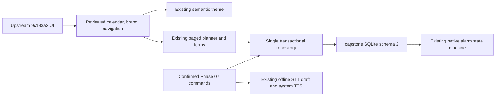

# ADR-021 — selective upstream integration on the confirmed offline core

Date: 2026-10-26. Status: accepted for authorized Phase 07.1 maintenance.

The owner requested integration of `origin/main` at
`9c183a20eca2377b5e54f219c5f83460b18af81b` before Phase 08. That branch replaces
the app rather than extending the current core. It introduces a second database
filename/schema, account/cloud/sync runtime, alternate native alarms and speech,
and removes prior test suites. A textual conflict resolution alone would hide
persisted data and break confirmed-command safety guarantees.

Keep the current `lafina-capstone.sqlite` schema 2, migration and atomic receipt
semantics, bounded repository queries, native alarm generations, offline voice
adapters and private confirmed command session. Pull into a branch after a
durable local checkpoint; use that checkpoint to resolve replacement conflicts.
Selectively adapt incoming presentational work, recording source paths and hash.
Do not create parallel databases, a second theme provider or a second scheduler.

Calendar month cells are date selectors, not a full-history load or invented item
counts. Existing day agenda paging remains authoritative. Month arithmetic uses
date strings/UTC calendar math, not local-midnight ISO slicing. No new dependency
or model is needed for the visual adaptation. Rounded navigation stays in normal
layout so it does not cover final form controls; all current dirty-form guards
remain in place. The incoming brand asset uses the owner's recorded reuse
authorization; detailed attribution/redistribution terms still need confirmation.

Incoming auth, cloud speech, sync, updater, notes/import/export, larger STT model,
duplicate native engine and alternative database are deferred/excluded. No
automatic import of an incoming `lafina.db` is attempted: identity ownership,
recurrence/timezone mapping and reminder generation semantics need a separately
reviewed import design if an actual installation requires it. Existing capstone
upgrades retain their database untouched. Remote history stays recoverable.

This avoids unmeasured model/dependency/runtime changes. New build size and
emulator evidence must be recorded, but do not imply measured performance on a
physical low-end phone. Phase 08 remains unapproved.
