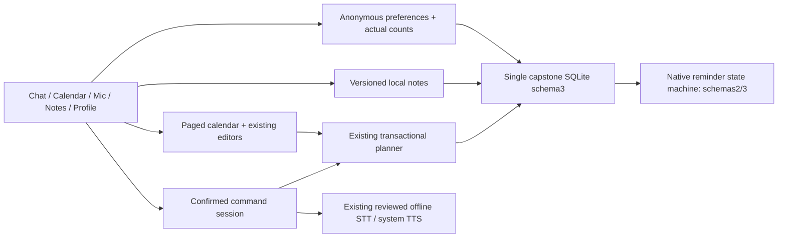

# ADR-022 — Nol reference screens on the confirmed local services

Date: 2026-10-27. Status: accepted for the owner's Phase07.1 UI follow-up.

The owner explicitly requested pulling `Nol-branch` and supplied five screenshots
showing icon navigation, a central mic, compact calendar/week timeline, Notes and
guest Profile. The previous adaptation did not reproduce this composition.
An explicit pull finds Nol and main both at `9c183a2`; that commit is already an
ancestor of our Phase07.1 merge. The mismatch was our presentation selection,
not missing upstream commits. Preserve prior reports as historical evidence.

Adopt those screen compositions around the existing typed services. Chat keeps
the private command session, reviewed transcript, explicit Send/Confirm, bounded
memory-only history and text fallback. The central microphone opens a visible
speech panel; it never starts capture automatically. Calendar continues querying
20-record day pages and opens the existing validated editors/details from its
timeline or floating add menu. The week-start preference controls both date
strip and header; time formatting remains separate from stored UTC/date values.

Use `react-native-svg` exactly15.15.5 (the incoming version) for small outline
icons and one static Profile gradient. No icon-font library, animation daemon,
new speech engine or incoming dependency tree. Capture lockfile integrity,
license notices, current advisory results, APK/native16KiB evidence and actual
emulator rendering. This is a rendering dependency, not a measured low-RAM gain.

The requested Notes screen gets real local CRUD/search/pin/category behavior.
Add schema3 with only a notes table and indexes, atomically preserving all prior
tables/settings/receipts/jobs. Notes have validated limits, source IDs, versions,
idempotent receipts and20-record pages. Body search can scan matching history;
paging bounds JS allocation rather than guaranteeing constant SQL time. Native
reminders accept both schema2 and3, refuse4+, and do not read or modify notes.
An older application cannot safely consume schema3; do not downgrade/reset data.

Profile is anonymous local identity and settings. Task/note totals use actual
SQLCOUNT; voice usage is not fabricated. Calendar clock format and first weekday
are persisted in the existing settings JSON; missing legacy keys default to the
previous24h/Monday behavior, malformed values fail validation. Native settings
panels remember whether they were entered from Profile or Preferences. Dirty
planner, note and preferences routes guard both tabs, Android Back and the mic.

Intentional reference deviations: no accounts/email/Pro/updater, no cloud speech
or handbook claim, no unsupported import/export action, no automatic voice-note
transcription/camera action. Notes categories are Personal/Coursework, suitable
for student use. UI exposes real offline functions rather than pretending these
deferred features exist. Phase08 and physical-phone acceptance remain unapproved.
