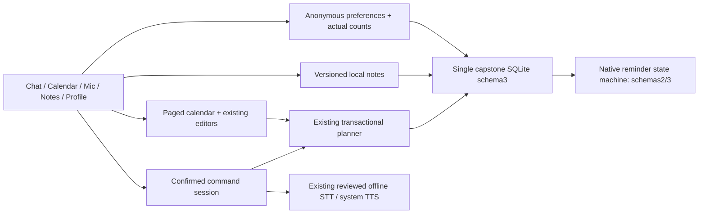

# ADR-022 — Nol reference screens on the confirmed local services

Date: 2026-10-27. Status: accepted for the owner's Phase07.1 UI follow-up.

The owner explicitly requested pulling `Nol-branch` and supplied five screenshots
showing icon navigation, a central mic, compact calendar/week timeline, Notes and
guest Profile. The previous adaptation did not reproduce this composition.
An explicit pull finds Nol and main both at `9c183a2`; that commit is already an
ancestor of our Phase07.1 merge. The mismatch was our presentation selection,
not missing upstream commits. Preserve prior reports as historical evidence.

Adopt those screen compositions around the existing typed services. Chat keeps
the private command session, reviewed transcript, explicit Send/Confirm, bounded
memory-only history and text fallback. The central microphone opens a visible
speech panel; it never starts capture automatically. Calendar continues querying
20-record day pages and opens the existing validated editors/details from its
timeline or floating add menu. The week-start preference controls both date
strip and header; time formatting remains separate from stored UTC/date values.

Use `react-native-svg` exactly15.15.5 (the incoming version) for small outline
icons and one static Profile gradient. No icon-font library, animation daemon,
new speech engine or incoming dependency tree. Capture lockfile integrity,
license notices, current advisory results, APK/native16KiB evidence and actual
emulator rendering. This is a rendering dependency, not a measured low-RAM gain.

The requested Notes screen gets real local CRUD/search/pin/category behavior.
Add schema3 with only a notes table and indexes, atomically preserving all prior
tables/settings/receipts/jobs. Notes have validated limits, source IDs, versions,
idempotent receipts and20-record pages. Body search can scan matching history;
paging bounds JS allocation rather than guaranteeing constant SQL time. Native
reminders accept both schema2 and3, refuse4+, and do not read or modify notes.
An older application cannot safely consume schema3; do not downgrade/reset data.

Audit-hardening clarification (2026-10-27): removing a note is a soft deletion,
not erasure. Its saved content remains in the `notes` tombstone. Create/edit
operation receipts retain the saved note in `result` and retain the complete
canonical JSON draft in `fingerprint`; that fingerprint is not a one-way hash.
Earlier saved revisions can therefore remain after edits/removal. This phase
keeps those retry semantics and adds honest disclosure; it does not implement
purging, receipt cleanup, an expiry policy or a promise of permanent deletion.

Profile is anonymous local identity and settings. Task/note totals use actual
SQLCOUNT; voice usage is not fabricated. Calendar clock format and first weekday
are persisted in the existing settings JSON; missing legacy keys default to the
previous24h/Monday behavior, malformed values fail validation. Native settings
panels remember whether they were entered from Profile or Preferences. Dirty
planner, note and preferences routes guard both tabs, Android Back and the mic.

Intentional reference deviations: no accounts/email/Pro/updater, no cloud speech
or handbook claim, no unsupported import/export action, no automatic voice-note
transcription/camera action. Notes categories are Personal/Coursework, suitable
for student use. UI exposes real offline functions rather than pretending these
deferred features exist. Phase08 and physical-phone acceptance remain unapproved.

## Non-adopted incoming features

AUD-06 identified omissions that the original deviation list did not enumerate.
The independent [incoming reconciliation JSON](../reports/evidence/claude-phase-07-audit-incoming-reconciliation.json)
classifies all 1,417 changed paths against pinned incoming
`9c183a20eca2377b5e54f219c5f83460b18af81b`; it is a historical source audit of
`a186bfc`, not a new feature approval or a runtime measurement.

| Incoming reference feature | Current decision and usable alternative |
|---|---|
| Time blocks and their editor | Not adopted; validated tasks/events and bounded weekly classes remain available. No independent block entity/editor was imported. |
| Philippine-holiday layer and calendar-layer controls | Not adopted; the visible calendar uses the student's saved records. No holiday-policy completeness or authoritative university calendar is claimed. |
| Separate overdue section and quick task checkbox | Not adopted as presentation shortcuts; task filters, details and explicit task completion remain available. Reminder ACK is still separate from completion. |
| Rich text, checklists, tags, custom note categories and drag reorder | Not adopted; Notes stores plain title/body, Personal/Coursework, pin/search and bounded pages. No hidden rich-text metadata or custom taxonomy is imported. |
| Animated SynthSplash, product tour and native theme-reveal animation | Not adopted; local anonymous setup and the shared light/dark theme remain. No animation daemon or tour state was added. |
| Incoming launcher mipmap/icon set | Not adopted; the existing launcher remains. The previously reviewed in-app brand image has separate recorded provenance. |
| ICS/import/export, images/camera and voice-transcribed note metadata | Not adopted; no nonfunctional actions or automatic transcript persistence are exposed. |
| Accounts/email/Pro/updater, cloud sync/speech/chat and handbook responses | Excluded from the current offline scope; these cannot be enabled by copying the incoming presentation or its instructions. |

The student-facing presentation extras above are deferred considerations, not
requirements committed to Phase08. Any later adoption requires its own approved
scope, data/permission design and evidence. Phase08 remains the separate offline
acceptance gate. Existing manual controls do not depend on these extras.

## Installation compatibility boundary

Current bundled QA/release-preview and incoming Nol use the same
`com.lafina.capstone` package. Debug uses its separate `.debug` suffix. Development
signing configuration in both repositories does not establish that their actual
certificate bytes match; compatibility is UNKNOWN until verified for the two
artifacts/installations. Incoming `lafina.db` schema17 has no automatic migration
to `lafina-capstone.sqlite` schema3, regardless of certificate compatibility.
Do not uninstall, clear data, downgrade or import an unreviewed database to force
installation. Preserve the installed build and obtain a deliberate migration
plan when its lineage or signing is unknown.
