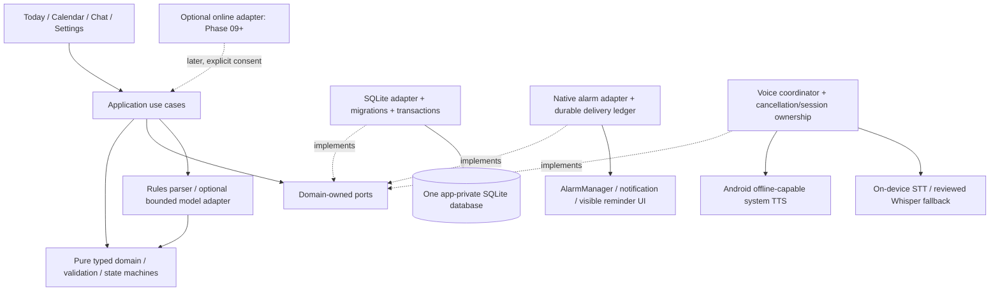
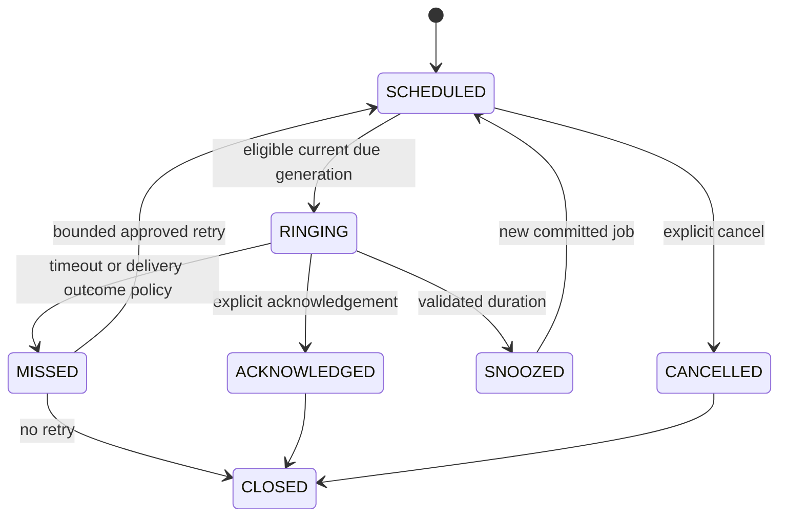

# Phase 00 implementation blueprint — proposed, not implemented

Authorization stops at Phase 00. This document freezes the handoff phase order
and describes interfaces and gates for review; it creates no app or native module.
Provisional stack choices remain contingent on a clean build and owner review.

## Scope and dependency direction

Anonymous single-device profile, manual tasks/events/calendar and native reminders
form the offline core. Text input and button actions are independent of speech and
AI. Prioritize low-end devices as requested by the owner during Phase 00: include
a 2–3 GB Android 11+ ARM64 validation tier where hardware is available, alongside
the handoff's approximately 4 GB reference phone and newer OS coverage. These are
test targets, not certified minimum requirements. No minimum RAM claim is made
before measurements. Evaluate 32-bit/Android Go compatibility separately before
promising it; the reviewed legacy ABIs do not establish that support. Avoid a
resident AI model, large animations and eager voice/model startup; keep manual
planner startup independent of every optional engine.
Android system offline-capable TTS is the default; Kokoro is benchmark-only
outside MVP. Evaluate platform on-device STT, then reviewed Whisper fallback where
needed. Simple commands use deterministic parsing and validation. No local LLM is
required for scheduling. No accounts, roles, subscriptions, teams, external Skills,
cloud sync, always-on mic or extensive visual redesign.

Domain owns types/ports and imports no RN, SQLite, Android, HTTP or React code.
Adapters depend on these contracts, not vice versa. UI calls use cases, never raw
SQL or model side effects. Core scheduling, storage, speech and intent have no
backend/network dependency. A composition root wires implementations.
The original architecture document's logical DB arrows describe data flow,
not permission for the domain to import a driver.

## Proposed module and ownership contracts

| Module | Contract and failure behavior | First phase |
|---|---|---:|
| app + features/onboarding/settings | Local optional nickname/timezone/preferences; route without identity checks | 01 |
| core/theme + core/ui | Semantic light/dark color, spacing/type/radius tokens; accessible states, legacy visual reference only | 01 |
| core/domain + application use cases | Discriminated commands/results, injected clock/IDs; validated mutations | 02 |
| core/storage | One OP-SQLite candidate driver; migrations, FK constraints, durable transactions, explicit recoverable failure | 02 |
| core/native + Android | Typed alarm capability/schedule/cancel/reconcile; id/occurrence/version in every event | 03 |
| features/calendar/scheduling/reminders | Manual CRUD, agenda/month/week as feasible; visible delivery constraints | 04 |
| core/speech | TTS readiness/voices/speak/stop/dispose; STT start/stop/cancel with session ID | 05–06 |
| core/intent + features/chat | Parse without writes; executor validates/confirms and owns transactions | 07 |
| integrated diagnostics/benchmarks | Redacted timings and lifecycle/fault evidence; no transcript logging by default | 08 |

Do not create future module folders with fake success implementations. Feature
screens consume use-case result unions such as success/validation-error/unavailable/
permission-required/recovery-needed. Every promise has cancellation/timeout and a
visible recoverable failure. Source candidates and their exact pinned dependencies
are in [the reuse audit](audits/phase-00-reuse.md).

## Minimal schema and migration plan

Fresh capstone DB, version 1; **no migration from legacy v17** is promised. Proposed
tables (final DDL and migration tests belong to Phase 02):

- `local_profile`: one local UUID, optional name, IANA timezone, onboarding complete
  time, UTC audit timestamps; no email, password, role or remote identity.
- `app_preferences`: validated theme/output mode/lead/snooze/quiet-hour values.
  Phase 01 persistence must use a reviewed local adapter with a documented migration
  into the Phase 02 DB if a temporary settings store is chosen; avoid two authorities.
- `tasks`: stable ID, title/notes, nullable due UTC, optional date-only value with
  an explicit date-only invariant, TODO/IN_PROGRESS/COMPLETED/CANCELLED, version,
  created/updated UTC. ACK never changes task status.
- `events`: stable ID, title/notes, start/end UTC, IANA timezone, optional bounded
  weekly recurrence anchor/rule, status/version and UTC audit timestamps.
- `reminders`: exactly one valid task/event owner, scheduled UTC, lead/snooze,
  occurrence key, delivery state, attempts, version, UTC audit timestamps.
  Prefer two nullable FK columns with a CHECK enforcing exactly one owner, rather
  than an unenforced polymorphic string. Free-standing reminders get an owned task.
- `reminder_jobs`: reminder FK, unique `(reminder_id, occurrence_key, generation)`,
  desired run UTC, platform key, state/attempt/version and UTC audit timestamps.
- `reminder_interactions`: occurrence/job FK, explicit interaction outcome and UTC
  timestamp; no raw voice payload. Bound retention and deletion behavior.
- `chat_messages`/`command_receipts`: local text/action IDs only where needed;
  optional history controls. A unique receipt/idempotency key prevents retry writes.

Enforce title bounds, valid dates, valid snooze ranges, unique occurrence keys,
FKs and version checks in both domain and DB constraints. Separate all-day dates
from midnight instants; specify timezone-change policy before recurrence code.
Tests must cover rollback, migration replay/data preservation, disk-full/error,
stale edits, duplicate alarms, delete/cancel and same-time different reminders.
There is no production mock/in-memory fallback after SQLite initialization fails.
Expose retry/recovery; do not show a durable-save success when data was not stored.

## Reminder/job consistency and native delivery

SQLite and AlarmManager cannot share an atomic transaction. Use a durable desired
job/outbox inside the **same SQLite transaction** as each reminder mutation:

1. Validate command/current version and commit reminder + desired job/receipt.
2. Reconciler submits/cancels native alarm with stable collision-free platform key
   and `(reminderId, occurrenceKey, generation)`; record scheduling result.
3. Native alarm callbacks verify generation/cancellation/eligibility before showing
   current content. Duplicate/stale broadcasts are harmless; re-entry is idempotent.
4. Reconcile after launch/reboot/package update/time or timezone change/permission
   changes. Distinguish pending delivery setup, denied and failed from delivered.
5. Persist acknowledgement/snooze/missed outcome with its paired job changes, then
   cancel/replace native delivery; retry a crash-interrupted reconcile safely.

Before Phase 03, prove receiver-safe access to authoritative durable state. Kotlin
must be able to consult the shared DB or a versioned, reconciled native ledger
with defined locking and crash ordering; do not pretend JS plus SharedPreferences
is one transaction. A native ledger, if needed, is a delivery cache, not a second
schedule source. Phase 03 ADR must resolve DB concurrency/driver accessibility and
notification-without-JS behavior with instrumentation before acceptance.

Job states are distinct: desired/pending-native → scheduled → triggered → handled,
with cancellation/failed branches. Permission denial cannot become “delivered”.
Define whether Answer merely opens the reminder or is an explicit ACK in Phase 04;
the conservative default is Answer opens, Acknowledge records receipt. Task
completion always requires a separate explicit action.

## Voice and intent decisions

TTS bridge: asynchronous initialization, installed voice enumeration, verified
offline voice selection, progress/error callbacks, audio focus, stop and disposal.
Text confirmation occurs after durable commit and does not await audio. Missing
voice/language uses text and notification with guidance; never silent network use.

STT: API/capability detection on supported devices, visible hold-to-talk only,
single capture/session owner, release-to-stop, cancellation and stale callback
rejection. API 30 cannot assume the newer on-device recognizer API. Whisper is a
conditional reviewed fallback, not an automatic model download. If no engine is
available, preserve typed commands/manual controls and disclose voice unavailable.
Phase 06 must either prove an offline engine on the supported minimum device or
bring the coverage gap for owner review; typed fallback alone does not pass F-010.

Parser returns a typed intent with normalized slots, target/context, uncertainty
and confirmation needs. It has no mutation/native side effects. Contradictory ACK
and snooze, unresolved “Friday/it/later”, destructive actions, invalid/past dates
and unknown targets require clarification/rejection. Small offline model remains
disabled unless held-out accuracy/latency/memory evidence shows added value.

## Frozen phase sequence and gates

| Phase | Outcome | Permission status |
|---:|---|---|
| 00 | Audit, tool validation, scope, blueprint and report | Authorized now; no runtime code |
| 01 | Foundation/theme/local anonymous onboarding | Explicit owner approval required |
| 02 | Minimal SQLite domain/repositories/migrations | After reviewed 01, separately approved |
| 03 | Native alarms/permissions/simulated reminder shell | Physical delivery tests required |
| 04 | Manual calendar/tasks/reminder controls | Offline planner usable without voice |
| 05 | Android system TTS/output modes | Offline audibility + matched Kokoro comparison |
| 06 | Hold-to-talk on-device STT/fallback | Offline WER/latency/device evidence |
| 07 | Deterministic intent + safe text/voice actions | No false critical mutations |
| 08 | Integrated offline release gate | All offline MUSTs + human device review |
| 09 | Optional secure Gemini backend | Only after 08 passes and explicit approval |
| 10 | Verified USTP handbook RAG | Source rights/revisions/page citations/refusal |
| 11 | Hardening/research/release evidence | Separate review; no automatic deployment |

All `phases/` and `prompts/` files are plans, not approval records. RAG must later
use verified official sources, applicable revisions, true page citations and
evidence-based refusal. No handbook corpus ingestion, provider setup or backend
implementation is part of Phase 00.

## Phase 01 readiness and rollback

Planning prerequisites are available. Execution remains **on hold** pending owner
review/approval; no phone is attached and no application build has run. Initial
sandboxed Gradle/ADB failures resolved in outside-sandbox version/enumeration
checks; Gradle9.3.1 with explicit JDK17 passed. Do not mistake a version query for
native dependency compatibility. Default Java25 drift needs explicit JDK selection.
Use fresh template/configuration and a minimal reviewed dependency set; do not copy
the legacy native tree or lockfile. Exact app version pins are not accepted until
a clean debug/release-like build establishes compatibility. Do not call installed
tools a validated application toolchain. The owner confirmed legacy source/brand
authorization on 2026-10-21 (“I have authorization; details to follow”); record
attribution details when supplied and verify third-party/model terms separately.
Source candidates still require phase approval and tests before any port.

Graphify is NOT RUN (not available and no capstone source graph). The Mermaid
diagrams are a manual design substitute, not a cycle scan. Phase 01 should enforce
import boundaries with a reproducible static checker and run Graphify if available;
record the actual command/results then.

Phase 00 rollback is removal/reversion of its documentation branch changes; no
application state or legacy checkout is changed. Future adapters must be replaceable
without losing authoritative tasks or pending desired jobs. No phase is implicitly
approved by this blueprint.
