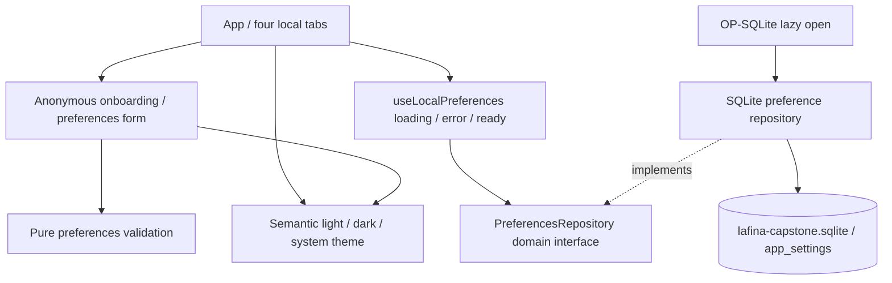

# Phase 01 foundation — implementation map and validation limits

The implemented slice is F-001/F-002 plus the preference portion of F-017, awaiting
physical-device validation. Calendar, Chat, alarms and voice remain explicitly
unavailable. There is no user registration or server.

Actual paths:

- `src/app`: composition, hydration/retry, four-tab shell, Android back handling.
- `src/features/onboarding`: welcome/settings form, validation, save/error/retake.
- `src/core/domain`: pure preference types/validation and future adapter contracts.
- `src/core/storage`: one SQL snapshot repository and native opening adapter.
- `src/core/theme`, `src/core/ui`: semantic colors, spacing, type/dimensions and
  shared labeled controls; 48dp minimum controls, scalable text, wrapping navigation.
- `__tests__`: behavioral UI, invalid/corrupt settings, real host SQLite persistence
  and failed-write preservation. No mock is proof of native phone behavior.
- `scripts/check-architecture.mjs`: import resolution/cycles, pure domain and
  forbidden offline network dependencies/release permissions. Graphify NOT RUN.
- `.github/workflows/phase-01.yml`: reproducible Node checks and Android build jobs;
  remote GitHub execution is NOT RUN unless an actual workflow run is linked.

Permission design: no runtime permissions requested. Release has no INTERNET,
microphone, notification, alarm or full-screen intent permission. Debug needs only
INTERNET for Metro. No native scheduling/STT/TTS feature exists. Default replies
are text; voice selections are saved preferences only. Quiet hours do not modify
Android Do Not Disturb and cannot silence nonexistent reminders.

The debug-only diagnostics view exposes implementation availability, not invented
permission/engine health. It contains no nickname, agenda, transcript, device ID or
API credentials. Production preview removes its `__DEV__` branch.

See [ADR-013](decisions/ADR-013-phase-01-preferences.md),
[Phase 01 report](reports/phase-01-report.md) and
[manual checklist](../qa/PHASE-01-MANUAL.md). Raw logs record real results, including
initial harness/environment failures and subsequent fixes. No runtime performance
improvement is claimed from compile/test times or emulator behavior.
