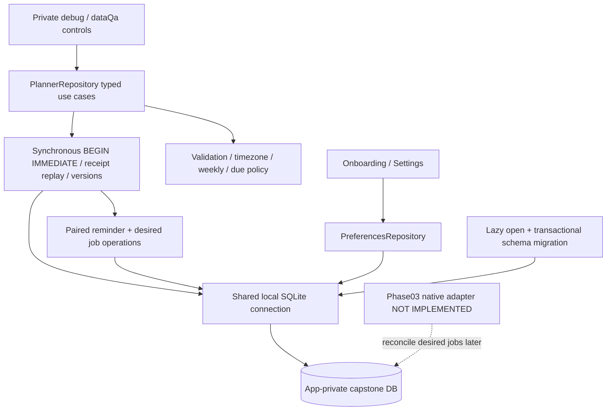
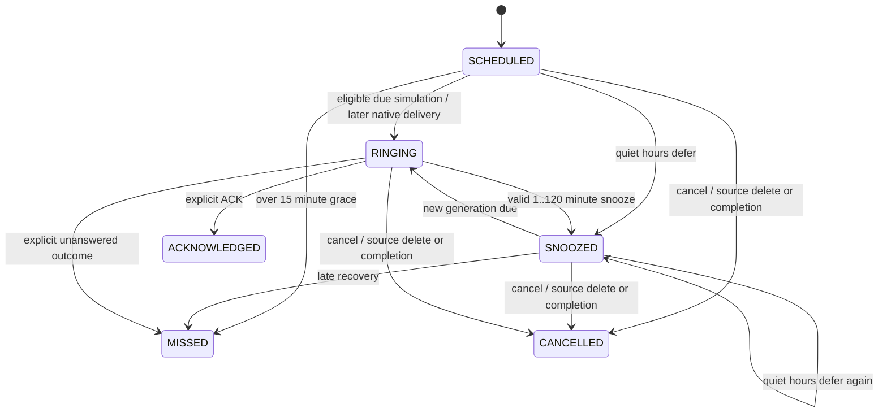

# Phase 02 data architecture and contracts

All application data stays in `lafina-capstone.sqlite`. Phase01 settings payloads
are preserved; schema version 1 refers to SQLite `user_version`, not the preference
payload's independent schemaVersion. No account, legacy migration or online layer.

| Table | Identity and purpose | Constraints / access |
|---|---|---|
| app_settings | singleton id1, JSON preference snapshot | Existing validated Phase01 representation retained |
| local_profile | singleton `local`, creation instant | Anonymous local namespace; name/timezone/preferences remain in settings |
| tasks | title/notes, nullable UTC or date-only due, timezone, status, version, current reminder lead, timestamps/deleted_at | Date-only vs timed mutually exclusive; explicit completion |
| events | title/notes, start/end UTC, timezone, optional finite weekly JSON, current reminder lead, status/version/timestamps/deleted_at | End after start; runtime strict date/rule validation |
| reminders | exactly one task/event FK, occurrence key, original planned alert UTC, lead, status/version/outcome time | Unique source + occurrence; no account owner |
| reminder_jobs | one per reminder, stable ID/key, current run UTC, generation, state/attempt count, delivery availability/reason | FK; unique reminder; current generation replaces prior desired registration |
| operation_receipts | token, canonical request fingerprint, JSON result and creation instant | Retry without duplicate side effects; conflicting reuse rejects |
| chat_messages | local id, timestamp, user/assistant text and optional action reference | No command execution; retain latest 100; no audio/transcripts collection |

Indices cover task timed/date queries, events, pending reminders/jobs, recent chat.
Foreign keys are enabled; busy timeout is 5 seconds. DDL/status/source/integer
constraints complement domain validation. Database reads reject invalid rows,
rather than silently displaying an empty agenda. Current debug snapshot reads all
records then displays only 20 tasks, 20 events and 40 reminders with explicit counts.
Production pagination and pruning are deferred, and large datasets remain unproven.

The [typed API](../src/core/domain/planner.ts) accepts operation tokens generated
once per submitted action and retained across uncertain retries. Reusing a token
for another payload fails. `createTask/createEvent`, `updateTask/updateEvent`,
`deleteTask/deleteEvent`, `reminderAction`, `snapshot`, `upcoming`, `appendChat` and
`recentChat` expose tested storage behavior. Update/delete require the last read
version. Calls return only after commit, and storage errors are recoverable errors.

For this schema ACKNOWLEDGED/MISSED are retained terminal states, rather than
additional CLOSED rows. They never imply task COMPLETED. Cancellation tombstones
and generation checks suppress stale callbacks. A deliberately changed occurrence
instant creates a new identity. Rescheduling an eligible existing occurrence queues
a newer generation. RINGING is a data state in Phase02; deliveryState stays
UNAVAILABLE. Attempts increment only when entering RINGING, never on token replay.
No automatic callbacks, timers, alarms or audio exist yet.

Weekly classes expand at most 366 inclusive calendar dates; they use a reviewed
subset, not general RFC5545 support. Start must match a selected weekday and fold.
Each occurrence's end is start + original elapsed duration (maximum 24h for weekly
classes). DST can therefore change the displayed local end across a transition;
this explicit duration policy is covered by docs rather than implied wall-clock
end recurrence. Gap/fold errors refuse the whole save; they never partially create
a series. Existing instants/class zones remain anchored during travel. Date-only
tasks have no reminder until an explicit due time is selected.

Private `dataQa` is a debuggable, development-signed APK with bundled JS and no
Metro or INTERNET permission. It upgrades the preview app ID to preserve setup.
A native build constant gates the harness; release sets it false. `debug` also
enables the tool but requires Metro. Never distribute dataQa as a production app.
The isolated SQL check opens **lafina-phase02-qa.sqlite** with synthetic data only;
its reset loop cannot target the user's primary DB. It tests native SQLite, not
Android alarm delivery. See [ADR-014](decisions/ADR-014-planner-transactions.md).
