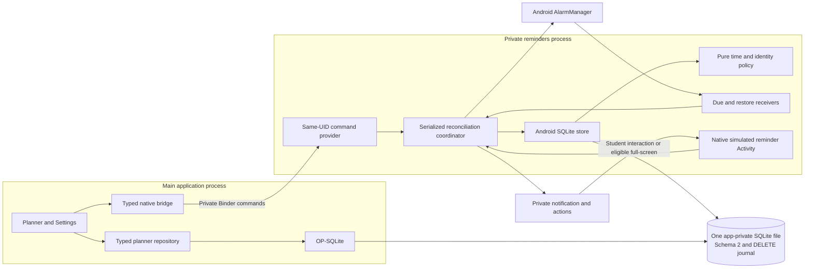

# Phase 03 — native academic reminder delivery

Approved scope is Android alarms, capability/fallback reporting and a simulated
reminder shell. Source under validation is not evidence of physical-phone success.
Final test/build/device statuses and artifact hashes are in the
[Phase 03 report](reports/phase-03-report.md); a missing result is **NOT RUN**.
The detailed decision is [ADR-015](decisions/ADR-015-native-reminder-delivery.md).

## Architecture and ownership

The main process alone runs the JS migration; native code will not open the
primary DB until file/schema/journal checks pass. OP-SQLite and Android system
SQLite never access that file inside the same process. DELETE rollback journal
is explicit in both processes; use ordinary SQLite operations and never raw-copy
or replace a live database. The locking/WAL rationale is documented in ADR-015.
Both sides use bounded synchronous transactions and a 5000 ms busy timeout.

Modules are deliberately narrow:

| Surface | Responsibility |
|---|---|
| `core/native/reminders` and Settings | Typed capability/actions, post-commit reconcile, explicit delivery/FSI choices and recovery text. |
| `ReminderProvider` / native RN package | Private same-UID command transport; no raw SQL or arbitrary filename interface. |
| `ReminderRuntime` | Platform scheduling, prior-identity cancellation, active-ring recovery and overflow maintenance. |
| `ReminderStore` | Existing-schema SQL, authoritative live-source checks, paired transitions, cache/receipts and bounded diagnostics. |
| `ReminderPolicy` / `ReminderIdentityKey` | Canonical UTC/timezone/DST policy and collision-safe lossless identities. |
| `AlarmRegistrationPolicy` | A fresh native process restores OS state; within a completed restoration lifetime, unchanged valid registrations/posted-ring timeouts are reused to avoid resetting nearby deadlines. |
| Receivers / capability adapter | Boot/unlock/time/permission reconciliation and actual current Android availability. |
| Notification / Activity | Private lock-screen preview, user actions, response deadline, accessible text shell. |

No Android service, speech engine, mic permission, network permission, account,
backend, model or business module is needed for this phase.

## Durable states and delivery meaning

```mermaid
stateDiagram-v2
  [*] --> SCHEDULED
  SCHEDULED --> RINGING: due and allowed
  SCHEDULED --> SNOOZED: quiet deferral; generation advances
  SCHEDULED --> MISSED: over 15 minutes late
  SCHEDULED --> CANCELLED: source cancelled or deleted
  SNOOZED --> RINGING: next due and allowed
  SNOOZED --> SNOOZED: quiet deferral; generation advances
  SNOOZED --> MISSED: over grace
  SNOOZED --> CANCELLED: explicit cancel or stale source
  RINGING --> ACKNOWLEDGED: Answer or Acknowledge
  RINGING --> SNOOZED: explicit snooze; generation advances
  RINGING --> MISSED: matching 60-second timeout
  RINGING --> CANCELLED: source cancelled or deleted
```

Job PENDING corresponds to reminder SCHEDULED/SNOOZED. Job RINGING and terminal
outcomes match the reminder in the same transaction. Task TODO/IN_PROGRESS is a
separate state machine: acknowledging an alert never completes its source task.
Terminal occurrences do not replay on metadata changes. Cancellation/snooze/new
occurrence generation makes old Android intents stale.

`delivery_state` reports UNAVAILABLE/PENDING/REGISTERED/FAILED independently of
domain status. REGISTERED describes platform registration, not a received alert.
Exact versus inexact is recorded in the derived registration cache. Permission or
storage failure cannot be presented as delivered. Failed notification posting
retains FAILED/reason when its ring is ended as MISSED, including the failure
count across terminal jobs. A malformed ring with no deadline can only be ended
by MISS with `MALFORMED_RING_STATE`; it cannot be acknowledged or snoozed as if
delivery had occurred, and must not block another valid due job.

Schema 2 additions:

Migration closes old Phase 02 simulated RINGING pairs as MISSED with
`LEGACY_SIMULATION_ENDED`; no real alarm/notification is inferred from that state.

- Job `ringing_deadline` and `notified_at` distinguish an active 60-second window
  from successful posting. The deadline is canonical UTC with milliseconds.
- `native_delivery_settings` has one row: enabled=false and full_screen=false.
- `native_alarm_registrations` holds prior platform identity/run time/precision.
  It has no foreign key so deletion cannot erase information needed to cancel
  old Android effects. Runtime explicitly cleans it after cancellation.
- `native_alarm_events` keeps the latest 200 records of IDs/generation, redacted
  event/reason codes and UTC timestamps. It excludes title/notes/audio/transcript.

Crashes between committed claim and notification are reconciled while a matching
ring is live. Stable URI/tag identity and only-alert-once posting limit duplicate
effects; no exactly-once audible-delivery guarantee is asserted.

## Time, queue limits and permissions

| Condition | Behavior and limit |
|---|---|
| Future callback | Ignore without incrementing attempts. |
| More than 15 minutes late | Mark paired reminder/job MISSED; do not create a fresh ring. |
| Quiet hours | Saved global timezone, inclusive start/exclusive end; reschedule to end and advance generation. Gap boundaries reject; folds begin earlier/end later. |
| New eligible ring | One attempt increment and 60-second response deadline; no source task completion. |
| Snooze | Store validates 1–120 whole minutes; current shell/notification offers 10 minutes. New generation protects against old timeouts. |
| Many future jobs | At most 128 future due registrations per pass; overflow advances through one inexact maintenance alarm. |
| Many overdue jobs | At most 256 due items processed per pass; further work is deferred. |
| Native query memory | Active-job enumeration is currently materialized. The OS queue bounds do not prove bounded SQL memory or low-RAM capacity. |
| Notifications blocked | Cancel incompatible platform effects, expose unavailable/failed state, keep manual records usable. |
| Exact access unavailable | Inexact scheduling with explicit delay warning; never describe it as exact. |
| FSI denied/off/low channel | Notification opens the same reminder screen when the student taps it; the OS controls whether a heads-up banner appears. |
| Force stop | No delivery promise; reopen the app to reconcile. |
| Reboot | Reconcile after credential-protected storage is unlocked; no before-unlock promise. |
| Wall-clock TIME_SET | End existing rings as MISSED and reconcile; a rollback must not extend the response window indefinitely. A timezone-only change preserves current UTC instants/rings. |

POST_NOTIFICATIONS is a separate Android 13+ permission; muted channels and DND
also affect what is visible/audible. Android 14+ full-screen access remains subject
to platform/distribution eligibility and a separate in-app opt-in. Exact-access
revocation can remove platform alarms; foreground resume and permission restore
must reconcile desired jobs. See [notification permission](https://developer.android.com/develop/ui/compose/notifications/notification-permission),
[alarm guidance](https://developer.android.com/develop/background-work/services/alarms)
and [full-screen restrictions](https://developer.android.com/about/versions/14/behavior-changes-14).

The default channel uses normal notification sound/vibration and private preview.
The response window does not imply a continuous phone ringtone. DND, user volume,
channel importance, battery saver and OEM policy are respected and require real
device checks. The app never turns itself into a dialer or bypasses restrictions.

## Validation and outstanding evidence

The authored JVM tests cover time/DST/identity policy. Instrumentation exercises
real Android SQLite on isolated synthetic files, including paired rollback and
concurrent/stale claims. Bridge/UI tests cover typed arguments and recovery.
The [Phase 03 report](reports/phase-03-report.md) records the actual passing
preflight, 30 JVM tests, 23 emulator instrumentation tests and native builds.
Separate real AlarmManager/notification/UI checks have emulator evidence;
synthetic SQLite tests alone do not certify a real alarm or physical phone.

Required physical matrix: API 30; API 31+ exact-access behavior; API 33+ notification
permission; API 34+ FSI allowed/denied; a modest-RAM OEM phone where available.
Measure observed alarm lag and failures with device/build/conditions; do not
substitute enqueue times or emulator timings for received alerts. No old/new
latency, battery or memory benefit is established by this change.

Use [the manual checklist](../qa/PHASE-03-MANUAL.md), including the 15-second
synthetic Settings check, before human acceptance. Remaining Phase 03 tests do
not authorize Phase 04, offline STT/TTS, model loading or online services.
