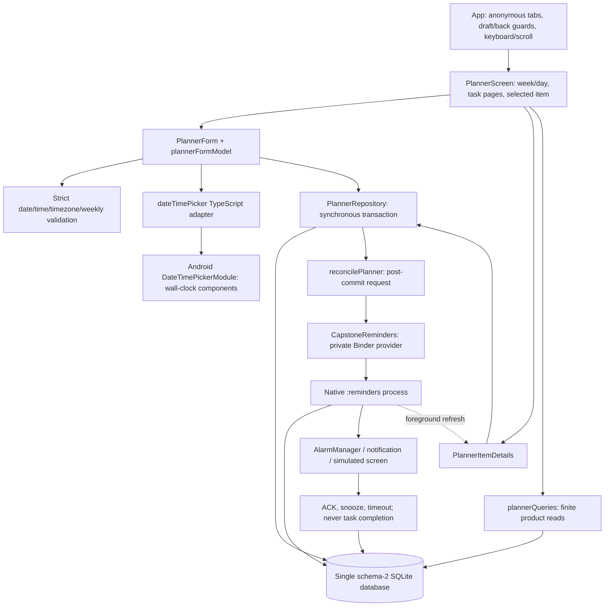

# Phase 04 manual offline planner architecture and behavior

**Scope:** anonymous manual academic tasks/events/calendar connected to existing
SQLite and Android reminder delivery. No voice/AI/cloud dependency is introduced.
Schema remains **2**; there is one primary database and no new runtime package.
Actual automated/emulator/physical statuses and APK hashes belong to
[the Phase 04 report](reports/phase-04-report.md). The detailed human checklist is
[PHASE-04-MANUAL](../qa/PHASE-04-MANUAL.md).

## Student flow

Today and Calendar show a shared week/day agenda and task pages. Use **Add task**
or **Add event**, enter title/notes/timezone and save. Tasks support no due date,
date only or date/time; only explicitly timed items can have an alarm. Events have
start/end, optional reminders and an optional bounded weekly series. A series
edit/delete affects the entire source, not one occurrence.

The selected week has Previous week / Today / Next week and named weekday buttons.
**Go to another date** exposes text and Android date-picker navigation.
**Display options** exposes a 12h/24h choice for this mounted view. This choice is
not saved; typed time entry stays 24-hour HH:mm. Undated tasks are in Tasks, while
dated active items appear in the agenda. Completed tasks are available through
their task filter; cancelled/deleted sources are excluded from ordinary lists.

Item detail shows academic due/start/end separately from original/next alert
times and alert delivery state. **Mark task complete**, **Start task** and **Undo
completion** are explicit source changes. Alert acknowledgement is separate.
**Cancel alert** retains its task/event; **Delete task/event** asks for confirmation
and cancels outstanding reminders. ACKNOWLEDGED/MISSED occurrences are not
replayed by a metadata edit or undoing completion. Reopening a completed task
can rearm an unhandled occurrence that completion had cancelled; a recent past
deadline can alert immediately under the existing grace policy. This does not
restore the old snooze time after completion cancelled it.

## Module and process ownership

The dotted edge means the main app rereads durable state on foreground, not that
native Android calls a React component. `PlannerScreen` propagates its refresh
revision into detail reads, so a snoozed alert's new next time appears after return
without a constant timer. Native delivery may run without React; SQLite process
separation and the private provider remain as described in
[ADR-015](decisions/ADR-015-native-reminder-delivery.md).

| Module | Responsibility / boundary |
|---|---|
| `src/app/App.tsx` | Today/Calendar integration, Settings access, foreground native reconciliation, tab/Back draft protection and keyboard/scroll layout. |
| `features/calendar/PlannerScreen.tsx` | View/date/filter/page/editor state, storage retry, permission warning, post-save navigation and foreground refresh. |
| `features/calendar/plannerDisplay.ts` | Date-based week navigation, local display, bounded clock fallback warning and operation token creation; never authoritative schedule mutation. |
| `features/scheduling/PlannerForm.tsx`, `plannerFormModel.ts` | Editable draft, validation, manual fields/pickers, weekly/fold/past/discard confirmations and synchronous save boundary. |
| `features/scheduling/PlannerItemDetails.tsx` | Latest source/reminder page, optimistic source actions, delete confirmation, separate reminder actions and error/retry states. |
| `core/storage/plannerQueries.ts` | Bound product results using scoped pages/window/cursor semantics; no QA snapshot dependency. |
| `core/native/dateTimePicker.ts`, Android `DateTimePickerModule.kt` | Strict date/time component request/results, one active dialog, cancellation and manual-entry fallback. |
| `core/native/reconcilePlanner.ts` | Request native effects only after committed mutation; retain local success when native delivery fails. |

## Correctness and failure boundaries

1. A form produces a typed validated draft. Domain conversion owns local timezone,
   nonexistent/repeated hour handling and bounded weekly recurrence. Native pickers
   return components only; they do not choose a hidden device-zone instant.
2. Repository mutation commits source and paired reminder/job changes within the
   existing synchronous transaction. Expected versions protect edits/deletes;
   operation receipts preserve existing idempotency semantics. A failed write keeps
   the draft and reports failure, without Saved.
3. Native reconciliation follows commit. Missing permission/service/notification
   access cannot undo a stored task or fabricate delivery. A later detail/query
   error exposes retry separately from the completed mutation.
4. Reminder actions validate generation/occurrence and current ring deadline.
   ACK changes alert outcome; Snooze creates a newer generation/new job run time.
   Neither shifts the academic deadline or event end. The native screen offers ten
   minutes; in-app snooze uses the preference. Expired/stale actions are reported
   as changed/expired only after a successful repository response.
5. Dirty forms are protected when leaving by Cancel, hardware Back or bottom tab.
   Picker/save guards and mounted callbacks avoid duplicate in-flight UI work.
   A failed latest-item read hides stale action controls. Clock/display fallbacks
   warn visibly and never alter persisted timezone/deadlines.

## Query limits and explicit omissions

The UI requests 20 tasks or agenda items per page and ten reminder-history pairs.
The repository validates page size 1–50 and agenda windows 1–42 dates. Agenda
source candidates stream in batches of 50 and keep a finite result selection;
task/history pages use parameterized limits/offsets. Recurring agenda entries
derive from source rules even without reminders; timezone boundaries account for
DST and date-only tasks retain their declared date. See
[ADR-016](decisions/ADR-016-planner-queries.md) for precise ordering,
carry-in, cursor and corrupted-series behavior.

These are JavaScript result bounds, not a guarantee of constant query CPU or total
SQLite/native memory. Candidate rescans, offset skips and historical weekly-source
scans remain measurable costs. The Phase 03 native active-job query is unchanged
and still materializes all active rows before its work/OS limits. No speculative
90-day deletion policy, schema migration or capacity claim is added.

The independent audit corrections, selective pinned reuse and newly fixed code
review findings are recorded in [the audit](audits/phase-04-independent-audit.md),
[reuse selection](audits/phase-04-legacy-selection.md) and
[code review](audits/phase-04-code-review.md).
[ADR-017](decisions/ADR-017-manual-planner-ui.md) records the UI/save decision.
Physical Android 11/ARM64/low-RAM/OEM, lockscreen/audio/vibration, accessibility,
battery and matched legacy/new release-like performance remain human validation
subjects. Speech, model commands, RAG and later-phase implementation are deferred.
