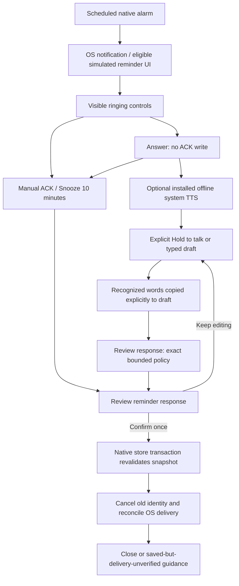

# Phase 08 — native offline reminder response contract

Candidate 0.8.0/code11; package `com.lafina.capstone`; schema 3. This documents
implemented behavior, not physical-device acceptance. See
[ADR-023](decisions/ADR-023-foreground-reminder-response.md), the
[phase report](reports/phase-08-report.md) and
[human checklist](../qa/PHASE-08-MANUAL.md).

The [remaining-case follow-up](reports/phase-08-remaining-emulator-report.md) and
[ADR-024](decisions/ADR-024-reminder-speech-vocabulary.md) add a reminder-only
decoder vocabulary/profile. General dictation stays unhinted. This changes
recognition context; the strict response grammar, editable draft, explicit copy,
exact review/Confirm, original deadline and manual fallbacks remain unchanged.
The English reminder profile uses a fixed local prompt, beam of three and
floor-aware signal-boundary context: magnitude at least
`max(16/32768, capturedPeak * 0.001)`, up to 250ms
before/750ms after the signal, then a 345ms first-signal anchor and one-second
trailing context. Input without an above-threshold sample receives 250ms on each
side. Capture remains limited to 15 seconds; the derived decoder input is at
most 16.345 seconds within the existing cancellation deadline. This is not a
general noise filter; quiet/noisy phone speech and durations other than the
pinned ten-minute sample still need device validation.

## Visible flow

The app's simulated reminder is not a real phone call. OS full-screen behavior
depends on permissions/platform eligibility; notification/manual planner
fallbacks remain. Answer, reading, recognition, copying words and opening a
review do not acknowledge or complete anything. A separate Confirm is required
for activity ACK/snooze. The notification's explicitly selected native
ACK/snooze actions retain their direct action behavior.

## Entry points and ownership

| Component / API | Responsibility | Boundary |
|---|---|---|
| `ReminderActivity.showReminder/showAnswered` | Render title, manual actions and optional offline TTS | Answer is presentation only; original deadline is preserved |
| `AnsweredDictationPanel` | Visible hold/release, recognition, explicit text transfer and Review response | No microphone on Answer, click, permission return or resume; no direct store call |
| `ReminderResponsePolicy.parse/review` | Exact bounded response proposal and disclosure | No generic Chat NLU or side effects; invalid input refuses |
| `ReminderResponseSession.active/prepare/consume` | Snapshot ownership, deadline and one-shot review | Expiry/cancel/edit/pause/replacement invalidates old proposals |
| `ReminderStore.action` | Revalidate source/version/deadline and atomically update paired reminder/job | ACK does not complete task; snooze uses a new generation |
| `ReminderRuntime` | Cancel old native identity and reconcile delivery after commit | OS failure does not undo committed state or justify saying unsaved |

The activity runs natively in `:reminders`; no React Native boot, generic
assistant, cloud call or new model is required for these actions. Existing
offline SpeechInput/SystemSpeech adapters and lease/focus handling are reused.

## Exact response grammar

The UI text input is limited to 2,000 characters. Policy validation also rejects
overlength input and anything outside printable ASCII. It normalizes case and
repeated ordinary spaces, trims outer spaces and permits one final `.`, `!` or
`?`; it does not remove hidden controls, combine commands or infer synonyms.

- `acknowledge`, `acknowledge reminder`, `acknowledge this reminder` propose ACK.
- `snooze` proposes a fixed 10 minutes, matching the native manual control.
- `snooze [for] N minute(s)` proposes 1–120 minutes. N may be an integer without
  leading zero or one/two/five/ten/fifteen/thirty/sixty. Examples: `snooze 1
  minute`, `snooze for five minutes`, `snooze 120 minutes`.

`okay`, `done`, `complete`, `delete all tasks`, vague `later`, contradictory
phrases, unsupported languages and invalid durations are refused. This grammar
is deliberately smaller than Chat's validated scheduling command grammar.
Refusal keeps manual controls available. Review discloses the exact reminder
title, action and duration and states that the task stays open.

## Lifetime and durable transitions

| Stage | Memory/presentation | Durable reminder/job/task outcome |
|---|---|---|
| RINGING | Snapshot + original response window | Existing paired ringing records; task unchanged |
| Answer/TTS/input | Same bounded session; optional voice/capture lease | No write; no ACK and no task completion |
| Pending review | Exact review object, command and presentation ticket | No write |
| Confirm consumed | Submitted once; worker may continue if view hides | Transaction verifies identity, source validity, source version, deadline and legal state |
| ACK applied | Close after reconciliation, or delivery warning | Paired ACKNOWLEDGED delivery; task remains TODO/open |
| Snooze applied | Old identity cancelled; replacement reconciled | Paired SNOOZED/PENDING with future run time and incremented generation; task unchanged |
| Timeout | Session/input/review retired | Existing MISS/timeout path reconciles; no task completion |
| Pause/new intent/destroy | Speech stopped/released; capture and unsaved draft/review retired | Existing durable state survives; resume reloads before a fresh response |

`expectedSourceVersion` and `expectedRingingDeadline` are optional parameters on
`ReminderStore.action`. The foreground review passes its snapshot values, which
are compared inside the existing transaction. Other native callers retain their
existing explicit action/state checks. There is no new database ANSWERED state,
table or migration; schema remains 3. Stored source text is not reinterpreted as
a command.

Answer does not restart the 60-second ring deadline. Both wall time and monotonic
elapsed time bound a live session; the activity preserves its elapsed deadline
across same-identity reloads. Once expired/closed, the session cannot revive.
The visible timeout callback is bounded; no infinite loop or periodic poll is
added. Existing alarm/runtime receivers handle durable reconciliation outside
the activity.

Holding the microphone first stops pending/current TTS. Reading again cancels
capture; review cancels capture/output; late recognition requires the same live
session ID and visible screen. Pause/new intent invalidates presentation tickets
and speech epochs so delayed loads/TTS cannot overwrite a newer reminder view.
An OS permission dialog may pause the activity: on return, the old draft is
discarded and the current record reloads; Answer and a fresh hold may be needed.
Permission success alone never starts recording.

## Failure and recovery behavior

Actual emulator testing initially found a review-dialog `BadTokenException`.
The selected-theme wrapper now uses the Activity as its base, with a single
configuration override before resource/asset access, as required by the
[Android API contract](https://developer.android.com/reference/android/view/ContextThemeWrapper#applyOverrideConfiguration(android.content.res.Configuration)).
The [failing attempt](reports/evidence/phase-08-dialog-crash-initial.log) remains
preserved; the phase report records rebuilt-candidate/dialog rerun outcomes.
This correction itself does not establish a green UI or physical-phone result.

Unavailable offline voice, failed recognition, denied microphone permission or
speech interruption leaves typed draft/manual controls available while the
window remains active. Closing without responding does not ACK. Reopen
Calendar/details when a window expires or an old source/identity changed.

After Confirm, an applied database action is durable even if OS cancellation or
reconciliation fails. The UI reports **saved**, explains that delivery could not
be verified, and points to Calendar and Profile → Reminder delivery. A rejected
stale action says no action was applied. An uncertain store exception instructs
the user to inspect Calendar before retrying. Force-stop and OEM delivery limits
remain explicit; no immediate delivery after force-stop is promised.

## Emulator transport evidence boundary

The synthetic loopback tool has optional `--initialize-input`. Only after an
independently observed visible Recording state and fresh host-input OFF does it
send a separate format-only `AudioPacket` with zero source PCM bytes. The RPC
has a two-second deadline and must finish with gRPC status 0. It then rechecks
host input OFF and the fresh Recording proof before streaming the same pinned
PCM once through the existing blocking stream. It does not start/restart the
app microphone, retry source audio, or change the app deadline, model, parser,
gain or padding. Manual controls and the visible interaction remain required.

Four actual-capture ACK cases passed across two cold boots on the original SDK
emulator 37.1.11 ([first pair](reports/evidence/phase-08-input-loss-initialized-capture-pair.json),
[second pair](reports/evidence/phase-08-input-loss-initialized-capture-pair-2b.json)).
The [two initial failures](reports/evidence/phase-08-input-loss-cold-pair-1.json)
are preserved, and the SDK cause remains unproven. Initialization is an
experimental, unreliable workaround: a later A03 actual-capture recognition
failed despite successful initialization, host-input OFF and captured signal.
The four focused passes do not establish a reliability fix. The completed
47-case campaign has44PASS/3FAIL/1NOT RUN; A03/V03/V04 remain failed.
See the
[emulator protocol](benchmarks/phase-08-emulator-voice-protocol.md) for transport
conditions and the rejected isolated SDK experiment. V05 remains deferred until
suitable reviewed audio is available.

Physical microphone/audibility, 30+ alarm cases, 10+ interactions per voice,
minimum/newer Android, low-memory/OEM behavior, accessibility, PSS/startup and
battery remain HUMAN REQUIRED until actual measured results and signed review
exist. Use the [device protocol](benchmarks/phase-08-device-protocol.md).
Implementation and automated results do not authorize Phase 09+ or certify a
stable offline release.

The completed input-loss follow-up retains a V04 all-OFF/gRPC0 no-signal failure
and V03's masked-error failure. Client logging now preserves the primary redacted
error and distinguishes source-stream entry; no producer or decoder repair is
claimed. See the [current report](reports/phase-08-input-loss-report.md).

<!-- phase08-capture-fix-current -->

## Current capture transport evidence — 2026-10-31

See the [stable-emulator report](reports/phase-08-stable-emulator-report.md) (retained A03/V03 failures coincide with observed emulator audio-path faults; root cause not established; low-load comparison NOT RUN, host admission unmet; aggregate unchanged), the [capture-fix report](reports/phase-08-capture-fix-report.md) and [closed ledger](reports/evidence/phase-08-capture-fix-case-ledger.json): 45 PASS / 2 FAIL / 1 NOT RUN. The current scoped path uses a single source RPC after real visible Recording, source gain500/pad1000/delay0, <=200ms prefill, start-anchored20ms deadlines and minimum5ms post-prefill spacing. Both100ms lateness/lag guards remain; native test coordination12s, production capture15s/ringing60s are unchanged. No new production/decoder/model/schema/permission decision is introduced.

Earlier initializer/blocking/rebased protocol observations above are historical/experimental, not the current comparison protocol. All failed experiments remain. Planned PCM duration, source RPC completion/host-OFF eligibility, generator-yield counters, native comparison metadata and strict review/Confirm are distinct; source success does not prove capture/recognition. Literal ABORT differs from invalid authorization or absent-marker timeout. A pre-controller navigation failure is neither a source abort nor a recognition failure. No ASR accuracy denominator is constructed.

30 host checks,5 real Windows-clock dry runs (no SDK/audio) and3 gate controls passed; the controls are excluded from the10 selected affected trials. SDK cause remains unproven;10 pinned trials do not establish broad reliability, phone accuracy or audibility. Manual/typed fallback and ACK-not-completion remain. V05 owner-deferred; all48 physical rows NOT RUN, human review NOT SIGNED; stable release and Phase09+ unapproved.
