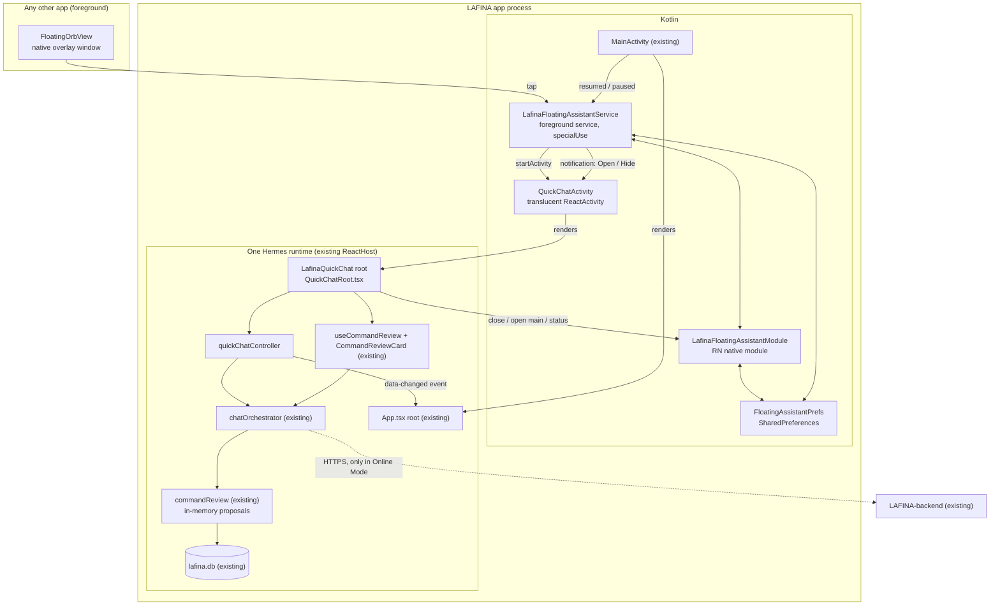
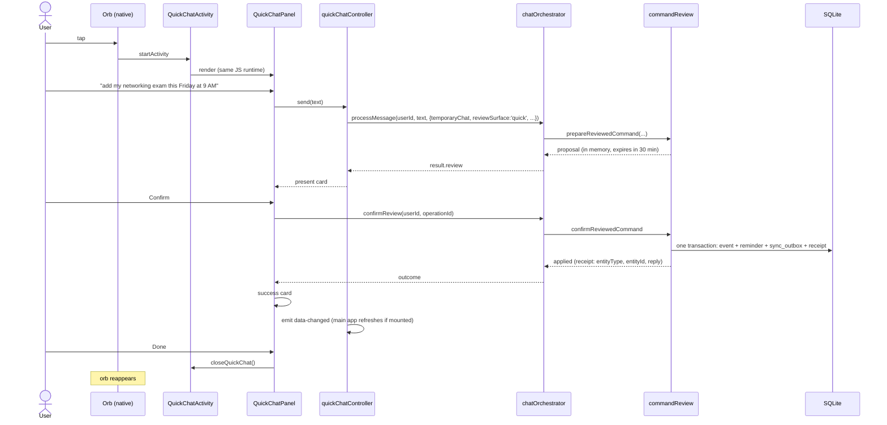

# 04 — Architecture Design

- **Status:** proposed design. Every component in section 2 marked **new** does not exist yet; names are proposals and may be adjusted to match conventions found during implementation.
- Existing symbols cited here were verified on 2026-11-17 (see `01-REPOSITORY-AUDIT.md`).

## 1. Overview



Key property: **Quick Chat is another screen of the same app**, in the same process and the same JavaScript runtime. It calls the same functions the Chat tab calls. The only native novelty is the orb and its service.

## 2. Components

### 2.1 New native components (`android/app/src/main/java/com/lafina/capstone/`)

| Component | Responsibility | Notes |
| --- | --- | --- |
| `LafinaFloatingAssistantService` | Foreground service (`specialUse`). Owns the orb window and the dismiss target. Posts the ongoing notification (Open, Hide). Hides or shows the orb on main-activity visibility, Quick Chat visibility, screen off/on, configuration change. Starts `QuickChatActivity` on tap and detects a blocked launch. | Pattern: `LafinaReminderService.kt`, `LafinaAlarmService.kt`. No wake lock. No timers while idle. |
| `FloatingOrbView` | Draws the orb (programmatic drawing, no XML layout), handles touch, exposes accessibility actions. | Pattern for code-built UI: `AlarmRingingActivity.kt`. |
| `FloatingOrbRules` | Pure functions: tap-or-drag decision, clamping to safe bounds, nearest edge, edge + fraction ⇄ pixels, dismiss-target hit test. | Unit-tested with JUnit like `AlarmSchedule.kt`. |
| `FloatingAssistantPrefs` | Device-local preferences: `enabled` mirror, `ownerId`, orb edge and vertical fraction, orb color, `hiddenUntilAppOpen`, `launchBlockedSeen`. | Needed because the service must work without JS. |
| `QuickChatActivity` | `ReactActivity` with `getMainComponentName() = "LafinaQuickChat"`. Translucent, own task, excluded from recents, not shown on the lock screen. Reports resume/pause to the service. Finishes itself if the main activity is in front. | Same delegate pattern as `MainActivity.kt:54-61`. |
| `LafinaFloatingAssistantModule` | JS bridge named `LafinaFloatingAssistant`. Registered in `CapstoneBuildPackage`. | See 2.3. |

### 2.2 New JS components

| Component (proposed path) | Responsibility |
| --- | --- |
| `src/ui/quickChat/QuickChatRoot.tsx` | Second root. Ensures storage is ready (`initDatabase()`), applies the saved backend (`backendSelection.applySaved()`), resolves `userStore.getCurrentUser()`, wraps `SafeAreaProvider` + `ThemeProvider userId`, renders the panel or a "open LAFINA" state. Marks Quick Chat presence (2.4). |
| `src/ui/quickChat/QuickChatPanel.tsx` | Layout, scrim, insets and keyboard offset, header, states 2–7 of the UX spec. |
| `src/ui/quickChat/QuickChatComposer.tsx` | Slim text input and send/stop. Not derived from `ChatInput`. |
| `src/ui/quickChat/QuickChatSuccessCard.tsx`, `QuickActionChips.tsx` | Completed state and chips. |
| `src/ai/quickChat/quickChatController.ts` | The only caller of the orchestrator for Quick Chat. Holds the in-memory transcript per owner. Applies the fixed options (2.5). Emits the data-changed event. |
| `src/cloud/onlineModeGate.ts` | `resolveOnlineMode(userId)`: setting `chat.onlineMode`, connectivity, `accountLinkService.authorizeOnlineMode`. Same rule the Chat tab applies at `ChatScreen.tsx:885-935`. |
| `src/utils/floatingAssistantNative.ts` | Typed wrapper around `NativeModules.LafinaFloatingAssistant`, safe when the module is absent (tests, iOS). |
| `src/ui/quickChat/quickChatPresence.ts` | Tiny module-level store: is Quick Chat the visible screen; pending "view item" request. Pattern: `src/ui/drafts/chatDraftStore.ts`. |
| `src/ui/components/profile/FloatingAssistantSettings.tsx` | Settings sheet and permission explainer. Pattern: `OfflineVoice.tsx`, `ReminderPermissionModal.tsx`. |

Placement follows the repository's `src/{ui,ai,cloud,utils}` layout. Check `scripts/offline-boundary.cjs` before fixing the location of `onlineModeGate.ts`.

### 2.3 Native module contract (proposed)

| Method | Returns | Purpose |
| --- | --- | --- |
| `getStatus()` | `{supported, overlayGranted, notificationsGranted, enabled, running, hiddenUntilAppOpen, launchBlockedSeen, lowRamDevice}` | Drives the settings status line |
| `openOverlaySettings()` | `void` | `ACTION_MANAGE_OVERLAY_PERMISSION` |
| `openAppDetailsSettings()` | `void` | Help for OEM-specific permissions |
| `setEnabled(enabled, ownerId)` | status | Writes the mirror, starts or stops the service. Starting is only attempted while an activity of the app is visible. |
| `setOrbAppearance({color})` | `void` | Theme color for the orb |
| `resetOrbPosition()` | `void` | |
| `closeQuickChat()` | `void` | Finishes `QuickChatActivity` |
| `openMainApp()` | `void` | Brings `MainActivity` to the front and finishes Quick Chat |

No event stream is required for the MVP: JS re-reads `getStatus()` when the settings sheet is focused and when the app becomes active.

### 2.4 Changes to existing files (complete list)

| File | Change | Why |
| --- | --- | --- |
| `src/ai/nlu/commandReview.ts` | `ReviewSurface = 'chat' \| 'voice' \| 'quick'` (line 75) and keep `'quick'` in the normalisation at line 2819 | Separate card slot for Quick Chat |
| `index.js` | `AppRegistry.registerComponent('LafinaQuickChat', () => QuickChatRoot)` | Second root |
| `App.tsx` | (a) listen for the data-changed event and bump `refreshTrigger`; (b) in the `AppState` handler (≈ lines 477-507) do not start the reminder poller or consume native calls while Quick Chat is the visible screen; (c) consume a pending "view item" request into the existing `callNavigation` mechanism; (d) in the `userId` effect (≈ 237-259) call the floating-assistant "apply for user" helper | Refresh, reminder safety, navigation, account switching |
| `src/ui/screens/ProfileScreen.tsx` | One `SettingItem` row and one sheet mount | Settings entry |
| `CapstoneBuildPackage.kt` | Add the module to `createNativeModules` | Registration |
| `MainActivity.kt` | In `onResume`/`onPause`, tell the service whether the main screen is visible; on resume, start the service if enabled and permitted | Orb hide rule; start from a visible state |
| `AndroidManifest.xml` | Two permissions, the service with its `specialUse` property, the activity | Declarations |
| `res/values/styles.xml` (+ `values-night` if needed) | `QuickChatTheme`: translucent, no title, transparent window background | Panel over other apps |
| `scripts/check-architecture.mjs` | Add the two permissions to `allowedPermissions` with a dated owner-approval comment | Build guard |
| `jest.setup.js` | Stub `NativeModules.LafinaFloatingAssistant` | Tests |

Nothing else in the assistant, storage, sync or scheduler code changes.

### 2.5 Fixed options Quick Chat passes to the pipeline

`chatOrchestrator.processMessage(userId, text, options)` with:

| Option | Value | Reason |
| --- | --- | --- |
| `temporaryChat` | `true` | No rows in chat history; no schema change (D-05) |
| `temporaryHistory` | The controller's in-memory messages (the orchestrator uses the last 10, `chatOrchestrator.ts:1359`) | Follow-up questions keep context |
| `reviewSurface` | `'quick'` | Own card slot (D-06) |
| `onlineMode` | Result of `resolveOnlineMode(userId)` | Same gate as the Chat tab (D-08) |
| `onReplyText` | Panel's streaming callback | Streaming replies |
| `isCurrent` | False after Stop, close, or user change | Drops stale results |
| `useHandbook`, `ustpRagOnly`, `speakReply`, `ringingCall` | Not set | Out of scope for the MVP |

Confirm and cancel go through `useCommandReview(userId, 'quick')`, which calls `chatOrchestrator.confirmReview` / `cancelReview`. Pass the temporary-chat flag where the hook accepts options (`useCommandReview.ts:34-43`) so no outcome row is written to chat history.

## 3. Flows

### 3.1 Enable

```mermaid
sequenceDiagram
  actor U as User
  participant S as FloatingAssistantSettings (JS)
  participant M as LafinaFloatingAssistantModule
  participant OS as Android Settings
  participant Svc as Service
  U->>S: toggle on
  S->>M: getStatus()
  alt overlay not granted
    S->>U: explainer
    U->>S: Continue
    S->>M: openOverlaySettings()
    M->>OS: ACTION_MANAGE_OVERLAY_PERMISSION
    U->>OS: grant, return
    S->>M: getStatus() on resume (and once more after a short delay)
  end
  alt granted
    S->>S: localSettingsStore.set(userId,'floatingAssistant.enabled','true')
    S->>M: setEnabled(true, userId), setOrbAppearance(color)
    M->>Svc: startForegroundService (app is visible)
    Svc->>Svc: startForeground(notification); orb stays hidden while MainActivity is visible
  else not granted
    S->>U: toggle off + one line of explanation
  end
```

### 3.2 Create a schedule



### 3.3 Orb tap that the OEM blocks

1. The service calls `startActivity` and starts a short one-shot check (about 1.5 s).
2. `QuickChatActivity.onResume` reports in to the service.
3. If it has not reported in time: the service shows a small label next to the orb for 4 s, sets `launchBlockedSeen`, and takes no further action.
4. The notification action remains available. Settings show device help.

### 3.4 View in LAFINA

1. The panel writes a pending request (`ownerId`, target screen, `entityId`, `entityKind` or `date`) to `quickChatPresence`, built from the receipt's `entityType` / `entityId` (`OperationReceipt`, `src/storage/assistantOperationStore.ts:6-16`).
2. It calls `openMainApp()`. Native brings `MainActivity` forward and finishes Quick Chat.
3. `App.tsx` consumes the request (on mount or when it becomes active), checks the owner matches the current user, and feeds the existing `callNavigation` request path (`App.tsx:122-130, 603-645`; type `CallNavigationTarget` in `src/ui/navigation/callNavigation.ts`).
4. If the entity type cannot be mapped, navigate to the calendar date; if nothing can be mapped, just open the app.

## 4. State synchronisation

| Concern | Design |
| --- | --- |
| Source of truth | SQLite, written only by `confirmReviewedCommand` and the existing low-risk path |
| Main app shows stale lists after a Quick Chat change | The controller emits one in-runtime event after every applied confirm and undo. `App.tsx` bumps `refreshTrigger`, the mechanism every screen already uses. If the main app is not mounted, its screens read fresh data when they mount. |
| Duplicate submission | Composer disabled while a request runs; Confirm disabled while saving (`busyRef`); repeated confirm of the same `operationId` returns the first receipt |
| Same request sent twice by the user | Each produces a new proposal; the first is replaced while unconfirmed. If both are confirmed, two items are created. There is no content-level duplicate check in the app today (R-17). |
| Card from Quick Chat vs Chat tab vs Voice | Separate slots per surface; none can replace another |
| Reminder alarms | Scheduled by the existing `afterCommit` step, unchanged |
| Cloud sync | Outbox rows are written in the confirm transaction. They are pushed when the sync scheduler runs: immediately if the main app root is mounted and the host is active, otherwise the next time LAFINA is opened (R-11). |
| Process death | In-memory transcript and any unconfirmed card are lost. Confirmed items are safe. On next open the panel starts empty. |
| Main app cold-starts after a Quick Chat card was prepared | `App.tsx` ends the review session when it first sets the user, so the card is refused with `session_ended`. The panel shows "no longer current, ask again" (R-06). |
| Account switch or sign-out | The helper called from the `userId` effect stops the service when the new user has not enabled the feature; the controller clears the transcript; `isCurrent` turns false. Quick Chat always resolves the current user itself on open and never trusts a stored owner. |
| Time and time zone | Unchanged: the pipeline uses device-local time at the moment of the request and stores zone metadata on confirm (ADR-021) |

## 5. Lifecycle

### 5.1 Service

| Event | Behaviour |
| --- | --- |
| Start | Only when: setting on, overlay granted, not Go/low-RAM blocked, and an app activity is visible. `startForeground` immediately with type `specialUse`. |
| `MainActivity` resumed | Hide orb. If the orb was "hidden until app open", clear that flag. |
| `MainActivity` paused | Show orb (if Quick Chat is not in front and the screen is on) |
| `QuickChatActivity` resumed / paused | Hide / show orb |
| Screen off / user present | Hide / show orb |
| Configuration change | Re-apply stored edge + fraction to the new bounds |
| Hide (drag target or notification) | Set `hiddenUntilAppOpen`, remove the window, `stopForeground`, `stopSelf` |
| Overlay permission missing at show time | Remove the window if any, stop, leave `enabled` as is; status reads "Permission needed" |
| Task removed (swipe from recents) | Keep running |
| Killed by the system | `START_STICKY`. On restart with a null intent: re-check everything, add the orb first, then `startForeground` in `try/catch`. On any failure stop quietly. |
| Force-stop, FGS Task Manager stop, app update | Gone until the user opens LAFINA again. Accepted. |
| Reboot | Not restored in the MVP (Q-03) |

### 5.2 Quick Chat activity and the shared React host

| Rule | Reason |
| --- | --- |
| The orb is hidden while `MainActivity` is resumed, and `QuickChatActivity` finishes itself in `onCreate`/`onResume` if the main activity is resumed | Keeps the two React activities from being resumed together (R-02) |
| `MainActivity.onResume` asks any existing `QuickChatActivity` to finish **before** its own React resume where possible; the exact ordering is settled in FLOAT-00 | Same |
| A guarded activity delegate (skips host pause when the activity is not the host's current one) or the React Native feature flag is added only if FLOAT-00 shows the assertion can still fire | Avoids speculative workarounds |
| Do not finish on `onStop` | Returning to the orb and tapping again should restore the draft and card |
| `launchMode="singleTask"`, own `taskAffinity`, `excludeFromRecents="true"`, `exported="false"`, no `showWhenLocked` | One instance; not in recents; not on the lock screen |
| `configChanges` handled like `MainActivity` | No React reload on rotation; Android 17 IME rule |
| No `screenOrientation` | Translucent activities must not request orientation; large-screen rules ignore it anyway |

### 5.3 What runs when

| Situation | JS running? | Notes |
| --- | --- | --- |
| Orb idle over another app | No JS work is scheduled by this feature. The runtime may exist if the app was opened earlier. | Zero timers in the service |
| Panel open | Yes, host resumed, timers run | Normal app behaviour |
| Panel closed mid-request | The request's native networking continues; timer-based steps pause until the next resume | Result is shown on reopen if still current |
| Process cold, user taps the notification | Activity start creates the React host and loads the bundle | Slowest path; see performance targets |

## 6. Security and privacy

| Topic | Design |
| --- | --- |
| Reading other apps | None. No Accessibility Service, no `MediaProjection`, no usage stats, no clipboard reading. |
| Microphone | MVP: not used. v1.1: only while the mic button is held, inside the visible activity. |
| Lock screen | Orb hidden; `QuickChatActivity` is not `showWhenLocked`. The notification text is generic ("Floating LAFINA is on") and carries no user content. |
| Credentials | Unchanged. Tokens stay in the existing keystore-backed session code; no API keys in the app. |
| Exported surface | The new activity and service are `exported="false"`. Notification `PendingIntent`s are immutable and explicit. |
| Deep links | "View in LAFINA" passes through an in-memory JS store with an owner check, not through intent extras from outside |
| Overlay abuse | The orb window is exactly orb-sized and opaque to touches; there is no full-screen overlay. The panel is an ordinary activity. |
| Sensitive screens | Apps that hide overlays hide the orb; nothing is done to resist that |
| Screenshots | Not captured, not blocked. `FLAG_SECURE` is not set on the panel in the MVP. |
| AI actions | Unchanged rules: tools validated, deletes never prepared from model text, every write needs Confirm |
| Logging | Follow existing practice; do not log message text from the native side |
| Data safety form | No new data type collected or shared |

## 7. Performance and battery design

All numbers are **proposed targets, not measurements**.

| Area | Target | How it is achieved | How it is measured |
| --- | --- | --- | --- |
| Idle CPU | No periodic work from this feature | No timers, no animation loop, no wake lock; the idle fade is a single delayed message | `adb shell top`, Perfetto, FLOAT-07 |
| Battery | Under 1% per 24 h attributable with the orb idle | As above | `adb shell dumpsys batterystats` over at least 8 h idle |
| Orb drag | Tracks the finger at display rate on the reference device | One `updateViewLayout` per move event; no allocation in the touch path | Visual + GPU profiling |
| Orb appears after leaving LAFINA | ≤ 300 ms | Window is created once and shown or hidden | Screen recording |
| Tap to panel, warm runtime | ≤ 500 ms median, ≤ 1 s p95 | Shared runtime; small component tree | Screen recording frame count |
| Tap to panel, cold process | ≤ 2.5 s | Optional native placeholder sheet while the bundle loads (FLOAT-07) | Same |
| Offline request to card | ≤ 400 ms on the fast path | Existing pipeline | Timestamps in a debug build |
| Added native memory | ≤ 5 MB PSS for service + orb | Programmatic drawing, one small bitmap or vector | `adb shell dumpsys meminfo` before and after |
| Whole-process memory | Measure; no target set yet | The service keeps the process, including the React runtime and any loaded models, in memory (R-07) | `dumpsys meminfo` after 1 h idle |

Explicit non-goals: no preloading of the React runtime by the service; no polling; no frequent wake-ups; no background AI work; the orb never triggers sync by itself.

If R-07 measurements are poor, the fallback is to move only the service and orb to a small separate process so the main process can be reclaimed. That is deliberately not in the MVP because it adds cross-process state.

## 8. Why this architecture

| Question | Answer |
| --- | --- |
| Why appropriate | Maximum reuse of proven code (pipeline, review card, theme), minimum new native surface, and it respects every platform rule found in `02` |
| Alternatives evaluated | Native-only panel, Compose, React surface in the overlay, Bubble API, entry points without an orb (`02` §4) |
| Trade-offs | Underlying app pauses while the panel is open; OEM launch restrictions; process memory |
| Integration | Section 2.4 lists every touched file; the pipeline is called through one controller with fixed options |
| What could make it fail | R-02, R-03, R-04, R-07 in `07-RISKS-AND-DECISIONS.md`; FLOAT-00 exists to find out early |
