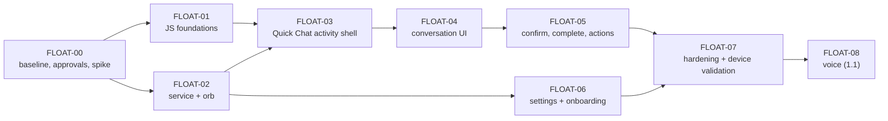

# 05 — Implementation Roadmap

- **Status:** plan only. No phase has started.
- Phase ids use the prefix `FLOAT-` so they do not collide with the repository's existing phase numbers.
- New file names are proposals from `04-ARCHITECTURE-DESIGN.md`. Existing files and symbols were verified on 2026-11-17; line numbers may drift.

## 1. Release scope

| Release | Contents | Phases |
| --- | --- | --- |
| **MVP (1.0)** | Opt-in orb with drag, edge snap, hide target, idle fade; ongoing notification with Open and Hide; Quick Chat panel (text only); offline and online requests through the existing pipeline; confirmation card with edit; success card with View in LAFINA and Done; quick-action chips; settings row, permission explainer, status and help; error and offline states | FLOAT-00 to FLOAT-07 |
| **1.1** | Hold-to-speak voice input; app shortcut; optional restore after reboot (owner decision); auto-fade in full screen; edge-tuck idle state; "reply ready" dot on the orb | FLOAT-08 and follow-ups |
| **Future** | Quick Settings tile; home-screen widget; Share-to-LAFINA (explicit share only); persistent Quick Chat history; separate orb process if memory requires it; spoken replies | Not planned in detail |
| **Out of scope** | Reading other apps' content, Accessibility Service, screen capture, wake word, always-on microphone, embedding Call LAFINA in the overlay, showing on the lock screen | Never |

## 2. Rules for every phase

1. One phase at a time. Stop after each phase and wait for the owner's explicit approval, as `AGENTS.md` requires.
2. Read the files listed under "Relevant files" before editing them.
3. Write a phase report at `docs/reports/float-NN-report.md` from `templates/PHASE-REPORT.md`, and give the owner a short manual-check list in chat.
4. Never report device behaviour (overlay, service, launch, microphone) as working on the strength of Jest or JUnit alone. Use `AWAITING DEVICE VALIDATION`.
5. No new npm or Gradle dependency. If one seems necessary, stop and ask.
6. Do not modify `LAFINA` or `LAFINA-backend`. Do not commit, push or switch branches unless the owner says so.

### Standard validation block (V-STD)

Run from the repository root unless noted. These are the project's real commands (`package.json` scripts; Gradle tasks taken from earlier phase reports).

```
npm run typecheck
npm run lint
npm test
npm run check:architecture
npm run preflight                      # the four above in one command

cd android
.\gradlew.bat :app:compileDebugKotlin :app:testDebugUnitTest -PreactNativeArchitectures=x86_64
.\gradlew.bat :app:assembleDebug
cd ..
```

Run a single Jest file with `npx jest --runInBand <path>`. Install and launch a debug build with `npm run android` (application id `com.lafina.capstone.debug`). The project also has a `dataQa` build type (`testBuildType 'dataQa'`); use `:app:testDataQaUnitTest` if the debug variant's unit-test task is not the one CI or earlier reports relied on.

## 3. Dependency order



---

## FLOAT-00 — Baseline, approvals and feasibility spike

**Objective.** Confirm the starting state, obtain the approvals the plan depends on, and prove the three riskiest assumptions on a device before feature work.

**Prerequisites.** None.

**Relevant files.** `AGENTS.md`; this task pack; `android/app/src/main/AndroidManifest.xml`; `MainApplication.kt`; `MainActivity.kt`; `index.js`; `App.tsx:237-259, 477-519`; `scripts/check-architecture.mjs:170-198`; `node_modules/react-native/ReactAndroid/src/main/java/com/facebook/react/runtime/ReactHostImpl.kt`.

**New or modified components.** None kept. Spike code lives on a throwaway branch or worktree and is discarded.

**Detailed tasks.**
1. Record `git status`, branch and HEAD. The pack was written against `feature/uniguide-inspired-ui-overhaul` at `1757a0a` with about 135 uncommitted changes. Ask the owner which branch to build on (Q-07).
2. Run V-STD on the untouched tree and record the results as the baseline. Pre-existing failures are reported, not fixed.
3. Obtain owner answers to Q-00 (feature authorised; `AGENTS.md` notice), Q-01 (two permissions and the allow-list change), and note Q-02 to Q-08.
4. Spike A, second React activity: register a trivial second component, add a translucent second `ReactActivity`, open it while `MainActivity` is stopped, and while the process is cold. Check: it renders, timers run, `BackHandler` closes it under predictive back, keyboard insets arrive, closing it leaves `MainActivity` healthy.
5. Spike B, lifecycle: open and close in every order; run `MainActivity` and the second activity in split-screen; watch for the `onHostPause` assertion. Decide the guard needed (none, ordering rule, guarded delegate, or the feature flag).
6. Spike C, service and launch: a `specialUse` foreground service adds a small overlay view; tapping it starts the second activity while another app is in front. Test on an emulator or Pixel and on every OEM device the owner can provide (Q-08).
7. Spike D, reminders: with the second activity in front and the main root mounted, create a reminder due in two minutes and observe which engine delivers it and where it appears.
8. Write `docs/decisions/ADR-036-floating-assistant.md` from `templates/ADR.md` (architecture, permissions, FGS type), status "proposed" until the owner accepts.

**Integration dependencies.** None.

**Acceptance criteria.** Baseline recorded; Q-00 and Q-01 answered in writing; each spike has a written result with device identifiers; the lifecycle guard is chosen; no spike code remains in the working branch.

**Validation commands.** V-STD (baseline). `adb shell dumpsys activity activities`, `adb logcat` during spikes.

**Failure conditions.** Owner declines Q-00 or Q-01 → stop, `STATUS: BLOCKED`. Spike A or B cannot be made stable → stop and report; the fallback (a separate React host for Quick Chat) breaks the shared-proposal design and needs a new plan. Spike C blocked on every available device including a Pixel/emulator → stop and report.

**Completion checklist.**
- [ ] Baseline results recorded
- [ ] Q-00, Q-01 approved; other answers noted
- [ ] Spikes A–D results written, with devices
- [ ] ADR-036 drafted
- [ ] Spike code removed
- [ ] `docs/reports/float-00-report.md` written

---

## FLOAT-01 — JS foundations

**Objective.** Everything Quick Chat needs from the JS side that can be built and tested without native code.

**Prerequisites.** FLOAT-00 approved.

**Relevant files.** `src/ai/nlu/commandReview.ts:75, 2766-2890, 4361`; `src/ai/chatOrchestrator.ts:108-176, 621-660, 1782-1881`; `src/ui/hooks/useCommandReview.ts`; `src/ui/screens/ChatScreen.tsx:885-935, 1057-1100, 1185-1310`; `src/cloud/accountLinkService.ts:725-733`; `src/storage/localSettingsStore.ts`; `src/ui/drafts/chatDraftStore.ts`; `scripts/offline-boundary.cjs`; `__tests__/ai/agentAuditFixes.test.ts`; `__tests__/ui/agyPort04ReviewUi.test.tsx`.

**New or modified components.** Modified: `commandReview.ts` (surface type and normalisation only). New: `src/ai/quickChat/quickChatController.ts`, `src/cloud/onlineModeGate.ts`, `src/ui/quickChat/quickChatPresence.ts`, `src/utils/floatingAssistantNative.ts`; tests.

**Detailed tasks.**
1. Add `'quick'` to `ReviewSurface` and keep it through the normalisation in `prepareReviewedCommand`. Search for every other place the surface is compared or defaulted and confirm behaviour.
2. `onlineModeGate.resolveOnlineMode(userId)`: returns on/off plus a reason (`setting_off`, `offline`, `auth_required`, …), using the same three checks the Chat tab uses. Do not change `ChatScreen`.
3. `quickChatController`: `send(userId, text, callbacks)`, `stop()`, `getTranscript(userId)`, `clear(userId)`; in-memory transcript capped at 20 messages; passes the fixed options of `04` §2.5; exposes the last result's `review`, `undo` and reply; emits a data-changed event (`DeviceEventEmitter`, name `LAFINA_QUICK_CHAT_DATA_CHANGED`) after an applied confirm or undo; clears on owner change and after 30 minutes without use.
4. `quickChatPresence`: `setOpen(bool)`, `isOpen()`, `requestNavigation(target)`, `consumeNavigation(ownerId)`, `subscribe`.
5. `floatingAssistantNative`: typed wrapper; every method resolves to a safe default when `NativeModules.LafinaFloatingAssistant` is missing.
6. Tests (see `06-TEST-PLAN.md` J-01 to J-08).

**Integration dependencies.** None on native code.

**Acceptance criteria.** A `'quick'` proposal and a `'chat'` proposal for the same owner coexist and neither replaces the other; confirming each works; the controller writes no `chat_messages` rows; the example sentence yields a "Create event" proposal through the controller; Online Mode resolution matches the Chat tab for guest, offline, signed-in cases; existing tests still pass.

**Validation commands.** `npx jest --runInBand __tests__/ai/quickChatController.test.ts __tests__/ai/quickReviewSurface.test.ts __tests__/cloud/onlineModeGate.test.ts`, then `npm run preflight`.

**Failure conditions.** Any existing review, chat or voice test fails because of the surface change; the architecture check flags a new import cycle or offline-boundary violation.

**Completion checklist.**
- [ ] Surface change minimal and covered
- [ ] Controller, gate, presence store, native wrapper with tests
- [ ] `npm run preflight` green (or only baseline failures)
- [ ] Report written

---

## FLOAT-02 — Native service, orb and module

**Objective.** A user-enabled orb that appears over other apps, can be moved and hidden, with a truthful notification. Tapping it does nothing yet except log.

**Prerequisites.** FLOAT-00 approved (Q-01 in particular).

**Relevant files.** `AndroidManifest.xml`; `LafinaReminderService.kt`; `LafinaAlarmService.kt`; `AlarmRingingActivity.kt`; `LafinaReminderModule.kt:239-275`; `CapstoneBuildPackage.kt`; `MainActivity.kt`; `AlarmSchedule.kt` and `AlarmScheduleTest.kt`; `res/values/colors.xml`, `res/drawable/`; `scripts/check-architecture.mjs:170-198`; `jest.setup.js`.

**New or modified components.** New: `LafinaFloatingAssistantService.kt`, `FloatingOrbView.kt`, `FloatingOrbRules.kt`, `FloatingAssistantPrefs.kt`, `LafinaFloatingAssistantModule.kt`, `FloatingOrbRulesTest.kt`, an orb glyph drawable if the owner supplies one. Modified: manifest, `CapstoneBuildPackage.kt`, `MainActivity.kt`, `check-architecture.mjs`, `jest.setup.js`. A functional but unpolished toggle in the settings sheet (finished in FLOAT-06).

**Detailed tasks.**
1. Manifest: `SYSTEM_ALERT_WINDOW`, `FOREGROUND_SERVICE_SPECIAL_USE`; the service with `android:foregroundServiceType="specialUse"`, `exported="false"` and the `PROPERTY_SPECIAL_USE_FGS_SUBTYPE` property (plain description such as "User-enabled floating button that opens LAFINA Quick Chat").
2. Extend `allowedPermissions` in `check-architecture.mjs` with a comment naming the owner approval and date.
3. `FloatingOrbRules` first, with unit tests: tap vs drag, clamp, nearest edge, fraction mapping, dismiss hit test, rotation remap.
4. `FloatingOrbView` and window parameters per `03` §3 and `02` §2.2: `TYPE_APPLICATION_OVERLAY`, `FLAG_NOT_FOCUSABLE`, wrap-content size, no pass-through window. Idle fade, press and drag states, snap animation honouring the system animator setting, dismiss target window shown only during a drag, accessibility label and custom actions.
5. Service: notification channel (low importance), ongoing notification with Open (placeholder until FLOAT-03) and Hide; `startForeground` with the `specialUse` type; visibility rules of `04` §5.1; screen on/off receiver registered in code; configuration changes; `START_STICKY` with the guarded restart path; `canDrawOverlays` check before every `addView`; all window calls wrapped against `BadTokenException` and `SecurityException`.
6. `MainActivity`: report resume and pause; on resume start the service when enabled, permitted and not running.
7. Module methods of `04` §2.3 except `closeQuickChat`/`openMainApp` (FLOAT-03); low-RAM detection via `ActivityManager.isLowRamDevice()`.
8. Minimal settings toggle to drive `setEnabled`.

**Integration dependencies.** `floatingAssistantNative` wrapper from FLOAT-01 (if FLOAT-01 is not done yet, call the module directly and reconcile later).

**Acceptance criteria (device).** With permission granted and the toggle on: leaving LAFINA shows the orb within about 300 ms; it drags smoothly, snaps, remembers its place across rotation and restart of the service; it is hidden inside LAFINA and when the screen is off; dropping it on the target or pressing Hide removes orb and notification; reopening LAFINA brings it back; revoking the permission in system settings removes it without a crash; the app underneath receives all touches outside the orb, and keeps keyboard focus.

**Validation commands.** V-STD. `adb shell appops set com.lafina.capstone.debug SYSTEM_ALERT_WINDOW allow` / `deny`; `adb shell dumpsys activity services com.lafina.capstone.debug`; `adb shell am compat enable FGS_SAW_RESTRICTIONS com.lafina.capstone.debug`; `adb logcat`.

**Failure conditions.** `ForegroundServiceStartNotAllowedException` or `MissingForegroundServiceTypeException` in the normal enable path; touches blocked in the app below; any crash on permission revoke; the architecture check failing for a reason other than the approved permissions.

**Completion checklist.**
- [ ] JUnit tests for `FloatingOrbRules` pass
- [ ] Manifest and allow-list updated together
- [ ] Device checks done and recorded with device ids, or status `AWAITING DEVICE VALIDATION`
- [ ] No timers or wake locks while idle (reviewed in code)
- [ ] Report written

---

## FLOAT-03 — Quick Chat activity shell

**Objective.** Tapping the orb or the notification opens a themed, empty Quick Chat panel over the current app and closes cleanly, with the lifecycle and reminder guards in place.

**Prerequisites.** FLOAT-01, FLOAT-02.

**Relevant files.** `MainActivity.kt`; `MainApplication.kt`; `index.js`; `App.tsx:192-259, 300-330, 371-430, 477-519, 603-645, 996-1009`; `src/scheduler/reminderPoller.ts`; `src/scheduler/deliveryReconciler.ts`; `src/ui/contexts/ThemeContext.tsx`; `src/storage/dbInit.ts:695`; `src/cloud/backendSelection.ts`; `src/ui/screens/ChatScreen.tsx:452, 625-627, 769-781`; `res/values/styles.xml`.

**New or modified components.** New: `QuickChatActivity.kt`, `QuickChatTheme` style, `src/ui/quickChat/QuickChatRoot.tsx`, `QuickChatPanel.tsx` (shell). Modified: manifest (activity), `index.js`, service (launch + blocked-launch detection + notification Open), module (`closeQuickChat`, `openMainApp`), `App.tsx` (items b, c, d of `04` §2.4 and the data-changed listener).

**Detailed tasks.**
1. Activity declaration per `04` §5.2. Apply the lifecycle guard chosen in FLOAT-00.
2. Service: orb tap and notification Open start the activity; one-shot check for a blocked launch; hint label; `launchBlockedSeen`.
3. `QuickChatRoot`: storage readiness, backend selection, current user, providers, presence flag on mount/unmount and on `AppState`; states for "no user" and "storage problem".
4. `QuickChatPanel` shell: scrim, sheet, header (title, status chip, Open LAFINA, Close), insets and keyboard offset for an edge-to-edge window, back handling (keyboard, then close), open animation with reduced-motion variant.
5. `App.tsx`: gate the reminder poller start and native-call consumption on "Quick Chat is not the visible screen" inside the existing `AppState` handler; leave the sync scheduler as is. Read `reminderPoller.ts` and `deliveryReconciler.ts` first and keep the one-engine-per-generation rule intact.
6. `App.tsx`: data-changed listener; pending navigation consumption with owner check; apply-for-user call in the `userId` effect.
7. Send the theme primary color to the orb when the root mounts and when the theme changes.

**Integration dependencies.** Presence store, native wrapper (FLOAT-01); service (FLOAT-02).

**Acceptance criteria.** From another app: tap → panel appears over the dimmed app, keyboard opens, Back closes keyboard then panel, the previous app is exactly where it was. Works when the LAFINA process was cold (via notification). Light, dark, classic and modern themes render correctly. Rotation keeps the panel. Opening LAFINA while the panel exists does not crash and leaves one visible React screen. A reminder that comes due while the panel is open is delivered the same way as when LAFINA is in the background. All existing tests pass.

**Validation commands.** V-STD; `npx jest --runInBand __tests__/ui/quickChatRoot.test.tsx __tests__/scheduler`; device runs with `adb logcat` filtered on `ReactHost`, `ActivityTaskManager`.

**Failure conditions.** The React host assertion or a red screen in any open/close order; reminder delivered twice or not at all; `MainActivity` state lost after closing the panel; the panel resizing or covering the keyboard incorrectly on Android 15+.

**Completion checklist.**
- [ ] Guard from FLOAT-00 implemented and tested in split-screen
- [ ] Reminder-delivery check done on a device
- [ ] Blocked-launch hint verified by simulating a block (for example denying the permission mid-run or on an OEM device)
- [ ] Report written

---

## FLOAT-04 — Conversation UI

**Objective.** The user can type a request, see honest progress, and read LAFINA's reply inside the panel, online or offline.

**Prerequisites.** FLOAT-03.

**Relevant files.** `src/ui/components/chat/ChatMessageItem.tsx`, `ChatReplyText.tsx`, `TypingBubble.tsx`; `ChatScreen.tsx:1185-1310`; `src/ai/chatOrchestrator.ts:334, 1601-1648`; `__tests__/ui/chatOfflineResponseDesign.test.tsx`.

**New or modified components.** New: `QuickChatComposer.tsx`, transcript view inside the panel, status banner; tests.

**Detailed tasks.**
1. Composer: multiline to 4 lines, auto-focus, Send disabled when empty or busy, Send becomes Stop while busy. Take the maximum length from the existing chat input if it defines one.
2. Transcript from the controller, rendered with the existing reply components (pass only the props they need; no attachments, no memory controls).
3. Processing state per `03` §6: immediate echo, typing indicator, "Still working…" after 8 s, streaming through `onReplyText`.
4. Errors and offline per `03` §9 using the pipeline's own messages; restore the typed text on a thrown error, as `ChatScreen` does.
5. Status chip driven by `resolveOnlineMode`; re-evaluate on connectivity change.

**Integration dependencies.** Controller and gate (FLOAT-01).

**Acceptance criteria.** Offline: "what is on my schedule tomorrow" answers from local data. Online with a signed-in user: a general question streams an answer. Guest with Online Mode off: local reply. Airplane mode mid-request: a clear message and the text restored. No `chat_messages` rows are created by any of this. Double-tapping Send sends once.

**Validation commands.** `npx jest --runInBand __tests__/ui/quickChatPanel.test.tsx`; `npm run preflight`; device smoke test.

**Failure conditions.** Quick Chat messages appearing in the Chat tab's history; a request left spinning forever; duplicate sends.

**Completion checklist.**
- [ ] States 2 and 4 and the error table implemented
- [ ] Tests for send, stop, error restore, no persistence
- [ ] Report written

---

## FLOAT-05 — Confirmation, completion and quick actions

**Objective.** The full capture loop: request → review card → Confirm → success → Done or View in LAFINA. Plus the chips.

**Prerequisites.** FLOAT-04.

**Relevant files.** `src/ui/components/chat/CommandReviewCard.tsx`; `src/ui/hooks/useCommandReview.ts`; `UndoSnackbar.tsx`; `ChatScreen.tsx` handlers for review, undo and multi-action batches; `src/storage/assistantOperationStore.ts:6-16`; `src/ui/navigation/callNavigation.ts`; `App.tsx:603-645`; `src/ai/nlu/fastPathParser.ts`; `src/ai/nlu/intentRoutes.ts`.

**New or modified components.** New: `QuickChatSuccessCard.tsx`, `QuickActionChips.tsx`; tests. No change to `CommandReviewCard` unless a layout bug in the compact panel forces a prop (prefer wrapping).

**Detailed tasks.**
1. `useCommandReview(userId, 'quick')`; `present(result.review)`; render `CommandReviewCard` with `testIDPrefix="quick-review"`; wire edit, delivery choice, confirm, cancel, dismiss. Pass the temporary-chat option on confirm and cancel if the hook supports it.
2. Map every refusal reason to the messages in `03` §9; keep the card only for `failed`.
3. Success card from the confirm outcome (`reply`, receipt `entityType`/`entityId`); Done; View in LAFINA through the presence store and `openMainApp()`.
4. Low-risk actions with Undo: show the existing Undo pattern for the offered window.
5. Multi-action requests: read how `ChatScreen` handles `multiBatch`. If it cannot be supported simply in the panel, reply with a line offering "Open LAFINA" for that request and record the limitation.
6. Scrim tap does not close while a card is open.
7. Chips: confirm each starter phrase reaches the intended intent with a parser test before shipping it; adjust wording to what the parser accepts.
8. Emit the data-changed event after applied confirms and undos (controller).

**Integration dependencies.** FLOAT-01 surface; FLOAT-03 navigation consumption.

**Acceptance criteria.** The brief's example ("add my networking exam this Friday at 9 AM") produces a "Create event" card with the correct date and time; Confirm creates exactly one event and its reminder; a second Confirm tap creates nothing more; the Calendar in the main app shows the item without a manual refresh; View in LAFINA opens the right day or item; Cancel leaves no data; an expired or session-ended card is handled with a clear message; a reminder request and a note request complete the same loop.

**Validation commands.** `npx jest --runInBand __tests__/ui/quickChatReviewFlow.test.tsx __tests__/ai/quickChatStarters.test.ts`; `npm run preflight`; device run of the loop with the main app both mounted and not mounted.

**Failure conditions.** Any path that writes without Confirm; a Quick Chat request replacing the Chat tab's card; duplicate records; `check:architecture` reporting an unreviewed writer.

**Completion checklist.**
- [ ] Loop works for schedule, reminder, note
- [ ] Refusal reasons covered by tests
- [ ] Main app refresh verified
- [ ] Report written

---

## FLOAT-06 — Settings, permission onboarding and help

**Objective.** A complete, understandable way to turn the feature on and off and to recover from problems.

**Prerequisites.** FLOAT-02 (can run in parallel with FLOAT-04/05).

**Relevant files.** `src/ui/screens/ProfileScreen.tsx` (assistant rows near "Offline Voice" and "Online Voice · ElevenLabs"); `src/ui/components/profile/SettingItem.tsx`, `OfflineVoice.tsx`, `ReminderHealth.tsx`; `src/ui/components/call/ReminderPermissionModal.tsx`; `__tests__/ui/agyPort09ProfileHealth.test.tsx`; `docs/11-UX-AND-ONBOARDING.md`.

**New or modified components.** New: `FloatingAssistantSettings.tsx` (sheet, explainer, help); tests. Modified: `ProfileScreen.tsx` (one row, one mount).

**Detailed tasks.**
1. Row "Floating LAFINA" with a value reflecting status.
2. Sheet per `03` §10.2; statuses from `getStatus()`, refreshed on focus and on app resume, with a delayed second read after returning from system settings.
3. Explainer before the system screen; "Not now" leaves everything off; no automatic re-prompt.
4. Per-user setting `floatingAssistant.enabled` in `local_settings`; native mirror through `setEnabled`; apply on user change.
5. Help: notifications off, battery restrictions, device-specific notes shown when `launchBlockedSeen` is set, "Open app settings".
6. Unsupported device state (low-RAM / permission unavailable).
7. Update user-facing docs that list permissions or onboarding steps.

**Integration dependencies.** Native module (FLOAT-02).

**Acceptance criteria.** Default is off for new and existing users; enabling without permission always shows the explainer first; returning without granting leaves the toggle off; granting turns it on and the orb appears on leaving the app; turning off removes orb and notification at once; switching to a user who has not enabled it stops the orb.

**Validation commands.** `npx jest --runInBand __tests__/ui/floatingAssistantSettings.test.tsx`; `npm run preflight`; device walk-through.

**Failure conditions.** The feature turning on without an explicit toggle; a permission prompt on app start; a stale "On" status after revocation.

**Completion checklist.**
- [ ] All status values reachable and tested
- [ ] Copy reviewed against `03`
- [ ] Docs updated
- [ ] Report written

---

## FLOAT-07 — Hardening, device validation and MVP gate

**Objective.** Prove the MVP on real devices, measure it, fix what fails.

**Prerequisites.** FLOAT-05, FLOAT-06.

**Relevant files.** `06-TEST-PLAN.md`; everything added so far; `docs/08-QA-AND-PERFORMANCE.md` if present.

**New or modified components.** Fixes only; optional native placeholder sheet for cold opens.

**Detailed tasks.**
1. Run the device matrix and every manual case in `06-TEST-PLAN.md`; record device model, Android version and build.
2. Measure the targets of `04` §7 and record real numbers. Replace "proposed" with measured values in the report, not in this pack.
3. Process-death, force-stop, low-memory and permission-revoke cases; sticky-restart behaviour.
4. TalkBack pass on orb and panel; 200% font scale; reduced motion.
5. OEM pass on whatever devices the owner provides; write the help text for what is actually observed.
6. Decide, with numbers, whether the separate-process fallback for memory is needed.
7. Accept ADR-036 with the measured facts.

**Integration dependencies.** All earlier phases.

**Acceptance criteria.** All MVP acceptance criteria in `06` pass on at least one Pixel-class device or emulator per supported Android version available, and results for each OEM device tested are recorded; no crash in the lifecycle cases; measured idle behaviour shows no periodic work.

**Validation commands.** V-STD; `adb shell dumpsys meminfo com.lafina.capstone.debug`; `adb shell dumpsys batterystats --reset` then `adb shell dumpsys batterystats com.lafina.capstone.debug`; `adb shell am force-stop com.lafina.capstone.debug`; `adb shell cmd deviceidle force-idle`.

**Failure conditions.** Any unresolved crash; any write without Confirm; measured idle wake-ups from the feature; an untested claim written as tested.

**Completion checklist.**
- [ ] Matrix results recorded, including "not tested" cells
- [ ] Measurements recorded
- [ ] Known limitations listed for users
- [ ] Report written; status reflects what was and was not validated on devices

---

## FLOAT-08 — Voice input (1.1)

**Objective.** Hold-to-speak in Quick Chat using the existing offline STT.

**Prerequisites.** MVP accepted; owner approval for 1.1.

**Relevant files.** `src/ai/stt/sttService.ts`; `src/ai/native/speechCapture.ts:36-58`; `src/ui/components/chat/ChatInput.tsx:137-300`; `LafinaSpeechToTextModule.kt`; `LafinaMicrophoneLease.kt`; `docs/decisions/ADR-031-background-call-and-multimodal-feasibility.md`.

**New or modified components.** New: a small hold-to-speak hook and button for the composer; tests. No native change expected.

**Detailed tasks.**
1. Mic button: `sttService.ensureMicrophonePermission()` on first use (the activity is visible, so the dialog can show); `startListening({mode: 'manual', …})` on press, `stopListening` on release, `cancelListening` on slide-away or when the activity pauses.
2. Reuse the Chat tab's filtering of empty and hallucinated transcripts; extract shared helpers only if they are already separable, otherwise copy the minimum and note it.
3. Handle `MIC_IN_USE` / `CAPTURE_BUSY`, permission denied, model not downloaded.
4. Send the transcript like typed text. Confirmation still needs the button.
5. Verify on a device that capture stops the moment the panel is closed or covered.

**Integration dependencies.** Composer (FLOAT-04).

**Acceptance criteria.** Speaking the example sentence produces the same card as typing it; no audio is captured unless the button is held; typing still works when the microphone is unavailable.

**Validation commands.** `npx jest --runInBand __tests__/ui/quickChatVoice.test.tsx`; `npm run preflight`; device tests with the system microphone indicator visible.

**Failure conditions.** Capture continuing after the panel closes; a new foreground service or permission being needed; any change that makes the microphone available without a held button.

**Completion checklist.**
- [ ] Hold, release, cancel verified on a device
- [ ] Busy and denied states handled
- [ ] Report written
